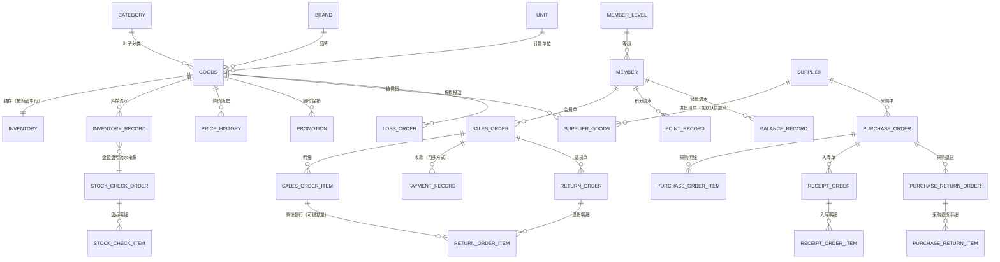

# 超市商品管理系统 数据库设计说明书

| 项目 | 说明 |
| --- | --- |
| 文档编号 | SMMS-DB-01 |
| 版本 | V1.0 |
| 状态 | 定稿（对应交付验收 AC-D02） |
| DDL 实体 | `db/schema.sql`（42 张表，MySQL 8.0+/MariaDB 10.6+） |
| 初始数据 | `db/init-data.sql`（角色/权限/演示用户/参数/字典/单位/等级/示例分类） |
| 仿真数据 | `tools/gen-perf-data.py` + `tools/gen-perf-data.sh`（AC-D07） |

---

## 1 概述

### 1.1 设计依据

依据《需求规格说明书-精简版》第 6 章数据需求（DR-01 ~ DR-38）设计，物理实现为 MySQL 8.4（InnoDB、utf8mb4），完整 DDL 见 `db/schema.sql`。

### 1.2 命名与类型约定

| 约定项 | 规则 | 依据 |
| --- | --- | --- |
| 表/字段命名 | snake_case；主键统一 `id`（BIGINT UNSIGNED 自增） | — |
| 金额 | `DECIMAL(12,2)`（元）；成本单价 `DECIMAL(12,4)` | DR-C-07，禁止 float/double 存金额 |
| 数量 | 普通商品以整数表示；称重商品 `DECIMAL(10,3)`（千克） | DR-C-07 |
| 折扣/倍率 | `DECIMAL(5,4)`（如 0.9500） | — |
| 时间 | `DATETIME` 精度到秒；库/连接时区 `Asia/Shanghai`（+08:00） | C-08 |
| 枚举 | 单据存代码（如 `CASH`），展示时关联 `sys_dict_item` | FR-SYS-07 |
| 审计字段 | 业务表统一含 `create_by/create_time/update_by/update_time` | DR-C-08 |
| 多门店预留 | 业务表含 `store_id`，本期恒为 1 | NFR-EXT-02 |
| 只增表 | 流水/日志类（`inventory_record`、`point_record`、`balance_record`、`operation_log`、`login_log`、`sys_token_blacklist`）不提供 UPDATE/DELETE 路径 | DR-C-06 |
| 删除策略 | 用户、商品、分类、供应商等主数据不物理删除，仅停用 | FR-SYS-02、BR-GOODS-06 |

### 1.3 表清单总览（9 组 43 表）

| 分组 | 表 |
| --- | --- |
| 系统与权限（10） | `sys_user`、`sys_role`、`sys_permission`、`sys_user_role`、`sys_role_permission`、`sys_token_blacklist`、`sys_config`、`sys_dict`、`sys_dict_item`、`operation_log`、`login_log`（※含日志 11 张） |
| 主数据（5） | `category`、`brand`、`unit`、`goods`、`price_history`、`promotion`（※6 张） |
| 供应商（2） | `supplier`、`supplier_goods` |
| 采购（5） | `purchase_order`、`purchase_order_item`、`receipt_order`、`receipt_order_item`、`purchase_return_order`、`purchase_return_item`（※6 张） |
| 库存（6） | `inventory`、`inventory_record`、`stock_check_order`、`stock_check_item`、`loss_order`、`inventory_snapshot`（预留） |
| 销售（8） | `sales_order`、`sales_order_item`、`payment_record`、`return_order`、`return_order_item`、`hold_order`、`cashier_shift` |
| 会员（4） | `member`、`member_level`、`point_record`、`balance_record` |
| 异步任务（1） | `async_task`（V1.1 新增：重导出/导入提交后台执行，见 §3.7） |
| 全量表结构详表 | 见附录 A（43 表 547 字段逐字段说明） |

> 说明：`inventory_snapshot` 为历史预留表（当前代码零引用，不参与业务），保留以兼容早期设计。

---

## 2 实体关系（ER 图）

核心链路：主数据 → 库存 → 销售/退货 → 会员；采购链路：供应商 → 采购单 → 入库 → 库存。仅标注主要外键关系（数据库层不建物理外键，约束由应用层保证，避免并发场景锁扩散）：

金额与状态的关系要点：

1. **销售链路**：`sales_order_item.paid_amount = amount − discount_amount`（行实付快照），`sales_order.payable_amount = goods_amount − discount_amount`，且 `Σ行实付 = 单据应收`（BR-SALE-03 尾差入最后一行）；`Σpayment_record.amount = paid_amount`；
2. **退货链路**：`return_order_item.refund_amount` 按原行成交单价比例分摊（BR-SALE-06）；`sales_order_item.returned_qty` 累加；`sales_order.return_status ∈ {NONE, PARTIAL, ALL}`；
3. **库存链路**：`inventory_record.before_qty/after_qty` 构成逐商品连续链，`inventory.quantity = 期初 + Σchange_qty`（BR-INV-08）；
4. **成本链路**：`inventory.cost_price` 由 `PURCHASE_IN` 移动加权维护；销售/退货明细保存 `cost_price/cost_amount` 快照（BR-SALE-04）。

---

## 3 核心表设计说明

### 3.1 商品主数据

| 表 | 关键设计 | 索引与约束 |
| --- | --- | --- |
| `goods` | 编码 `goods_code`（分类码+流水，创建后不可改）、条码 `barcode` 全局唯一、`pinyin_initial` 收银检索、`plu_code` 称重必填、`is_weighed`/`allow_return` 业务开关、`safety_stock_lower/upper` 预警阈值 | `uk_goods_code`、`uk_barcode`；`idx_goods_name`、`idx_goods_category`、`idx_goods_status` |
| `category` | 树形：`parent_id + level + path`（物化路径）支撑子树查询与校验，最多 3 级 | `uk_parent_name`（同级重名）、`idx_parent` |
| `promotion` | 同商品同时间段仅一条生效（应用层校验 BR-GOODS-04）；状态 `ACTIVE/EXPIRED/DISABLED` | `idx_promo_goods(goods_id,status)`、`idx_promo_time(end_time)` |
| `price_history` | 调价留痕：`price_type` 区分零售/会员/进货，记录前值/后值/原因/操作人 | `idx_ph_goods(goods_id, create_time)` |

### 3.2 库存

| 表 | 关键设计 | 索引与约束 |
| --- | --- | --- |
| `inventory` | 一行一商品（`PK(goods_id)`）；`quantity` 结存、`cost_price` 移动加权成本、`cost_amount` 库存成本额、`version` 乐观版本 | `PK(goods_id)`；单语句原子扣减 `UPDATE ... WHERE quantity >= ?` |
| `inventory_record` | 只增流水：`record_type`（INIT/PURCHASE_IN/SALE_OUT/…) + `change_qty/before_qty/after_qty` 三元组链 + `unit_cost` 成本快照 + `biz_type/biz_no` 溯源 | 主键 + 商品维度查询索引；代码层无改删路径 |
| `stock_check_order/_item` | 状态机（草稿→已提交→已审核/已驳回）；明细含账面数/实盘数/差异/原因 | 未审核盘点唯一性由应用层校验（BR-INV-09） |
| `loss_order` | 报损报溢：原因码取字典 `loss_reason`，审核后生成出/入流水 | 状态机约束 |
| `inventory_snapshot` | **预留表**（零引用），不参与业务 | — |

### 3.3 销售与收银

| 表 | 关键设计 | 索引与约束 |
| --- | --- | --- |
| `sales_order` | 单号 `XS+日期+收银台+流水`；金额四件套 `goods_amount/discount_amount/payable_amount/paid_amount + change_amount`；折扣拆分 `member_discount_amount/order_discount_amount`；`cost_amount/profit_amount` 毛利快照；`return_status`；`request_token` 防重 | `uk_so_no`、`uk_so_token`；时间/收银台/会员/班次查询索引 |
| `sales_order_item` | 全字段快照（名称/条码/单价/原价/数量/净重/金额/折扣率/折扣额/实付/成本单价与成本额/毛利）；`returned_qty` 累加可退校验 | `idx` 单据与商品维度 |
| `payment_record` | 一单多收款方式（现金/银行卡/移动支付/会员储值），`Σ金额 = 实付` | 单据维度索引 |
| `return_order/_item` | XT 单号；退款方式 `refund_type`；授权人/授权时间；明细挂 `sales_item_id` 与退款单价/金额 | `uk_rt_no`、`uk_rt_token` |
| `hold_order` | 挂单快照（明细 JSON/行表），取单/删除/24h 清理，上限 50 | 收银台维度索引 |
| `cashier_shift` | 班次：状态、起止时间、收款合计与分方式合计、退款合计 | 收银员+日期索引 |

### 3.4 会员

| 表 | 关键设计 | 索引与约束 |
| --- | --- | --- |
| `member` | 手机号全局唯一（BR-MEM-01）；`points`、`balance`（不允许负）、`total_consume`、`consume_times`、`level_id` 派生维护 | `uk_phone`、`uk_member_no` |
| `member_level` | 门槛 `threshold` + 折扣率 `discount_rate` + 积分倍率 `point_rate`；`ONLY_UP` 只升不降（BR-MEM-06） | 等级名唯一 |
| `point_record` | 只增积分流水：`change_type(CONSUME/RETURN/MANUAL)` + `change_value/after_value` 链 | 会员维度索引 |
| `balance_record` | 只增储值流水：`change_type(RECHARGE/CONSUME/REFUND/MANUAL)` + `after_balance` 链 + `pay_type` | 会员维度索引 |

### 3.5 采购

| 表 | 关键设计 | 索引与约束 |
| --- | --- | --- |
| `purchase_order/_item` | 状态机（草稿/已提交/已审核/部分入库/已完成/作废/终止/关闭）；明细 `qty/price/amount/received_qty/returned_qty` | 单号唯一；供应商/状态/日期索引 |
| `receipt_order/_item` | 入库验收：实收数量与单价、差异原因、验收人；超收容差/价差容差校验（BR-PUR-04/05）与授权留痕 | 关联采购单索引 |
| `purchase_return_order/_item` | 采购退货：退回数量不超已入库待退量，库存出库与状态回写 | 单号唯一 |
| `supplier` | `supplier_code`（S+5 位）、名称唯一、结算方式字典、`lead_time_days` 参与建议采购、`total_purchase_amount` 派生 | `uk_supplier_code`、`uk_supplier_name` |

### 3.6 系统与日志

| 表 | 关键设计 | 索引与约束 |
| --- | --- | --- |
| `sys_user` | 不可删除只停用；`fail_count/lock_until` 锁定；`must_change_pwd` 首登强制改密 | `uk_username` |
| `sys_role/_permission/*_role_permission` | RBAC：角色-权限（目录/菜单/按钮三级）多对多；内置角色保护；权限变更触发全量权限版本失效 | `uk_role_code`、`uk_perm_code`、关联表双唯一键 |
| `sys_token_blacklist` | JWT 登出/停用黑名单，按 `expire_time` 清理 | `PK(jti)`、`idx_expire` |
| `sys_config` | 业务参数键值（23 项内置），`value_type/editable/instant_effect` 元数据 | `uk_config_key` |
| `sys_dict/_item` | 业务枚举字典（收款方式/退货原因/报损原因/盘点差异原因/结算方式） | `uk_dict_type`、`uk_dict_value` |
| `operation_log` | 操作留痕（操作人账号+真实姓名/角色/模块/动作/目标/参数摘要/结果/耗时），只增；`real_name` 为 V1.3 新增（GAP-P1-10，BR-SYS-07） | `idx_op_time`、`idx_op_user`、`idx_op_module` |
| `login_log` | 登录成功/失败全量记录（IP/浏览器/OS/提示），只增 | `idx_ll_time`、`idx_ll_username` |

### 3.7 异步任务（V1.1 新增）

| 表 | 关键设计 | 索引与约束 |
| --- | --- | --- |
| `async_task` | 导出/导入后台任务：`task_no`(32位)对外标识，`status` 状态机 `QUEUED→RUNNING→SUCCESS/FAILED`，`progress/phase` 供前端轮询，`file_path/file_name/file_size` 指向结果文件，`result_json` 存导入结果摘要，`params_json` 存提交参数快照，`expires_at` 控制保留期（默认 24h） | `uk_at_task_no`、`idx_at_user(user_id,create_time)`（“我的任务”查询）、`idx_at_expires`（过期清理）、`idx_at_status`（积压监控） |

> 设计取舍：任务状态字段会被后台线程更新（因此不属于“只增表”约定）；结果文件落在容器本地目录而非库内 BLOB，避免大导出撑爆 `max_allowed_packet` 与表空间；`user_id` 落库用于下载鉴权（仅提交人可取，BR 对齐操作留痕原则）。

---

## 4 索引设计（针对 NFR-PERF-09）

| 场景 | 索引 | 说明 |
| --- | --- | --- |
| 商品列表/收银检索 | `uk_barcode`、`idx_goods_name`、`idx_goods_category`、分类 `path` 前缀 | 条码精确、名称模糊（前缀）、分类子树 |
| 库存流水查询/体检 | `inventory_record` 按 `(goods_id, operate_time, id)` 顺序扫描 | 流水链校验与前后结存审计 |
| 销售单查询 | `sales_order` 单号/时间/收银台/会员/班次索引 | 列表默认按时间倒序分页 |
| 退货追溯 | `return_order.sales_order_id`、`return_order_item.sales_item_id` | 原单 → 退货单 → 明细反查 |
| 报表聚合 | 时间列（`sale_time/business_date`）+ 维度列组合 | 日报/毛利/排行按营业日切片 |
| 日志审计 | `operation_log(operate_time)`、`login_log(login_time)` | 按时间范围分页 |
| 参数/字典 | 唯一键直查 + 内存缓存 | 高频读小表 |

---

## 5 初始化脚本与仿真数据

### 5.1 初始数据（`db/init-data.sql`）

| 内容 | 说明 |
| --- | --- |
| 内置角色（5） | SUPER_ADMIN 超级管理员、MANAGER 店长、PURCHASER 采购员、KEEPER 库管员、CASHIER 收银员（内置不可删） |
| 权限树 | 目录/菜单/按钮三级；`perm_code` 与后端 `@RequirePerm` 一一对应；`route_path/component` 供前端动态路由 |
| 演示用户（5） | `admin/Admin@2026`、`manager/Manager@2026`、`purchaser/Buyer@2026`、`keeper/Keeper@2026`、`cashier/Cashier@2026`（BCrypt 强度 10；首登建议改密） |
| 角色-权限 | 按 §1.3 角色职责分配；库存体检一键修正仅超管 |
| 系统参数（23 项） | 折扣下限、退货阈值/有效期、积分规则、建议采购 K/N、锁定阈值、店内码前缀等（FR-SYS-06） |
| 数据字典（5 类 22 项） | 收款方式、退货原因、报损报溢原因、盘点差异原因、供应商结算方式（FR-SYS-07） |
| 计量单位（10） | 含重量单位 kg/g（称重商品限选，BR-GOODS-05） |
| 会员等级（3） | 普通/银卡(1000)/金卡(5000)，折扣 1.0/0.98/0.95，积分倍率 1.0/1.0/1.2 |
| 示例分类（4） | 食品/饮料/日用品/生鲜果蔬（便于联调，可删） |

### 5.2 仿真数据方案（AC-D07 / NFR-PERF-05）

`tools/gen-perf-data.py`（纯标准库 Python 3）按业务规则生成仿真数据，经 `tools/gen-perf-data.sh` 管道导入 MySQL：

| 维度 | 说明 |
| --- | --- |
| 规模 | 默认 2 万商品 / 200 万销售单 / 5000 会员 / 50 供应商 / 3000 采购单 / 3000 报损单 / 36 个月（可用参数缩减） |
| 一致性设计 | 时间序事件流生成，保证库存流水 `before/after` 链、结存=Σ流水、单据金额勾稽（行实付和=应收、收款和=实付）、会员积分/储值流水链、退货回写等全部自洽 |
| 业务规则仿真 | 单号格式、折扣分摊尾差、移动加权成本、积分取整、等级只升不降、退货按原成交单价比例退款、集散与整月分布、现金找零等 |
| 导入方式 | 按批 INSERT（默认 800 行/批）+ 定批提交；输出可直接 `mysql <` 管道导入 |
| 实测 | 2 万商品/200 万单全量生成约 83 秒（2.1GB SQL），导入与校验结论见《测试报告》 |

数据一致性校验（库存结存=Σ流水、流水链连续、单据勾稽、会员流水链等 20 余项）在《测试报告》第 4 章列示。

---

## 附录 A：全量表结构详表（42 表 520 字段）

| # | 表名 | 说明 | 字段数 |
| --- | --- | --- | --- |
| 1 | `sys_user` | 系统用户 | 15 |
| 2 | `sys_role` | 系统角色 | 10 |
| 3 | `sys_permission` | 系统权限（目录/菜单/按钮树） | 14 |
| 4 | `sys_user_role` | 用户-角色关联 | 3 |
| 5 | `sys_role_permission` | 角色-权限关联 | 3 |
| 6 | `sys_token_blacklist` | JWT 黑名单 | 4 |
| 7 | `sys_config` | 系统参数 | 13 |
| 8 | `sys_dict` | 数据字典类型 | 9 |
| 9 | `sys_dict_item` | 数据字典项 | 11 |
| 10 | `operation_log` | 操作日志（只增不改不删） | 16 |
| 11 | `login_log` | 登录日志（只增不改不删） | 9 |
| 12 | `category` | 商品分类（树形，最多3级） | 11 |
| 13 | `brand` | 商品品牌 | 9 |
| 14 | `unit` | 计量单位 | 9 |
| 15 | `goods` | 商品档案 | 25 |
| 16 | `price_history` | 调价历史 | 9 |
| 17 | `promotion` | 单品限时促销 | 11 |
| 18 | `supplier` | 供应商档案 | 20 |
| 19 | `supplier_goods` | 供应商-商品关联及供货价 | 10 |
| 20 | `purchase_order` | 采购单 | 26 |
| 21 | `purchase_order_item` | 采购单明细 | 9 |
| 22 | `receipt_order` | 采购入库单 | 13 |
| 23 | `receipt_order_item` | 采购入库单明细 | 8 |
| 24 | `purchase_return_order` | 采购退货单 | 16 |
| 25 | `purchase_return_item` | 采购退货单明细 | 8 |
| 26 | `inventory` | 库存结存（派生数据，只能由流水驱动） | 8 |
| 27 | `inventory_record` | 库存流水（不可变，审计与成本核算核心） | 15 |
| 28 | `stock_check_order` | 库存盘点单 | 20 |
| 29 | `stock_check_item` | 盘点明细 | 10 |
| 30 | `loss_order` | 报损/报溢单（单商品，与销售退货分开统计） | 17 |
| 31 | `inventory_snapshot` | 库存日快照（每日营业结束后生成） | 7 |
| 32 | `sales_order` | 销售单（结算成功后不可修改删除，BR-SALE-08） | 26 |
| 33 | `sales_order_item` | 销售明细（快照不可变） | 21 |
| 34 | `payment_record` | 销售收款记录 | 6 |
| 35 | `return_order` | 销售退货单 | 15 |
| 36 | `return_order_item` | 销售退货明细 | 10 |
| 37 | `hold_order` | 收银挂单（临时态，不扣库存不计报表） | 16 |
| 38 | `cashier_shift` | 收银班次（开班/交班对账） | 15 |
| 39 | `member` | 会员档案 | 18 |
| 40 | `member_level` | 会员等级规则 | 11 |
| 41 | `point_record` | 积分流水（只增不改不删） | 9 |
| 42 | `balance_record` | 储值流水（只增不改不删） | 11 |
| 43 | `async_task` | 异步任务（导出/导入，V1.1 新增） | 22 |

#### `sys_user` —— 系统用户

| 字段 | 类型 | 默认值 | 说明 |
| --- | --- | --- | --- |
| id | BIGINT UNSIGNED | — | 用户ID |
| username | VARCHAR(30) | — | 用户名（登录账号） |
| password | VARCHAR(100) | — | 密码哈希（BCrypt 强度10，BR-SYS-02） |
| real_name | VARCHAR(30) | — | 真实姓名 |
| phone | VARCHAR(20) | NULL | 手机号 |
| status | TINYINT      NOT | 1 | 状态：1启用 0停用 |
| last_login_time | DATETIME   DEFAULT | NULL | 最后登录时间 |
| fail_count | INT          NOT | 0 | 连续登录失败次数（FR-SYS-01） |
| lock_until | DATETIME     DEFAULT | NULL | 锁定到期时间（FR-SYS-01） |
| must_change_pwd | TINYINT    NOT | 0 | 是否强制下次登录修改密码（重置密码后） |
| remark | VARCHAR(200) | NULL | 备注 |
| create_by | VARCHAR(30) | NULL | 创建人 |
| create_time | DATETIME     NOT | CURRENT_TIMESTAMP | 创建时间 |
| update_by | VARCHAR(30) | NULL | 更新人 |
| update_time | DATETIME     NOT | CURRENT_TIMESTAMP | 更新时间 |

约束与索引：`PRIMARY KEY (id)`；`UNIQUE KEY uk_username (username)`

#### `sys_role` —— 系统角色

| 字段 | 类型 | 默认值 | 说明 |
| --- | --- | --- | --- |
| id | BIGINT UNSIGNED | — | 角色ID |
| role_name | VARCHAR(30) | — | 角色名称 |
| role_code | VARCHAR(30) | — | 角色代码（SUPER_ADMIN等） |
| description | VARCHAR(200) | NULL | 描述 |
| is_builtin | TINYINT      NOT | 0 | 是否内置角色：1是 0否 |
| status | TINYINT      NOT | 1 | 状态：1启用 0停用 |
| create_by | VARCHAR(30) | NULL | 创建人 |
| create_time | DATETIME     NOT | CURRENT_TIMESTAMP | 创建时间 |
| update_by | VARCHAR(30) | NULL | 更新人 |
| update_time | DATETIME     NOT | CURRENT_TIMESTAMP | 更新时间 |

约束与索引：`PRIMARY KEY (id)`；`UNIQUE KEY uk_role_code (role_code)`

#### `sys_permission` —— 系统权限（目录/菜单/按钮树）

| 字段 | 类型 | 默认值 | 说明 |
| --- | --- | --- | --- |
| id | BIGINT UNSIGNED | — | 权限ID |
| parent_id | BIGINT UNSIGNED | 0 | 父权限ID，0=根 |
| name | VARCHAR(30) | — | 权限名称 |
| perm_type | CHAR(1) | — | 类型：D目录 M菜单 B按钮 |
| perm_code | VARCHAR(60) | NULL | 权限标识（如 goods:create），目录/菜单为空 |
| route_path | VARCHAR(100) | NULL | 前端路由路径 |
| component | VARCHAR(100) | NULL | 前端组件路径（懒加载） |
| icon | VARCHAR(50) | NULL | 菜单图标 |
| sort_no | INT          NOT | 0 | 同级排序号 |
| status | TINYINT      NOT | 1 | 状态：1启用 0停用 |
| create_by | VARCHAR(30) | NULL | 创建人 |
| create_time | DATETIME     NOT | CURRENT_TIMESTAMP | 创建时间 |
| update_by | VARCHAR(30) | NULL | 更新人 |
| update_time | DATETIME     NOT | CURRENT_TIMESTAMP | 更新时间 |

约束与索引：`PRIMARY KEY (id)`；`UNIQUE KEY uk_perm_code (perm_code)`

#### `sys_user_role` —— 用户-角色关联

| 字段 | 类型 | 默认值 | 说明 |
| --- | --- | --- | --- |
| id | BIGINT UNSIGNED | — | 主键 |
| user_id | BIGINT UNSIGNED | — | 用户ID |
| role_id | BIGINT UNSIGNED | — | 角色ID |

约束与索引：`PRIMARY KEY (id)`；`UNIQUE KEY uk_user_role (user_id, role_id)`；`KEY idx_role (role_id)`

#### `sys_role_permission` —— 角色-权限关联

| 字段 | 类型 | 默认值 | 说明 |
| --- | --- | --- | --- |
| id | BIGINT UNSIGNED | — | 主键 |
| role_id | BIGINT UNSIGNED | — | 角色ID |
| perm_id | BIGINT UNSIGNED | — | 权限ID |

约束与索引：`PRIMARY KEY (id)`；`UNIQUE KEY uk_role_perm (role_id, perm_id)`；`KEY idx_perm (perm_id)`

#### `sys_token_blacklist` —— JWT 黑名单

| 字段 | 类型 | 默认值 | 说明 |
| --- | --- | --- | --- |
| jti | VARCHAR(40) | — | JWT ID |
| expire_time | DATETIME     NOT | — | Token 原始过期时间（过期后可清理） |
| reason | VARCHAR(50) | NULL | 拉黑原因：LOGOUT登出/PWD_CHANGE改密（停用与权限变更经用户状态 + JWT ver 即时生效，不写黑名单；过期记录定时清理，GAP-P1-11） |
| create_time | DATETIME     NOT | CURRENT_TIMESTAMP | 创建时间 |

约束与索引：`PRIMARY KEY (jti)`；`KEY idx_expire (expire_time)`

#### `sys_config` —— 系统参数

| 字段 | 类型 | 默认值 | 说明 |
| --- | --- | --- | --- |
| id | BIGINT UNSIGNED | — | 参数ID |
| config_name | VARCHAR(60) | — | 参数名称 |
| config_key | VARCHAR(60) | — | 参数键 |
| config_value | VARCHAR(500) | — | 参数值 |
| value_type | VARCHAR(10) | STRING | 值类型：STRING/NUMBER/BOOLEAN/TIME |
| config_group | VARCHAR(30) | basic | 参数分组 |
| editable | TINYINT      NOT | 1 | 是否可修改：1是 0否 |
| instant_effect | TINYINT     NOT | 1 | 是否立即生效：1是 0否 |
| remark | VARCHAR(200) | NULL | 备注 |
| update_by | VARCHAR(30) | NULL | 更新人 |
| update_time | DATETIME     NOT | CURRENT_TIMESTAMP | 更新时间 |
| create_by | VARCHAR(30) | NULL | 创建人 |
| create_time | DATETIME     NOT | CURRENT_TIMESTAMP | 创建时间 |

约束与索引：`PRIMARY KEY (id)`；`UNIQUE KEY uk_config_key (config_key)`

#### `sys_dict` —— 数据字典类型

| 字段 | 类型 | 默认值 | 说明 |
| --- | --- | --- | --- |
| id | BIGINT UNSIGNED | — | 字典ID |
| dict_type | VARCHAR(30) | — | 字典类型编码（如 pay_type） |
| dict_name | VARCHAR(30) | — | 字典名称 |
| status | TINYINT      NOT | 1 | 状态：1启用 0停用 |
| remark | VARCHAR(200) | NULL | 备注 |
| create_by | VARCHAR(30) | NULL | 创建人 |
| create_time | DATETIME     NOT | CURRENT_TIMESTAMP | 创建时间 |
| update_by | VARCHAR(30) | NULL | 更新人 |
| update_time | DATETIME     NOT | CURRENT_TIMESTAMP | 更新时间 |

约束与索引：`PRIMARY KEY (id)`；`UNIQUE KEY uk_dict_type (dict_type)`

#### `sys_dict_item` —— 数据字典项

| 字段 | 类型 | 默认值 | 说明 |
| --- | --- | --- | --- |
| id | BIGINT UNSIGNED | — | 字典项ID |
| dict_id | BIGINT UNSIGNED | — | 字典ID |
| label | VARCHAR(30) | — | 标签（显示名） |
| value | VARCHAR(30) | — | 值（存储代码） |
| sort_no | INT          NOT | 0 | 排序号 |
| status | TINYINT      NOT | 1 | 状态：1启用 0停用（停用项不可被新单据选择） |
| remark | VARCHAR(200) | NULL | 备注 |
| create_by | VARCHAR(30) | NULL | 创建人 |
| create_time | DATETIME     NOT | CURRENT_TIMESTAMP | 创建时间 |
| update_by | VARCHAR(30) | NULL | 更新人 |
| update_time | DATETIME     NOT | CURRENT_TIMESTAMP | 更新时间 |

约束与索引：`PRIMARY KEY (id)`；`UNIQUE KEY uk_dict_value (dict_id, value)`

#### `operation_log` —— 操作日志（只增不改不删）

| 字段 | 类型 | 默认值 | 说明 |
| --- | --- | --- | --- |
| id | BIGINT UNSIGNED | — | 日志ID |
| user_id | BIGINT UNSIGNED | NULL | 操作人ID |
| username | VARCHAR(30) | NULL | 操作人用户名 |
| real_name | VARCHAR(30) | NULL | 操作人真实姓名（BR-SYS-07，V1.3 新增；历史日志保持 NULL） |
| role_names | VARCHAR(100) | NULL | 操作人角色 |
| module | VARCHAR(30) | — | 模块（如 商品管理） |
| action | VARCHAR(60) | — | 动作（如 调价、审核） |
| target | VARCHAR(60) | NULL | 目标对象标识（单号/编码等） |
| http_method | VARCHAR(10) | NULL | 请求方法 |
| request_url | VARCHAR(200) | NULL | 请求URL |
| param_summary | VARCHAR(1000) | NULL | 请求参数摘要（不含敏感信息） |
| ip | VARCHAR(50) | NULL | 客户端IP |
| user_agent | VARCHAR(255) | NULL | 浏览器标识 |
| result | TINYINT      NOT | 1 | 结果：1成功 0失败 |
| error_msg | VARCHAR(500) | NULL | 错误信息 |
| cost_ms | INT          DEFAULT | NULL | 耗时（毫秒） |
| operate_time | DATETIME     NOT | — | 操作时间 |

约束与索引：`PRIMARY KEY (id)`；`KEY idx_op_time (operate_time)`；`KEY idx_op_user (username, operate_time)`；`KEY idx_op_module (module)`

#### `login_log` —— 登录日志（只增不改不删）

| 字段 | 类型 | 默认值 | 说明 |
| --- | --- | --- | --- |
| id | BIGINT UNSIGNED | — | 日志ID |
| username | VARCHAR(30) | — | 尝试登录的用户名 |
| user_id | BIGINT UNSIGNED | NULL | 用户ID（登录成功时） |
| ip | VARCHAR(50) | NULL | 客户端IP |
| browser | VARCHAR(50) | NULL | 浏览器 |
| os | VARCHAR(50) | NULL | 操作系统 |
| status | TINYINT      NOT | 1 | 状态：1成功 0失败 |
| message | VARCHAR(100) | NULL | 提示信息（失败原因/锁定提示） |
| login_time | DATETIME     NOT | — | 登录时间 |

约束与索引：`PRIMARY KEY (id)`；`KEY idx_ll_time (login_time)`；`KEY idx_ll_username (username, login_time)`

#### `category` —— 商品分类（树形，最多3级）

| 字段 | 类型 | 默认值 | 说明 |
| --- | --- | --- | --- |
| id | BIGINT UNSIGNED | — | 分类ID |
| parent_id | BIGINT UNSIGNED | 0 | 父分类ID，0=根节点 |
| name | VARCHAR(30) | — | 分类名称（同级唯一，BR-CAT-01） |
| level | TINYINT      NOT | 1 | 层级：1~3 |
| path | VARCHAR(50) |  | 物化路径，如 1/5/12 |
| sort_no | INT          NOT | 0 | 同级排序号 |
| status | TINYINT      NOT | 1 | 状态：1启用 0停用 |
| create_by | VARCHAR(30) | NULL | 创建人 |
| create_time | DATETIME     NOT | CURRENT_TIMESTAMP | 创建时间 |
| update_by | VARCHAR(30) | NULL | 更新人 |
| update_time | DATETIME     NOT | CURRENT_TIMESTAMP | 更新时间 |

约束与索引：`PRIMARY KEY (id)`；`UNIQUE KEY uk_parent_name (parent_id, name)`；`KEY idx_parent (parent_id)`

#### `brand` —— 商品品牌

| 字段 | 类型 | 默认值 | 说明 |
| --- | --- | --- | --- |
| id | BIGINT UNSIGNED | — | 品牌ID |
| name | VARCHAR(30) | — | 品牌名称（唯一） |
| first_letter | VARCHAR(2) | NULL | 首字母（拼音） |
| logo | VARCHAR(255) | NULL | Logo 路径 |
| status | TINYINT      NOT | 1 | 状态：1启用 0停用 |
| create_by | VARCHAR(30) | NULL | 创建人 |
| create_time | DATETIME     NOT | CURRENT_TIMESTAMP | 创建时间 |
| update_by | VARCHAR(30) | NULL | 更新人 |
| update_time | DATETIME     NOT | CURRENT_TIMESTAMP | 更新时间 |

约束与索引：`PRIMARY KEY (id)`；`UNIQUE KEY uk_brand_name (name)`

#### `unit` —— 计量单位

| 字段 | 类型 | 默认值 | 说明 |
| --- | --- | --- | --- |
| id | BIGINT UNSIGNED | — | 单位ID |
| name | VARCHAR(10) | — | 单位名称（如 瓶/袋/kg） |
| symbol | VARCHAR(10) | NULL | 单位符号 |
| is_weight | TINYINT      NOT | 0 | 是否重量单位：1是 0否（称重商品只能选重量单位，BR-GOODS-05） |
| status | TINYINT      NOT | 1 | 状态：1启用 0停用 |
| create_by | VARCHAR(30) | NULL | 创建人 |
| create_time | DATETIME     NOT | CURRENT_TIMESTAMP | 创建时间 |
| update_by | VARCHAR(30) | NULL | 更新人 |
| update_time | DATETIME     NOT | CURRENT_TIMESTAMP | 更新时间 |

约束与索引：`PRIMARY KEY (id)`；`UNIQUE KEY uk_unit_name (name)`

#### `goods` —— 商品档案

| 字段 | 类型 | 默认值 | 说明 |
| --- | --- | --- | --- |
| id | BIGINT UNSIGNED | — | 商品ID |
| goods_code | VARCHAR(20) | — | 商品编码：分类码+流水（BR-GOODS-02），创建后不可修改 |
| barcode | VARCHAR(20) | — | 商品条码（EAN-13/店内码，全局唯一，BR-GOODS-01） |
| name | VARCHAR(100) | — | 商品名称 |
| pinyin_initial | VARCHAR(100) | NULL | 名称拼音首字母（随名称自动生成，收银检索 FR-SALE-02） |
| category_id | BIGINT UNSIGNED | — | 所属分类（必须是叶子分类，BR-CAT-04） |
| brand_id | BIGINT UNSIGNED | NULL | 品牌ID |
| unit_id | BIGINT UNSIGNED | — | 计量单位ID |
| spec | VARCHAR(50) | NULL | 规格 |
| origin | VARCHAR(100) | NULL | 产地 |
| purchase_price | DECIMAL(12,2) | NULL | 进货参考价 ≥0 |
| retail_price | DECIMAL(12,2) | — | 零售单价 >0 |
| member_price | DECIMAL(12,2) | NULL | 会员价 ≤零售价 |
| plu_code | VARCHAR(10) | NULL | PLU 码（称重商品必填，BR-GOODS-05） |
| is_weighed | TINYINT      NOT | 0 | 是否称重商品：1是 0否 |
| allow_return | TINYINT      NOT | 1 | 是否允许退货：1是 0否（BR-SALE-07） |
| safety_stock_lower | DECIMAL(10,3) | 0 | 安全库存下限 |
| safety_stock_upper | DECIMAL(10,3) | NULL | 库存上限（积压预警） |
| image | VARCHAR(255) | NULL | 图片相对路径 |
| status | TINYINT      NOT | 1 | 状态：1启用 0停用 |
| remark | VARCHAR(500) | NULL | 备注 |
| create_by | VARCHAR(30) | NULL | 创建人 |
| create_time | DATETIME     NOT | CURRENT_TIMESTAMP | 创建时间 |
| update_by | VARCHAR(30) | NULL | 更新人 |
| update_time | DATETIME     NOT | CURRENT_TIMESTAMP | 更新时间 |

约束与索引：`PRIMARY KEY (id)`；`UNIQUE KEY uk_goods_code (goods_code)`；`UNIQUE KEY uk_barcode (barcode)`；`KEY idx_goods_name (name)`；`KEY idx_goods_category (category_id)`；`KEY idx_goods_status (status)`

#### `price_history` —— 调价历史

| 字段 | 类型 | 默认值 | 说明 |
| --- | --- | --- | --- |
| id | BIGINT UNSIGNED | — | 记录ID |
| goods_id | BIGINT UNSIGNED | — | 商品ID |
| price_type | VARCHAR(10) | — | 价格类型：RETAIL零售/MEMBER会员/PURCHASE进货 |
| old_value | DECIMAL(12,2) | NULL | 前值（新设价格时为空） |
| new_value | DECIMAL(12,2) | NULL | 后值（清空价格时为空） |
| effective_time | DATETIME     DEFAULT | NULL | 生效时间 |
| operator_name | VARCHAR(30) | — | 操作人 |
| reason | VARCHAR(200) | NULL | 调价原因 |
| create_time | DATETIME     NOT | CURRENT_TIMESTAMP | 操作时间 |

约束与索引：`PRIMARY KEY (id)`；`KEY idx_ph_goods (goods_id, create_time)`

#### `promotion` —— 单品限时促销

| 字段 | 类型 | 默认值 | 说明 |
| --- | --- | --- | --- |
| id | BIGINT UNSIGNED | — | 促销ID |
| goods_id | BIGINT UNSIGNED | — | 商品ID |
| promo_price | DECIMAL(12,2) | — | 促销价（<零售价） |
| start_time | DATETIME     NOT | — | 开始时间 |
| end_time | DATETIME     NOT | — | 结束时间 |
| status | VARCHAR(10) | ACTIVE | 状态：ACTIVE生效/EXPIRED过期/DISABLED停用 |
| create_by | VARCHAR(30) | NULL | 创建人 |
| create_time | DATETIME     NOT | CURRENT_TIMESTAMP | 创建时间 |
| update_by | VARCHAR(30) | NULL | 更新人 |
| update_time | DATETIME     NOT | CURRENT_TIMESTAMP | 更新时间 |
| remark | VARCHAR(200) | NULL | 备注 |

约束与索引：`PRIMARY KEY (id)`；`KEY idx_promo_goods (goods_id, status)`；`KEY idx_promo_time (end_time)`

#### `supplier` —— 供应商档案

| 字段 | 类型 | 默认值 | 说明 |
| --- | --- | --- | --- |
| id | BIGINT UNSIGNED | — | 供应商ID |
| supplier_code | VARCHAR(10) | — | 供应商编码：S+5位流水（BR-SUP-03） |
| name | VARCHAR(100) | — | 供应商名称（唯一，BR-SUP-01） |
| contact_person | VARCHAR(30) | NULL | 联系人 |
| phone | VARCHAR(20) | NULL | 联系电话（手机/固话格式） |
| address | VARCHAR(200) | NULL | 地址 |
| email | VARCHAR(50) | NULL | 邮箱 |
| bank_name | VARCHAR(100) | NULL | 开户行（仅店长及以上可见，BR-SUP-01） |
| bank_account | VARCHAR(50) | NULL | 银行账号（脱敏展示，FR-SYS-09） |
| tax_no | VARCHAR(30) | NULL | 纳税人识别号 |
| settle_type | VARCHAR(10) | CASH | 结算方式（字典 settle_type）：CASH现结/MONTHLY月结/CREDIT账期 |
| credit_days | INT          DEFAULT | NULL | 账期天数（结算方式为账期时） |
| lead_time_days | INT          NOT | 3 | 采购提前期（天），参与建议采购量（BR-INV-07） |
| total_purchase_amount | DECIMAL(12,2) | 0 | 累计采购额（派生数据，DR-C-04） |
| status | TINYINT      NOT | 1 | 状态：1启用 0停用 |
| remark | VARCHAR(500) | NULL | 备注 |
| create_by | VARCHAR(30) | NULL | 创建人 |
| create_time | DATETIME     NOT | CURRENT_TIMESTAMP | 创建时间 |
| update_by | VARCHAR(30) | NULL | 更新人 |
| update_time | DATETIME     NOT | CURRENT_TIMESTAMP | 更新时间 |

约束与索引：`PRIMARY KEY (id)`；`UNIQUE KEY uk_supplier_code (supplier_code)`；`UNIQUE KEY uk_supplier_name (name)`；`KEY idx_supplier_status (status)`

#### `supplier_goods` —— 供应商-商品关联及供货价

| 字段 | 类型 | 默认值 | 说明 |
| --- | --- | --- | --- |
| id | BIGINT UNSIGNED | — | 主键 |
| supplier_id | BIGINT UNSIGNED | — | 供应商ID |
| goods_id | BIGINT UNSIGNED | — | 商品ID |
| supply_price | DECIMAL(12,2) | NULL | 供货单价 |
| is_default | TINYINT      NOT | 0 | 是否默认供应商：1是 0否 |
| last_supply_time | DATETIME     DEFAULT | NULL | 最近供货时间 |
| create_by | VARCHAR(30) | NULL | 创建人 |
| create_time | DATETIME     NOT | CURRENT_TIMESTAMP | 创建时间 |
| update_by | VARCHAR(30) | NULL | 更新人 |
| update_time | DATETIME     NOT | CURRENT_TIMESTAMP | 更新时间 |

约束与索引：`PRIMARY KEY (id)`；`UNIQUE KEY uk_supplier_goods (supplier_id, goods_id)`；`KEY idx_sg_goods (goods_id)`

#### `purchase_order` —— 采购单

| 字段 | 类型 | 默认值 | 说明 |
| --- | --- | --- | --- |
| id | BIGINT UNSIGNED | — | 采购单ID |
| order_no | VARCHAR(20) | — | 采购单号：PO+yyyyMMdd+4位流水（BR-PUR-01） |
| store_id | BIGINT UNSIGNED | 1 | 门店ID（多门店预留，本期恒1，NFR-EXT-02） |
| supplier_id | BIGINT UNSIGNED | — | 供应商ID |
| status | VARCHAR(20) | DRAFT | 状态：DRAFT草稿/SUBMITTED已提交/APPROVED已审核待入库/PARTIAL部分入库/COMPLETED已完成/TERMINATED已终止/CANCELLED已作废/PARTIAL_RETURNED部分退货/ALL_RETURNED全部退货 |
| create_by | VARCHAR(30) | — | 创建人（采购员） |
| create_time | DATETIME     NOT | CURRENT_TIMESTAMP | 创建时间 |
| business_date | DATE         NOT | — | 营业日（下单时刻+营业日起始时刻归属，BR-RPT-02/GAP-P1-05，采购报表按此聚合） |
| submit_time | DATETIME     DEFAULT | NULL | 提交时间 |
| audit_by | VARCHAR(30) | NULL | 审核人（店长） |
| audit_time | DATETIME     DEFAULT | NULL | 审核时间 |
| audit_remark | VARCHAR(200) | NULL | 审核意见（驳回时必填） |
| expect_date | DATE         DEFAULT | NULL | 预计到货日期 |
| total_amount | DECIMAL(12,2) | 0 | 订购总额 = Σ(数量×单价)（BR-PUR-03） |
| received_amount | DECIMAL(12,2) | 0 | 实收总额（按实收单价计算） |
| return_amount | DECIMAL(12,2) | 0 | 退货总额 |
| settle_status | VARCHAR(10) | UNSETTLED | 结算状态：UNSETTLED未结算/PARTIAL部分结算/SETTLED已结算 |
| settle_amount | DECIMAL(12,2) | NULL | 已结算金额 |
| settle_method | VARCHAR(20) | NULL | 结算方式（字典 settle_type）：CASH现结/MONTHLY月结/CREDIT账期（FR-PUR-09） |
| settle_date | DATE         DEFAULT | NULL | 结算日期 |
| settle_by | VARCHAR(30) | NULL | 结算经办人 |
| terminate_reason | VARCHAR(200) | NULL | 终止/作废原因 |
| version | INT          NOT | 0 | 版本号（乐观锁，BR-PUR-06） |
| remark | VARCHAR(500) | NULL | 备注 |
| update_by | VARCHAR(30) | NULL | 更新人 |
| update_time | DATETIME     NOT | CURRENT_TIMESTAMP | 更新时间 |

约束与索引：`PRIMARY KEY (id)`；`UNIQUE KEY uk_po_no (order_no)`；`KEY idx_po_supplier (supplier_id)`；`KEY idx_po_status (status)`；`KEY idx_po_create_time (create_time)`；`KEY idx_po_biz_date (business_date)`

#### `purchase_order_item` —— 采购单明细

| 字段 | 类型 | 默认值 | 说明 |
| --- | --- | --- | --- |
| id | BIGINT UNSIGNED | — | 明细ID |
| order_id | BIGINT UNSIGNED | — | 采购单ID |
| goods_id | BIGINT UNSIGNED | — | 商品ID |
| quantity | DECIMAL(10,3) | — | 订购数量 >0（BR-PUR-03） |
| price | DECIMAL(12,2) | — | 采购单价 ≥0 |
| amount | DECIMAL(12,2) | — | 行金额 = 数量×单价 |
| received_qty | DECIMAL(10,3) | 0 | 已入库数量 |
| returned_qty | DECIMAL(10,3) | 0 | 已退货数量 |
| remark | VARCHAR(200) | NULL | 行备注 |

约束与索引：`PRIMARY KEY (id)`；`KEY idx_poi_order (order_id)`；`KEY idx_poi_goods (goods_id)`

#### `receipt_order` —— 采购入库单

| 字段 | 类型 | 默认值 | 说明 |
| --- | --- | --- | --- |
| id | BIGINT UNSIGNED | — | 入库单ID |
| order_no | VARCHAR(20) | — | 入库单号：RK+yyyyMMdd+4位流水（BR-PUR-01） |
| store_id | BIGINT UNSIGNED | 1 | 门店ID（预留） |
| purchase_order_id | BIGINT UNSIGNED | — | 采购单ID |
| supplier_id | BIGINT UNSIGNED | — | 供应商ID |
| receipt_time | DATETIME     NOT | — | 入库时间 |
| business_date | DATE         NOT | — | 营业日（入库时刻+营业日起始时刻归属，BR-RPT-02/GAP-P1-05，到货及时率按此聚合） |
| operator_name | VARCHAR(30) | — | 验收操作人（库管员） |
| authorizer_name | VARCHAR(30) | NULL | 授权人（超收/价差授权时记录，BR-PUR-04/05） |
| delivery_order_no | VARCHAR(50) | NULL | 供应商送货单号 |
| total_amount | DECIMAL(12,2) | 0 | 入库总金额 = Σ(实收数量×实收单价) |
| remark | VARCHAR(500) | NULL | 备注 |
| request_token | VARCHAR(64) | NULL | 请求令牌（提交防重，NFR-REL-02） |

约束与索引：`PRIMARY KEY (id)`；`UNIQUE KEY uk_ro_no (order_no)`；`UNIQUE KEY uk_ro_token (request_token)`；`KEY idx_ro_po (purchase_order_id)`；`KEY idx_ro_supplier (supplier_id)`；`KEY idx_ro_time (receipt_time)`；`KEY idx_ro_biz_date (business_date)`

#### `receipt_order_item` —— 采购入库单明细

| 字段 | 类型 | 默认值 | 说明 |
| --- | --- | --- | --- |
| id | BIGINT UNSIGNED | — | 明细ID |
| receipt_id | BIGINT UNSIGNED | — | 入库单ID |
| purchase_item_id | BIGINT UNSIGNED | NULL | 采购单明细ID |
| goods_id | BIGINT UNSIGNED | — | 商品ID |
| received_qty | DECIMAL(10,3) | — | 实收数量（受容差约束，BR-PUR-04） |
| received_price | DECIMAL(12,2) | — | 实收单价（存货成本以此为准，BR-PUR-07） |
| amount | DECIMAL(12,2) | — | 行金额 = 实收数量×实收单价 |
| remark | VARCHAR(200) | NULL | 验收备注 |

约束与索引：`PRIMARY KEY (id)`；`KEY idx_roi_receipt (receipt_id)`；`KEY idx_roi_goods (goods_id)`

#### `purchase_return_order` —— 采购退货单

| 字段 | 类型 | 默认值 | 说明 |
| --- | --- | --- | --- |
| id | BIGINT UNSIGNED | — | 退货单ID |
| order_no | VARCHAR(20) | — | 退货单号：PT+yyyyMMdd+4位流水（BR-PUR-01） |
| store_id | BIGINT UNSIGNED | 1 | 门店ID（预留） |
| purchase_order_id | BIGINT UNSIGNED | — | 原采购单ID |
| supplier_id | BIGINT UNSIGNED | — | 供应商ID |
| status | VARCHAR(20) | SUBMITTED | 状态：SUBMITTED待审核/APPROVED已退货/REJECTED已驳回 |
| return_reason | VARCHAR(200) | — | 退货原因（质量问题等） |
| total_amount | DECIMAL(12,2) | 0 | 退货总额 = Σ(退货数量×入库时成本单价) |
| create_by | VARCHAR(30) | — | 创建人（采购员） |
| create_time | DATETIME     NOT | CURRENT_TIMESTAMP | 创建时间 |
| business_date | DATE         NOT | — | 营业日（创建时刻+营业日起始时刻归属，BR-RPT-02/GAP-P1-05） |
| audit_by | VARCHAR(30) | NULL | 审核人（店长） |
| audit_time | DATETIME     DEFAULT | NULL | 审核时间 |
| audit_remark | VARCHAR(200) | NULL | 审核意见 |
| remark | VARCHAR(500) | NULL | 备注 |
| update_time | DATETIME     NOT | CURRENT_TIMESTAMP | 更新时间 |

约束与索引：`PRIMARY KEY (id)`；`UNIQUE KEY uk_pr_no (order_no)`；`KEY idx_pr_po (purchase_order_id)`；`KEY idx_pr_supplier (supplier_id)`；`KEY idx_pr_status (status)`；`KEY idx_pr_biz_date (business_date)`

#### `purchase_return_item` —— 采购退货单明细

| 字段 | 类型 | 默认值 | 说明 |
| --- | --- | --- | --- |
| id | BIGINT UNSIGNED | — | 明细ID |
| return_id | BIGINT UNSIGNED | — | 退货单ID |
| purchase_item_id | BIGINT UNSIGNED | — | 采购单明细ID |
| goods_id | BIGINT UNSIGNED | — | 商品ID |
| return_qty | DECIMAL(10,3) | — | 退货数量 |
| return_price | DECIMAL(12,2) | — | 退货单价（入库时成本单价，按入库记录加权） |
| amount | DECIMAL(12,2) | — | 行金额 = 退货数量×退货单价 |
| remark | VARCHAR(200) | NULL | 行备注 |

约束与索引：`PRIMARY KEY (id)`；`KEY idx_pri_return (return_id)`；`KEY idx_pri_goods (goods_id)`

#### `inventory` —— 库存结存（派生数据，只能由流水驱动）

| 字段 | 类型 | 默认值 | 说明 |
| --- | --- | --- | --- |
| goods_id | BIGINT UNSIGNED | — | 商品ID（主键，与商品1:1） |
| store_id | BIGINT UNSIGNED | 1 | 门店ID（预留） |
| quantity | DECIMAL(10,3) | 0 | 结存数量（可为负仅当允许负库存，BR-INV-02） |
| cost_price | DECIMAL(12,4) | 0 | 成本单价（移动加权平均，BR-INV-06） |
| cost_amount | DECIMAL(12,2) | 0 | 库存成本金额 = 结存×成本单价 |
| last_change_time | DATETIME    DEFAULT | NULL | 最近变动时间 |
| version | INT         NOT | 0 | 版本号（乐观锁，BR-INV-04） |
| update_time | DATETIME    NOT | CURRENT_TIMESTAMP | 更新时间 |

约束与索引：`PRIMARY KEY (goods_id)`；`KEY idx_inv_store (store_id)`

#### `inventory_record` —— 库存流水（不可变，审计与成本核算核心）

| 字段 | 类型 | 默认值 | 说明 |
| --- | --- | --- | --- |
| id | BIGINT UNSIGNED | — | 流水ID |
| goods_id | BIGINT UNSIGNED | — | 商品ID |
| store_id | BIGINT UNSIGNED | 1 | 门店ID（预留） |
| record_type | VARCHAR(20) | — | 变动类型：INIT/PURCHASE_IN/PURCHASE_RETURN/SALE_OUT/SALE_RETURN/CHECK_SURPLUS/CHECK_SHORTAGE/LOSS_OUT/OVERFLOW_IN（§8.2） |
| change_qty | DECIMAL(10,3) | — | 变动数量（带符号，入库+出库-，BR-INV-05） |
| before_qty | DECIMAL(10,3) | — | 变动前结存 |
| after_qty | DECIMAL(10,3) | — | 变动后结存 |
| unit_cost | DECIMAL(12,4) | 0 | 单位成本（出库为结转成本，入库为入库单价） |
| biz_type | VARCHAR(20) | NULL | 关联单据类型：PO/RK/PT/XS/XT/PD/SZ/BY |
| biz_no | VARCHAR(20) | NULL | 关联单据号 |
| batch_no | VARCHAR(30) | NULL | 批次号（预留，本期恒空，NFR-EXT-06） |
| operator_name | VARCHAR(30) | — | 操作人 |
| operate_time | DATETIME     NOT | — | 操作时间 |
| business_date | DATE         NOT | — | 营业日（记账时刻+营业日起始时刻归属，BR-RPT-02/GAP-P1-05，变动/周转/期初报表按此聚合） |
| remark | VARCHAR(200) | NULL | 备注 |

约束与索引：`PRIMARY KEY (id)`；`KEY idx_ir_goods_time (goods_id, operate_time)`；`KEY idx_ir_biz_no (biz_no)`；`KEY idx_ir_type_time (record_type, operate_time)`；`KEY idx_ir_time (operate_time)`；`KEY idx_ir_biz_date (business_date)`

#### `stock_check_order` —— 库存盘点单

| 字段 | 类型 | 默认值 | 说明 |
| --- | --- | --- | --- |
| id | BIGINT UNSIGNED | — | 盘点单ID |
| order_no | VARCHAR(20) | — | 盘点单号：PD+yyyyMMdd+4位流水 |
| store_id | BIGINT UNSIGNED | 1 | 门店ID（预留） |
| scope_type | VARCHAR(10) | — | 盘点范围：ALL全店/CATEGORY分类/GOODS指定商品/WARNING预警商品 |
| scope_desc | VARCHAR(200) | NULL | 范围描述 |
| status | VARCHAR(20) | CHECKING | 状态：CHECKING盘点中/PENDING_AUDIT待审核/AUDITED已审核/CANCELLED已作废 |
| checker_name | VARCHAR(30) | — | 盘点人 |
| start_time | DATETIME     NOT | — | 开始时间 |
| base_time | DATETIME     NOT | — | 账面快照基准时间（BR-INV-10） |
| business_date | DATE         NOT | — | 营业日（创建时按创建时刻、审核通过后改写为审核时刻归属，BR-RPT-02/GAP-P1-05，盘亏报表按审核营业日聚合） |
| item_count | INT          NOT | 0 | 盘点商品行数 |
| surplus_amount | DECIMAL(12,2) | 0 | 盘盈金额 |
| shortage_amount | DECIMAL(12,2) | 0 | 盘亏金额 |
| during_change_count | INT          NOT | 0 | 盘点期间发生出入库笔数（BR-INV-10） |
| auditor_name | VARCHAR(30) | NULL | 审核人（店长，须≠盘点人） |
| audit_time | DATETIME     DEFAULT | NULL | 审核时间 |
| audit_remark | VARCHAR(200) | NULL | 审核意见（驳回必填） |
| cancel_reason | VARCHAR(200) | NULL | 作废原因 |
| create_time | DATETIME     NOT | CURRENT_TIMESTAMP | 创建时间 |
| update_time | DATETIME     NOT | CURRENT_TIMESTAMP | 更新时间 |

约束与索引：`PRIMARY KEY (id)`；`UNIQUE KEY uk_sc_no (order_no)`；`KEY idx_sc_status (status)`；`KEY idx_sc_biz_date (business_date)`

#### `stock_check_item` —— 盘点明细

| 字段 | 类型 | 默认值 | 说明 |
| --- | --- | --- | --- |
| id | BIGINT UNSIGNED | — | 明细ID |
| order_id | BIGINT UNSIGNED | — | 盘点单ID |
| goods_id | BIGINT UNSIGNED | — | 商品ID |
| book_qty | DECIMAL(10,3) | — | 账面数量（快照） |
| actual_qty | DECIMAL(10,3) | NULL | 实盘数量（NULL=未盘，提交时按账面确认） |
| diff_qty | DECIMAL(10,3) | NULL | 差异数量 = 实盘-账面 |
| cost_price | DECIMAL(12,4) | 0 | 成本单价（快照） |
| diff_amount | DECIMAL(12,2) | NULL | 差异金额 |
| diff_reason | VARCHAR(100) | NULL | 差异原因（差异≠0时必填，FR-INV-08） |
| remark | VARCHAR(200) | NULL | 备注 |

约束与索引：`PRIMARY KEY (id)`；`UNIQUE KEY uk_sci (order_id, goods_id)`；`KEY idx_sci_goods (goods_id)`

#### `loss_order` —— 报损/报溢单（单商品，与销售退货分开统计）

| 字段 | 类型 | 默认值 | 说明 |
| --- | --- | --- | --- |
| id | BIGINT UNSIGNED | — | 单据ID |
| order_no | VARCHAR(20) | — | 单号：BS+yyyyMMdd+4位流水（报损）/BY+yyyyMMdd+4位流水（报溢） |
| store_id | BIGINT UNSIGNED | 1 | 门店ID（预留） |
| biz_type | VARCHAR(10) | — | 类型：LOSS报损出库/OVERFLOW报溢入库 |
| goods_id | BIGINT UNSIGNED | — | 商品ID |
| quantity | DECIMAL(10,3) | — | 数量 >0（落库为流水时带方向） |
| cost_price | DECIMAL(12,4) | — | 成本单价（报溢时录入） |
| amount | DECIMAL(12,2) | — | 金额 = 数量×成本单价 |
| reason | VARCHAR(30) | — | 原因（字典 loss_reason：过期/破损/失窃/赠品/样品等） |
| apply_name | VARCHAR(30) | — | 申请人 |
| status | VARCHAR(10) | PENDING | 状态：PENDING待审核/AUDITED已审核/REJECTED已驳回 |
| auditor_name | VARCHAR(30) | NULL | 审核人（店长） |
| audit_time | DATETIME     DEFAULT | NULL | 审核时间 |
| business_date | DATE         NOT | — | 营业日（创建时按申请时刻、审核通过后改写为审核时刻归属，BR-RPT-02/GAP-P1-05，损耗报表按审核营业日聚合） |
| audit_remark | VARCHAR(200) | NULL | 审核意见 |
| create_time | DATETIME     NOT | CURRENT_TIMESTAMP | 申请时间 |
| remark | VARCHAR(200) | NULL | 备注 |

约束与索引：`PRIMARY KEY (id)`；`UNIQUE KEY uk_lo_no (order_no)`；`KEY idx_lo_goods (goods_id)`；`KEY idx_lo_status (status)`；`KEY idx_lo_biz_date (business_date)`

#### `inventory_snapshot` —— 库存日快照（每日营业结束后生成）

| 字段 | 类型 | 默认值 | 说明 |
| --- | --- | --- | --- |
| id | BIGINT UNSIGNED | — | 主键 |
| snap_date | DATE         NOT | — | 快照日期 |
| goods_id | BIGINT UNSIGNED | — | 商品ID |
| quantity | DECIMAL(10,3) | — | 结存数量 |
| cost_price | DECIMAL(12,4) | — | 成本单价 |
| cost_amount | DECIMAL(12,2) | — | 成本金额 |
| create_time | DATETIME     NOT | CURRENT_TIMESTAMP | 创建时间 |

约束与索引：`PRIMARY KEY (id)`；`UNIQUE KEY uk_snap (snap_date, goods_id)`

#### `sales_order` —— 销售单（结算成功后不可修改删除，BR-SALE-08）

| 字段 | 类型 | 默认值 | 说明 |
| --- | --- | --- | --- |
| id | BIGINT UNSIGNED | — | 销售单ID |
| order_no | VARCHAR(22) | — | 销售单号：XS+yyyyMMdd+收银台2位+4位流水（BR-SALE-02） |
| store_id | BIGINT UNSIGNED | 1 | 门店ID（预留） |
| counter_no | TINYINT UNSIGNED | 1 | 收银台号（01~99） |
| cashier_id | BIGINT UNSIGNED | — | 收银员ID |
| cashier_name | VARCHAR(30) | — | 收银员姓名 |
| shift_id | BIGINT UNSIGNED | NULL | 班次ID |
| member_id | BIGINT UNSIGNED | NULL | 会员ID（散客为空） |
| sale_time | DATETIME     NOT | — | 销售时间（结算时间） |
| business_date | DATE         NOT | — | 营业日（按结算时间+营业日起始时刻归属，BR-RPT-02） |
| item_count | INT          NOT | 0 | 件数 |
| goods_amount | DECIMAL(12,2) | 0 | 商品总额（折扣前） |
| member_discount_amount | DECIMAL(12,2) | 0 | 会员优惠额 |
| order_discount_amount | DECIMAL(12,2) | 0 | 店长整单优惠额 |
| discount_amount | DECIMAL(12,2) | 0 | 优惠合计 |
| payable_amount | DECIMAL(12,2) | 0 | 应收金额 |
| paid_amount | DECIMAL(12,2) | 0 | 实收金额 |
| change_amount | DECIMAL(12,2) | 0 | 找零 |
| order_discount_rate | DECIMAL(5,4) | NULL | 店长整单折扣率（≥最低折扣率参数） |
| discount_reason | VARCHAR(200) | NULL | 整单折扣原因（FR-SALE-07） |
| cost_amount | DECIMAL(12,2) | 0 | 成本合计（快照） |
| profit_amount | DECIMAL(12,2) | 0 | 毛利额 |
| return_status | VARCHAR(10) | NONE | 退货状态：NONE无/PARTIAL部分/ALL全部 |
| authorizer_name | VARCHAR(30) | NULL | 店长授权人（改价/整单折扣时） |
| remark | VARCHAR(200) | NULL | 备注 |
| request_token | VARCHAR(64) | NULL | 请求令牌（提交防重，NFR-REL-02） |

约束与索引：`PRIMARY KEY (id)`；`UNIQUE KEY uk_so_no (order_no)`；`UNIQUE KEY uk_so_token (request_token)`；`KEY idx_so_time (sale_time)`；`KEY idx_so_biz_date (business_date)`；`KEY idx_so_cashier (cashier_id, sale_time)`；`KEY idx_so_member (member_id)`；`KEY idx_so_shift (shift_id)`

#### `sales_order_item` —— 销售明细（快照不可变）

| 字段 | 类型 | 默认值 | 说明 |
| --- | --- | --- | --- |
| id | BIGINT UNSIGNED | — | 明细ID |
| order_id | BIGINT UNSIGNED | — | 销售单ID |
| goods_id | BIGINT UNSIGNED | NULL | 商品ID（无码商品为空） |
| goods_name | VARCHAR(100) | — | 商品名称快照 |
| barcode | VARCHAR(20) | NULL | 条码快照 |
| unit_price | DECIMAL(12,2) | — | 成交取价（促销价/会员价/零售价；改价行为店长改价单价，BR-GOODS-04） |
| original_unit_price | DECIMAL(12,2) | NULL | 改价前按取价规则解析的单价（未改价为空，FR-SALE-07） |
| quantity | DECIMAL(10,3) | — | 数量（普通正整数/称重3位小数） |
| is_weighed | TINYINT      NOT | 0 | 是否称重商品 |
| net_weight | DECIMAL(10,3) | NULL | 净重（称重商品） |
| amount | DECIMAL(12,2) | — | 行金额（折扣前）= 单价×数量 |
| discount_rate | DECIMAL(5,4) | 1 | 行最终折扣率（会员×整单） |
| discount_amount | DECIMAL(12,2) | 0 | 行优惠额（分摊后，尾差入最后一行，BR-SALE-03） |
| paid_amount | DECIMAL(12,2) | — | 行实付金额 |
| cost_price | DECIMAL(12,4) | 0 | 成本单价快照 |
| cost_amount | DECIMAL(12,2) | 0 | 成本额快照 |
| profit_amount | DECIMAL(12,2) | 0 | 毛利额 = 实付-成本额 |
| returned_qty | DECIMAL(10,3) | 0 | 已退数量 |
| line_type | VARCHAR(10) | NORMAL | 行类型：NORMAL档案商品/TEMP无码商品（FR-SALE-13） |
| remark | VARCHAR(200) | NULL | 行备注 |
| price_reason | VARCHAR(200) | NULL | 改价原因（FR-SALE-07） |

约束与索引：`PRIMARY KEY (id)`；`KEY idx_soi_order (order_id)`；`KEY idx_soi_goods (goods_id)`；`KEY idx_soi_barcode (barcode)`

#### `payment_record` —— 销售收款记录

| 字段 | 类型 | 默认值 | 说明 |
| --- | --- | --- | --- |
| id | BIGINT UNSIGNED | — | 主键 |
| order_id | BIGINT UNSIGNED | — | 销售单ID |
| pay_type | VARCHAR(20) | — | 收款方式（字典 pay_type）：CASH现金/BANK银行卡/MOBILE移动支付/BALANCE会员储值 |
| amount | DECIMAL(12,2) | — | 收款金额 |
| pay_time | DATETIME     NOT | — | 收款时间 |
| operator_name | VARCHAR(30) | — | 操作人（收银员） |

约束与索引：`PRIMARY KEY (id)`；`KEY idx_pr_order (order_id)`；`KEY idx_pr_type_time (pay_type, pay_time)`

#### `return_order` —— 销售退货单

| 字段 | 类型 | 默认值 | 说明 |
| --- | --- | --- | --- |
| id | BIGINT UNSIGNED | — | 退货单ID |
| order_no | VARCHAR(22) | — | 退货单号：XT+yyyyMMdd+收银台2位+4位流水（BR-SALE-02） |
| store_id | BIGINT UNSIGNED | 1 | 门店ID（预留） |
| sales_order_id | BIGINT UNSIGNED | — | 原销售单ID |
| member_id | BIGINT UNSIGNED | NULL | 会员ID（原单会员） |
| return_reason | VARCHAR(20) | — | 退货原因（字典 return_reason） |
| reason_remark | VARCHAR(200) | NULL | 原因说明 |
| refund_amount | DECIMAL(12,2) | — | 退款金额（按原成交价，BR-SALE-06） |
| refund_type | VARCHAR(20) | — | 退款方式：CASH/BANK/MOBILE/BALANCE（退回储值） |
| cashier_name | VARCHAR(30) | — | 退货经办人（收银员） |
| authorizer_name | VARCHAR(30) | NULL | 授权人（店长，超阈值或误操作时，FR-SALE-11） |
| authorize_time | DATETIME     DEFAULT | NULL | 授权时间 |
| return_time | DATETIME     NOT | — | 退货时间 |
| business_date | DATE         NOT | — | 营业日 |
| request_token | VARCHAR(64) | NULL | 请求令牌（提交防重，NFR-REL-02） |

约束与索引：`PRIMARY KEY (id)`；`UNIQUE KEY uk_rt_no (order_no)`；`UNIQUE KEY uk_rt_token (request_token)`；`KEY idx_rt_sales (sales_order_id)`；`KEY idx_rt_member (member_id)`；`KEY idx_rt_time (return_time)`；`KEY idx_rt_biz_date (business_date)`

#### `return_order_item` —— 销售退货明细

| 字段 | 类型 | 默认值 | 说明 |
| --- | --- | --- | --- |
| id | BIGINT UNSIGNED | — | 明细ID |
| return_id | BIGINT UNSIGNED | — | 退货单ID |
| sales_item_id | BIGINT UNSIGNED | — | 原销售明细ID |
| goods_id | BIGINT UNSIGNED | NULL | 商品ID |
| return_qty | DECIMAL(10,3) | — | 退货数量（≤原数量-已退） |
| refund_price | DECIMAL(12,2) | — | 退款单价（原成交单价） |
| refund_amount | DECIMAL(12,2) | — | 退款金额 |
| cost_price | DECIMAL(12,4) | 0 | 成本单价（原快照回冲） |
| cost_amount | DECIMAL(12,2) | 0 | 成本回冲额 |
| remark | VARCHAR(200) | NULL | 备注 |

约束与索引：`PRIMARY KEY (id)`；`KEY idx_roi_return (return_id)`；`KEY idx_roi_sales_item (sales_item_id)`

#### `hold_order` —— 收银挂单（临时态，不扣库存不计报表）

| 字段 | 类型 | 默认值 | 说明 |
| --- | --- | --- | --- |
| id | BIGINT UNSIGNED | — | 挂单ID |
| counter_no | TINYINT UNSIGNED | — | 收银台号 |
| cashier_id | BIGINT UNSIGNED | — | 收银员ID（挂单归属，仅本人可见） |
| cashier_name | VARCHAR(30) | — | 收银员 |
| member_id | BIGINT UNSIGNED | NULL | 会员ID（挂单时已选） |
| member_name | VARCHAR(30) | NULL | 会员姓名快照（取单展示） |
| items_json | TEXT         NOT | — | 明细快照JSON |
| item_count | INT          NOT | 0 | 件数 |
| amount | DECIMAL(12,2) | 0 | 金额摘要（改价行按改价单价） |
| order_rate | DECIMAL(5,4) | NULL | 整单折扣率（挂单时已定，FR-SALE-07） |
| discount_reason | VARCHAR(200) | NULL | 整单折扣原因（FR-SALE-07） |
| authorizer_username | VARCHAR(30) | NULL | 整单折扣/改价授权账号（取单后重录密码） |
| remark | VARCHAR(200) | NULL | 备注 |
| hold_time | DATETIME     NOT | — | 挂单时间 |
| status | VARCHAR(10) | ACTIVE | 状态：ACTIVE待取/TAKEN已取/DELETED已删除 |
| taken_time | DATETIME     DEFAULT | NULL | 取单/删除时间 |

约束与索引：`PRIMARY KEY (id)`；`KEY idx_hold_cashier (cashier_id, status)`

#### `cashier_shift` —— 收银班次（开班/交班对账）

| 字段 | 类型 | 默认值 | 说明 |
| --- | --- | --- | --- |
| id | BIGINT UNSIGNED | — | 班次ID |
| cashier_id | BIGINT UNSIGNED | — | 收银员ID |
| cashier_name | VARCHAR(30) | — | 收银员姓名 |
| counter_no | TINYINT UNSIGNED | — | 收银台号 |
| start_time | DATETIME     NOT | — | 开班时间 |
| end_time | DATETIME     DEFAULT | NULL | 交班时间 |
| order_count | INT          NOT | 0 | 销售单数 |
| sales_amount | DECIMAL(12,2) | 0 | 销售总额（净销售） |
| cash_amount | DECIMAL(12,2) | 0 | 现金收款额 |
| bank_amount | DECIMAL(12,2) | 0 | 银行卡收款额 |
| mobile_amount | DECIMAL(12,2) | 0 | 移动支付收款额 |
| balance_amount | DECIMAL(12,2) | 0 | 储值收款额 |
| return_amount | DECIMAL(12,2) | 0 | 退货额 |
| expected_cash | DECIMAL(12,2) | 0 | 应收现金 = 现金-现金退款 |
| status | VARCHAR(10) | WORKING | 状态：WORKING在班/CLOSED已交班 |

约束与索引：`PRIMARY KEY (id)`；`KEY idx_shift_cashier (cashier_id, start_time)`；`KEY idx_shift_status (status)`

#### `member` —— 会员档案

| 字段 | 类型 | 默认值 | 说明 |
| --- | --- | --- | --- |
| id | BIGINT UNSIGNED | — | 会员ID |
| member_no | VARCHAR(10) | — | 会员编号：M+8位流水（BR-MEM-02） |
| name | VARCHAR(30) | — | 姓名 |
| phone | VARCHAR(11) | — | 手机号（全局唯一，主要识别键，BR-MEM-01） |
| gender | TINYINT      DEFAULT | NULL | 性别：1男 2女（不采集证件信息，C-07） |
| birthday | DATE         DEFAULT | NULL | 生日 |
| address | VARCHAR(200) | NULL | 地址 |
| level_id | BIGINT UNSIGNED | — | 会员等级ID |
| points | INT          NOT | 0 | 当前积分 |
| balance | DECIMAL(12,2) | 0 | 储值余额（不可为负，BR-MEM-07） |
| total_consume | DECIMAL(12,2) | 0 | 累计消费额 = Σ实付-Σ退款（等级判定依据，BR-MEM-06） |
| consume_times | INT          NOT | 0 | 消费次数 |
| last_consume_time | DATETIME    DEFAULT | NULL | 最近消费时间 |
| register_name | VARCHAR(30) | — | 注册人（收银员） |
| register_time | DATETIME     NOT | — | 注册时间 |
| status | TINYINT      NOT | 1 | 状态：1正常 0停用（BR-MEM-03） |
| remark | VARCHAR(200) | NULL | 备注 |
| update_time | DATETIME     NOT | CURRENT_TIMESTAMP | 更新时间 |

约束与索引：`PRIMARY KEY (id)`；`UNIQUE KEY uk_member_no (member_no)`；`UNIQUE KEY uk_member_phone (phone)`；`KEY idx_member_level (level_id)`

#### `member_level` —— 会员等级规则

| 字段 | 类型 | 默认值 | 说明 |
| --- | --- | --- | --- |
| id | BIGINT UNSIGNED | — | 等级ID |
| name | VARCHAR(30) | — | 等级名称 |
| threshold | DECIMAL(12,2) | 0 | 升级门槛（累计消费额） |
| discount_rate | DECIMAL(5,4) | 1 | 折扣率（如0.98=98折） |
| point_rate | DECIMAL(5,4) | 1 | 积分倍率 |
| sort_no | INT          NOT | 0 | 排序（门槛升序） |
| status | TINYINT      NOT | 1 | 状态：1启用 0停用 |
| create_by | VARCHAR(30) | NULL | 创建人 |
| create_time | DATETIME     NOT | CURRENT_TIMESTAMP | 创建时间 |
| update_by | VARCHAR(30) | NULL | 更新人 |
| update_time | DATETIME     NOT | CURRENT_TIMESTAMP | 更新时间 |

约束与索引：`PRIMARY KEY (id)`；`UNIQUE KEY uk_level_name (name)`

#### `point_record` —— 积分流水（只增不改不删）

| 字段 | 类型 | 默认值 | 说明 |
| --- | --- | --- | --- |
| id | BIGINT UNSIGNED | — | 流水ID |
| member_id | BIGINT UNSIGNED | — | 会员ID |
| change_type | VARCHAR(10) | — | 变动类型：CONSUME消费/RETURN退货/MANUAL人工调整（FR-MEM-09） |
| change_value | INT          NOT | — | 变动值（消费+，退货-） |
| after_value | INT          NOT | — | 变动后积分余额 |
| biz_no | VARCHAR(22) | NULL | 来源单据号（销售单/退货单） |
| operator_name | VARCHAR(30) | — | 操作人 |
| create_time | DATETIME     NOT | — | 时间 |
| remark | VARCHAR(200) | NULL | 备注（人工调整原因） |

约束与索引：`PRIMARY KEY (id)`；`KEY idx_pt_member (member_id, create_time)`；`KEY idx_pt_biz (biz_no)`

#### `balance_record` —— 储值流水（只增不改不删）

| 字段 | 类型 | 默认值 | 说明 |
| --- | --- | --- | --- |
| id | BIGINT UNSIGNED | — | 流水ID |
| member_id | BIGINT UNSIGNED | — | 会员ID |
| change_type | VARCHAR(10) | — | 变动类型：RECHARGE充值/CONSUME消费/REFUND退款回充/MANUAL人工调整 |
| change_amount | DECIMAL(12,2) | — | 变动金额（充值+，消费-） |
| after_balance | DECIMAL(12,2) | — | 变动后余额（不可为负） |
| pay_type | VARCHAR(20) | NULL | 收款方式（充值时） |
| biz_no | VARCHAR(22) | NULL | 来源单据号 |
| operator_name | VARCHAR(30) | — | 操作人 |
| authorizer_name | VARCHAR(30) | NULL | 授权人（充值需店长授权） |
| create_time | DATETIME     NOT | — | 时间 |
| remark | VARCHAR(200) | NULL | 备注 |

约束与索引：`PRIMARY KEY (id)`；`KEY idx_br_member (member_id, create_time)`；`KEY idx_br_biz (biz_no)`

#### `async_task` —— 异步任务（导出/导入，V1.1 新增）

| 字段 | 类型 | 默认值 | 说明 |
| --- | --- | --- | --- |
| id | BIGINT UNSIGNED | — | 任务ID |
| task_no | CHAR(32) | — | 任务编号（对外唯一标识，无横线 UUID） |
| task_type | VARCHAR(20) | — | `EXPORT` 导出 / `IMPORT` 导入 |
| biz_type | VARCHAR(40) | — | 业务类型：`SALES_REPORT_EXPORT`、`GOODS_EXPORT`、`GOODS_IMPORT`、`MEMBER_IMPORT`、`INVENTORY_ALERT_EXPORT`、`OPERATION_LOG_EXPORT` 等 |
| biz_name | VARCHAR(60) | — | 任务名称（前端展示） |
| status | VARCHAR(10) | — | `QUEUED` / `RUNNING` / `SUCCESS` / `FAILED` |
| progress | TINYINT | 0 | 进度百分比 0~100 |
| phase | VARCHAR(60) | NULL | 当前阶段描述（如“正在查询销售明细”） |
| file_name | VARCHAR(120) | NULL | 结果文件名（下载默认名） |
| file_path | VARCHAR(255) | NULL | 结果文件绝对路径（容器内） |
| file_size | BIGINT | NULL | 结果文件字节数 |
| result_json | TEXT | NULL | 导入类任务结果摘要（JSON） |
| error_message | VARCHAR(500) | NULL | 失败原因（面向用户的友好文案） |
| params_json | TEXT | NULL | 提交参数快照（JSON，便于排查与重试） |
| user_id | BIGINT UNSIGNED | — | 提交人ID（下载鉴权） |
| username | VARCHAR(30) | — | 提交人账号 |
| create_time | DATETIME | — | 提交时间 |
| start_time | DATETIME | NULL | 开始执行时间 |
| finish_time | DATETIME | NULL | 结束时间 |
| expires_at | DATETIME | — | 过期时间（结果保留期，默认 24 小时） |

约束与索引：`PRIMARY KEY (id)`；`UNIQUE KEY uk_at_task_no (task_no)`；`KEY idx_at_user (user_id, create_time)`；`KEY idx_at_expires (expires_at)`；`KEY idx_at_status (status)`

---

## 修订记录

| 版本 | 日期 | 修订说明 |
| --- | --- | --- |
| V1.0 | 2026-10-06 | 首次发布：设计约定、ER 图、核心表说明、索引设计、初始与仿真数据方案、全量表结构附录 |
| V1.1 | 2026-10-07 | 新增 `async_task` 表（43 表 546 字段）与 §3.7 异步任务设计说明；升级脚本 `db/upgrade-1.1-async-task.sql` |
| V1.2 | 2026-10-13 | 批次二（权限与资金安全）：`operation_log` 新增 `real_name` 字段（43 表 547 字段）；`sys_token_blacklist` 拉黑原因语义修正为 LOGOUT/PWD_CHANGE；升级脚本 `db/upgrade-1.3-permission-fund-safety.sql` |
| V1.3 | 2026-10-13 | 批次三（报表口径与审计一致性）：`purchase_order`/`receipt_order`/`purchase_return_order`/`inventory_record`/`stock_check_order`/`loss_order` 新增 `business_date` 营业日字段（43 表 553 字段，BR-RPT-02/GAP-P1-05），报表聚合改为按该字段；补充 `idx_po_biz_date` 等 6 个营业日索引与 `return_order.idx_rt_biz_date`；升级脚本 `db/upgrade-1.4-report-audit.sql` |
