# 超市商品管理系统 用户操作手册

| 项目 | 说明 |
| --- | --- |
| 文档编号 | SMMS-UM-01 |
| 版本 | V1.0 |
| 状态 | 定稿（对应交付验收 AC-D05：覆盖收银、入库、盘点、报表四大高频场景，含截图与常见问题） |
| 适用角色 | 超级管理员 / 店长 / 采购员 / 库管员 / 收银员 |

---

## 1 系统简介与登录

### 1.1 访问系统

系统为浏览器访问的 Web 管理端（推荐 Chrome / Edge 最新版）。默认地址：`http://<部署主机>/`（Docker 部署默认 80 端口；见《部署与运维手册》）。登录页展示超市名称、用户名/密码输入框与"记住我（72 小时内免登录）"选项。

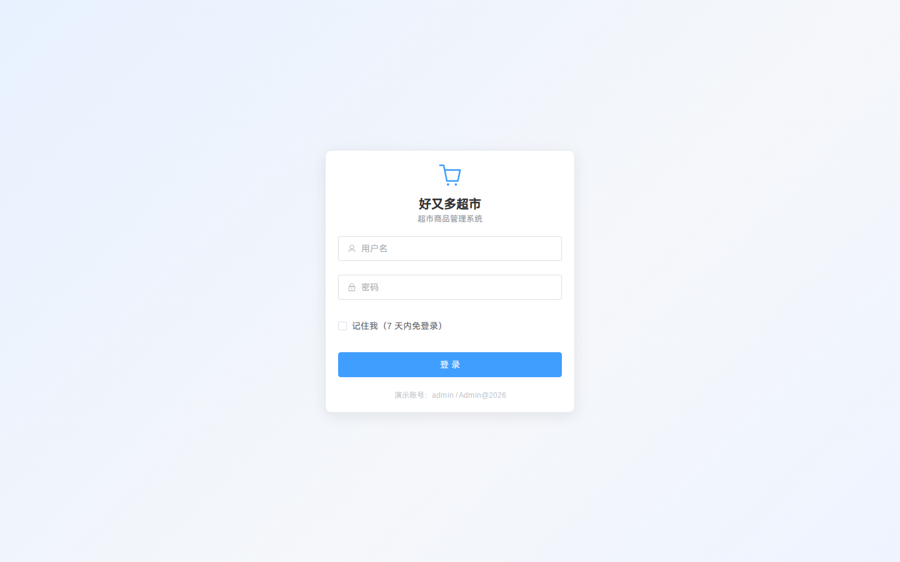

### 1.2 登录与演示账号

| 账号 | 角色 | 初始密码 | 主要职责 |
| --- | --- | --- | --- |
| admin | 超级管理员 | Admin@2026 | 全部权限 + 系统管理 + 库存体检一键修正 |
| manager | 店长 | Manager@2026 | 审核/授权（采购、盘点、折扣、退货、充值）+ 全部业务报表 |
| purchaser | 采购员 | Buyer@2026 | 供应商、采购单、建议采购、采购退货 |
| keeper | 库管员 | Keeper@2026 | 入库验收、盘点执行、报损报溢 |
| cashier | 收银员 | Cashier@2026 | 收银台、退货办理、交班、会员查询/注册 |

**首次登录后请立即通过右上角"修改密码"修改初始密码**；管理员重置密码后，用户下次登录会被强制要求改密。连续输错密码 5 次账号将锁定 15 分钟（参数可调）。

### 1.3 界面框架

登录后进入主框架：左侧为按权限动态生成的菜单树（系统/商品/库存/采购/销售/会员/报表），顶部为待办消息（铃铛角标，按角色展示待审核采购单/超期到货/待审核盘点/缺货数量，点击直达处理页）、**全屏切换**、当前用户与"修改密码/退出登录"，主区域为各业务页面。首页提供欢迎信息、快捷入口与系统说明。网络异常时显示统一错误页并提供"重试"。

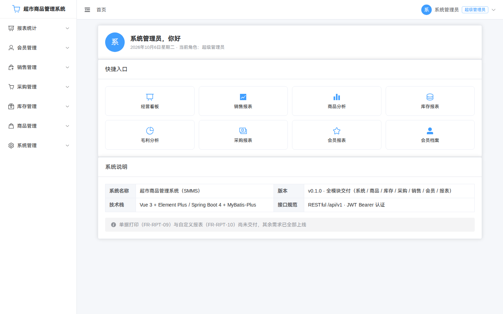

---

## 2 收银员操作

### 2.1 收银台（核心场景）

入口：左侧菜单"销售管理 → 收银台"；收银台为**独立全屏页面**（不含管理端菜单，右上角"退出收银"返回管理端；快捷键 回车 录入 ｜ F2 结算 ｜ F4 挂单 ｜ Esc 清空）。

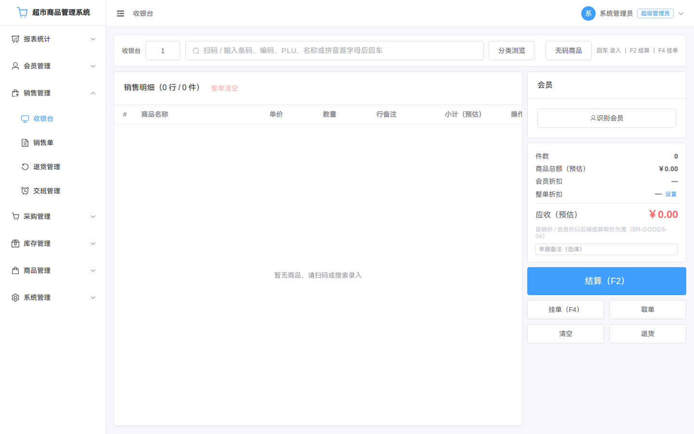

**操作步骤（对应验收 AC-05）：**

1. **开班**：进入收银台前先到"交班管理"开班（每收银员同时只能有一个在班班次）；收银台顶部会显示当前班次。
2. **录入商品**：在检索框输入 **条码 / 商品编码 / PLU 码（称重商品）/ 名称拼音首字母**，回车或双击候选行加入购物车；也可点"分类浏览"按分类树点选，或点"无码商品"临时录入（名称+金额，适用于散装临时商品）。检索框为**英数扫码模式**（屏蔽中文输入法组合）：扫码枪连续输入后自动查询（间隔 ≤50ms 识别，无需回车；可用系统参数"无结束符扫码自动查询"关闭）；**连续快速扫码不会漏单**（排队逐个查询），录入后自动回焦；按 **Esc** 可清空当前输入与候选。
3. **称重商品**：加入后录入净重（千克，最多 3 位小数）；单价自动取"促销价（生效中）> 零售价"。
4. **会员识别**：录入会员手机号/会员卡号，命中后显示会员姓名、等级、折扣率、积分与储值余额；会员折扣自动计入。为保护隐私，非店长账号在收银台/销售单/退货单中**仅显示手机号后 4 位**（如 `****5678`，BR-MEM-08），店长及以上可见完整号码；**停用会员**会给出常驻警示并**按散客继续结算**（不享受折扣与积分累计，BR-MEM-03），无需先移除会员。
5. **整单折扣（需店长授权）**：输入折扣率（不得低于系统下限，默认 0.7），填写折扣原因，并录入**店长账号与密码**完成现场授权（授权人不能是当前收银员）。
6. **单品改价（需店长授权）**：仅档案商品可改价；填写新单价与改价原因并录入店长账号密码。
7. **收款**：选择收款方式（现金/银行卡/移动支付/会员储值）并录入金额，支持组合收款（如储值 + 现金）；实收不足会提示。右侧汇总区**常驻实收合计与找零**，结算前即可核对。
8. **F2 结算**：核对应收/实收/找零后按 F2 或点"结算"，成功后展示小票信息（单号、找零、会员升级提示），可打印小票。
9. **F4 挂单 / 取单**：临时离场按 F4 挂单（最多 50 张，超过 24 小时自动清理）；点"取单"恢复挂单明细继续结算。

**常见拦截提示**：库存不足（显示当前可售数量，可减量后重试）、同一商品只能占一行（数量合并输入）、称重商品必须录入净重。收银台为触屏优化的大字号界面（明细行 16px、应收 32px、找零 24px）；库存不足、商品下架等异常以**常驻弹窗**提示，须点"我已确认"后方可继续操作。

### 2.2 退货办理

入口：左侧菜单"销售管理 → 退货管理"。按单号/时间/会员检索原销售单 → 打开单据详情 → 点"退货"勾选退货明细与数量（不超过可退数量），选择退款方式与退货原因 → 提交。

- 退款金额按**原成交单价**自动计算，无需手工录入；**不允许退货的商品**（生鲜/散装等档案开关）在明细中禁用勾选并提示原因（BR-SALE-07）；
- 以下情形须**店长账号密码授权**：退款金额超过阈值（默认 200 元）、原因为"误操作"、超过退货有效期（默认 7 天）需特批；
- 已交班班次的单据退货仅限店长处理；
- 原单退货状态自动更新为"部分退货/全部退货"，库存、会员积分与累计消费额自动回退。

### 2.3 交班管理

入口："销售管理 → 交班管理"。当前班次显示开班时间与实时销售汇总；点击"交班"生成交班单（收款合计、分支付方式合计、退款合计），交班后不可再在旧班次收银，需重新开班。

---

## 3 库管员操作

### 3.1 入库验收（核心场景）

入口："采购管理 → 入库单"→"新增入库"。

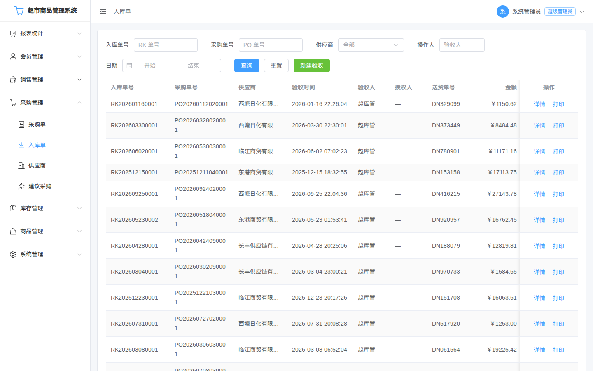

1. 选择待入库的采购单（已审核/部分入库状态），系统带出采购明细与待入库数量；
2. 逐行录入**实收数量与实收单价**（支持短少、超收场景）；
3. 超收或价差超过容差（默认 ±5%）时须店长授权（输入店长账号+密码），并填写备注；
4. 提交后：库存按**移动加权平均**重算成本、生成入库流水、采购单状态自动流转为"部分入库/已完成"；入库单可打印留档。

> 注意（GAP-P1-08 统一职责分离策略）：验收人与采购单创建人为同一人时，系统默认放行并写"职责未分离"异常日志；参数 `duty_separation_strict=true` 时拒绝；超级管理员可代验且同样留痕（BR-SYS-01）。库管员无需采购单菜单权限即可使用"待入库选单"（GAP-P0-05）。

### 3.2 盘点管理（核心场景）

入口："库存管理 → 盘点管理"。

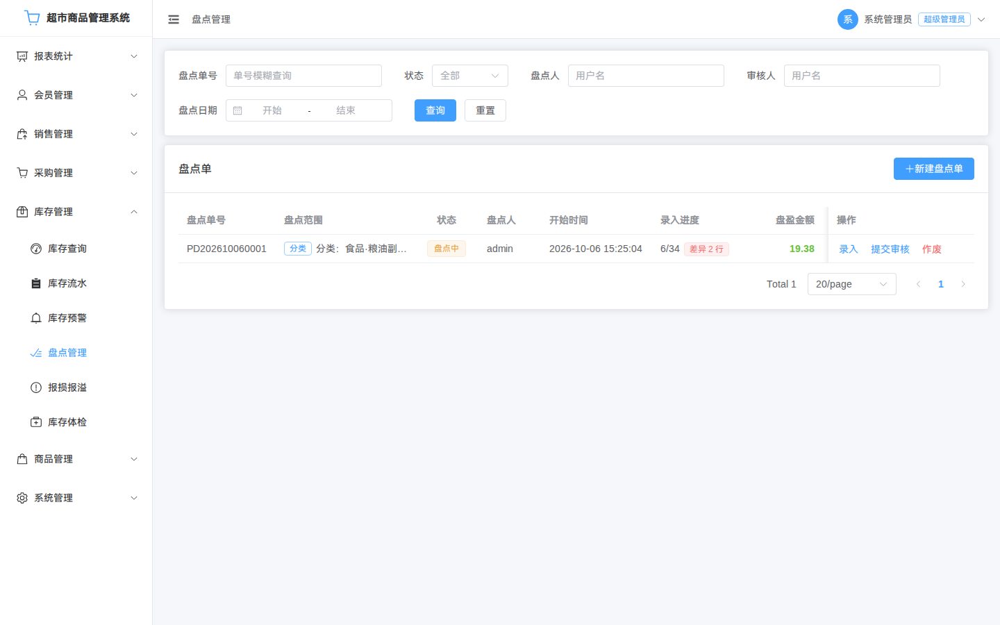

1. **创建盘点单**：选择范围（全店或指定分类），系统生成范围内的商品与账面数量快照；范围内存在未审核盘点单时不可重复创建；
2. **录入实盘数**：在线逐行录入，或下载模板批量填写后导入 Excel；
3. **差异处理**：盘盈/盘亏行必须填写差异原因（下拉取自数据字典 `check_diff_reason`，存代码、展示名称）；Excel 导入可填名称或代码；
4. **提交**：提交后单据进入待审核状态，由**店长**审核（GAP-P1-08：审核人 = 盘点人时默认放行并记异常日志、严格模式下拒绝，超级管理员可代审并留痕）；
5. **审核通过**：结存覆盖为实盘数，自动生成盘盈/盘亏流水；驳回则附驳回意见退回修改。

### 3.3 报损报溢

入口："库存管理 → 报损报溢"。登记报损（过期/破损/失窃/赠品/样品/其他）或报溢数量与原因 → 提交 → 店长审核 → 审核通过后库存与流水同步变动。报损金额按当前成本价结转。

### 3.4 库存查询与流水

- "库存管理 → 库存查询"：按分类/名称/编码检索实时结存、成本金额与安全库存状态；
- "库存管理 → 库存流水"：按商品/类型/单据号/操作人/时间检索全部出入库记录（每条含变动前后结存，可审计）；
- "库存管理 → 库存预警"：缺货（≤下限）/积压（≥上限）清单，按缺口量排序，可直接转建议采购。

### 3.5 库存体检

入口："库存管理 → 库存体检"（查看）。系统重算"期初 + Σ流水"与结存比对，输出差异清单；**一键修正仅超级管理员**可用。

---

## 4 采购员操作

### 4.1 供应商维护

入口："采购管理 → 供应商"。新增/编辑供应商（编码自动生成、名称唯一），维护联系人、结算方式（现结/月结/账期）与采购提前期；停用供应商不影响历史单据展示。

### 4.2 建议采购

入口："采购管理 → 建议采购"。查看系统按 `安全库存×K + 日均销量×提前期 − 结存 − 在途` 计算出的建议清单，勾选后一键生成**草稿采购单**。生成弹窗中**每行可修改供应商**（默认带出默认供应商；未维护默认供应商的商品会标"待指定供应商"，可勾选但须在弹窗中选择供应商）；数量与单价可调整，草稿会**保留原建议量与建议价**，事后可在采购单详情中对照评估。

### 4.3 采购单编制与跟踪

入口："采购管理 → 采购单"。

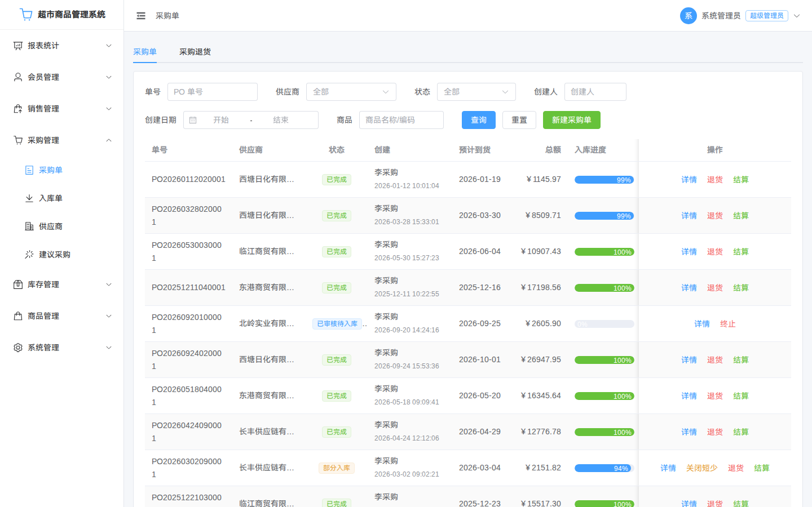

1. 新建草稿：选择供应商、录入商品与数量/单价（支持从建议采购转入）；
2. 提交：草稿 → 已提交，等待店长审核（可撤回修改）；
3. 审核：店长通过 → 已审核；驳回 → 退回并附意见；
4. 后续按入库验收进度自动流转"部分入库 → 已完成"；异常时可作废/终止/关闭（必须填写原因）；
5. 结算登记：按结算方式登记现结/月结/账期信息。

### 4.4 采购退货

从已完成/部分入库的采购单发起退货，录入退货数量与原因，审核后库存扣减并回写采购单可退数量。

---

## 5 店长操作

### 5.1 商品档案维护

入口："商品管理 → 商品档案"。

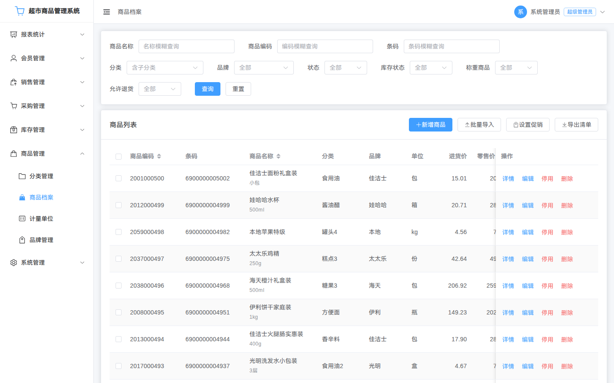

- 新增商品：选择叶子分类，条码可"生成店内码"（EAN-13），录入名称（自动生成拼音首字母）、单位、规格、进价/零售价/会员价与安全库存；**称重商品必须选择重量单位并录入 PLU 码**；可上传**商品图片**（jpg/png、≤2MB，保存后生效，编辑时可更换/移除）；
- 编码规则为"分类码 + 流水"，创建后不可修改；条码修改需二次确认；
- **条码被占用**时会拒绝保存、高亮条码字段，并提示占用商品名称（如"条码 6901234567892 已被商品【XX 牛奶 250ml】占用"，占用商品已停用时附带说明）；**商品编码重复**时提供【重新生成编码】按钮，点按后清空手工编码，保存时由系统按"分类码+流水"自动生成；表单中也可随时点编码输入框的"重新生成"清空手工编码；
- 已发生业务的商品只能停用、不可删除；
- **批量导入**：下载模板 → 上传校验（返回逐行校验报告，不落库）→ 确认导入（后台执行，对话框进度条与阶段文案按真实处理进度更新，完成后自动展示导入结果）；失败行可导出修正后重试；
- **导出清单**：点"导出清单"先选择**导出字段**（默认全选，可全选/半选），导出范围与当前筛选条件一致；单次上限 50000 行（超限提示缩小范围）。

### 5.2 调价与促销

- 商品详情"调价"：修改零售/会员/进货价须填写原因，历史留痕可追溯；
- "商品管理 → 促销"：设置单品限时促销价与生效时间段；同一商品同一时间段只能有一条生效促销，促销价必须低于零售价。

### 5.3 会员管理

- "会员管理 → 会员档案"：注册会员（手机号全局唯一）、储值充值（**须店长输入账号+密码现场授权，授权人不能为本人；系统按"账号+密码+店长角色"核验并落库真实授权人**）、查看积分与储值流水；
- "会员管理 → 会员等级"：维护等级门槛、折扣率与积分倍率；等级默认**只升不降**，会员累计消费跨过门槛后收银时自动升级并提示。

### 5.4 报表与下钻（核心场景）

入口："统计报表"菜单（经营看板 / 销售报表 / 商品分析 / 库存报表 / 毛利分析 / 采购报表 / 会员报表）。

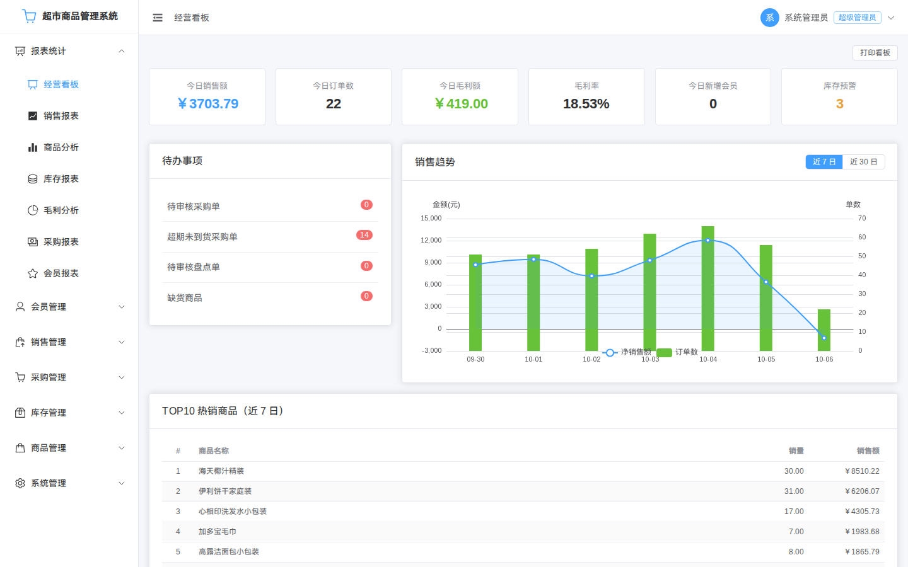

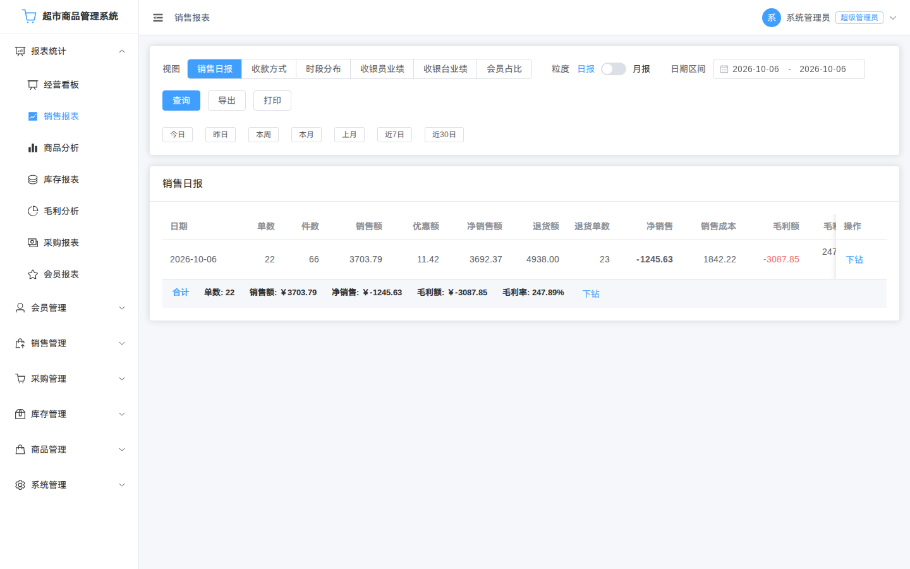

- 按**营业日/时间段/收银台/支付方式/会员**等维度组合筛选；**默认查询区间为"今日"**（BR-RPT-04），并提供统一的快捷区间：今日/昨日/本周/本月/上月/近7日/近30日；
- 销售日报口径：`净销售 = 销售额 − 优惠额 − 退货额`；点击汇总数字可**下钻**到构成它的销售单列表，再点单号打开单据详情（验收 AC-16）；
- 下钻覆盖：销售报表全部视图、商品分析（商品/品类/品牌行）、毛利分析（商品/分类/营业日/合计/负毛利行）、会员报表（排行/贡献）、采购报表（采购单/入库单）、库存报表（变动类型/周转商品/**库存汇总/库存预警/分类周转**）；**经营看板**的今日销售额/订单数/毛利额/毛利率与 TOP10 热销商品支持下钻（GAP-P2-21）；
- 毛利分析按明细成本快照核算，历史单据毛利不随调价变化；
- 各报表支持按当前筛选条件导出 Excel（单次上限默认 5 万行）：点击“导出”后任务在**后台生成**，弹窗显示进度，完成后自动下载；生成期间可继续操作，大范围导出不再因等待超时失败；
- 成本与毛利字段仅店长及以上可见，收银员/采购员等角色自动屏蔽。

### 5.5 店长审核与授权场景汇总

| 场景 | 入口 | 说明 |
| --- | --- | --- |
| 采购单审核 | 采购管理 → 采购单 | 通过/驳回（必填驳回原因） |
| 入库超收/价差授权 | 入库验收弹窗 | 超容差时录入店长账号密码 |
| 盘点审核 | 库存管理 → 盘点管理 | 通过/驳回；审核人 = 盘点人时按统一职责分离策略处理（默认放行记日志/严格拒绝/超管代审留痕） |
| 报损报溢审核 | 库存管理 → 报损报溢 | 通过后库存变动 |
| 收银整单折扣/单品改价授权 | 收银台 | 店长现场授权，授权人 ≠ 收银员 |
| 退货超阈值/误操作/超期授权 | 退货办理 | 店长账号密码授权，授权人 ≠ 发起人 |
| 会员储值充值授权 | 会员档案 | 店长账号+密码核验，授权人 ≠ 充值发起人（GAP-P0-07） |

---

## 6 管理员操作

### 6.1 用户与角色

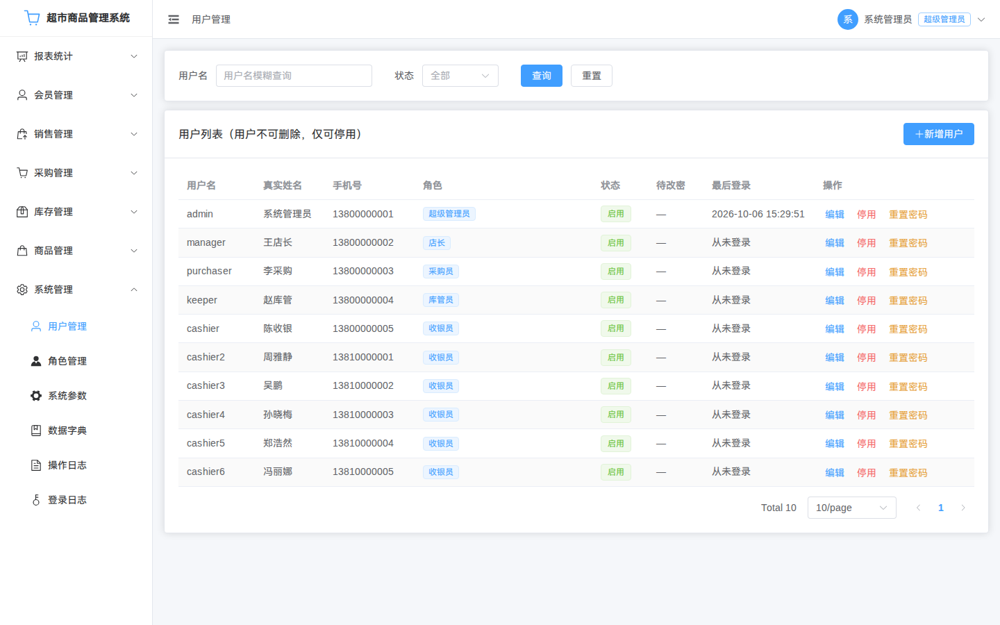

- "系统管理 → 用户管理"：新增用户、分配角色、重置密码（重置后首登强制改密）、启用/停用（不可删除，保留历史留痕）；
- "系统管理 → 角色管理"：内置角色（超级管理员/店长/采购员/库管员/收银员）不可删除，可按需调整权限；**超级管理员角色仅可授予初始账号**。

### 6.2 系统参数与数据字典

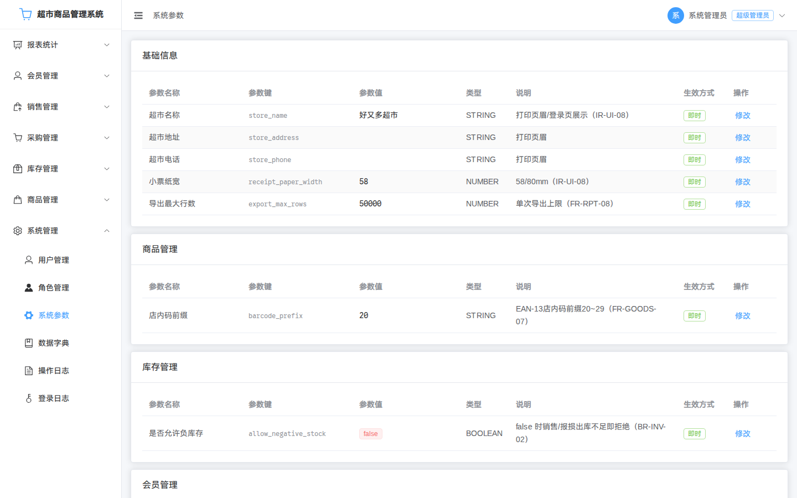

- "系统管理 → 系统参数"：在线调整折扣下限、退货阈值/有效期、积分规则、建议采购系数、锁定策略等；"生效方式"列区分**即时**（保存后立即清除参数缓存、后续读取即用新值）与**延迟**（不主动刷新缓存，最迟 60 秒内生效，**无需重启系统**），如 Token 有效期标注"修改后最迟 60 秒内对新签发令牌生效（存量令牌不受影响）"（GAP-P2-24）；
- "系统管理 → 数据字典"：维护收款方式、退货原因、报损原因、盘点差异原因等业务枚举；停用项不可被新单据选择，历史单据展示不受影响。

### 6.3 日志审计

- "系统管理 → 操作日志"：按操作人/模块/时间查询调价、审核、授权等操作留痕（含目标单据与结果）；
- "系统管理 → 登录日志"：登录成功/失败、锁定记录可追溯。

### 6.4 定时任务与数据备份（仅超级管理员）

- "系统管理 → 定时任务"：查看 6 个内置任务（促销到期失效、挂单清理、Token 黑名单清理、异步任务清理、会员生日提醒生成、每日数据备份）的调度周期与最近执行结果/耗时；可点"立即执行"手工补跑（任务幂等，补跑不会产生重复数据），执行日志可按任务/结果检索，失败原因与重试次数留痕；
- "系统管理 → 数据备份"：查看备份记录（文件名/大小/触发方式/结果/耗时/操作人），点"一键触发备份"立即执行全量备份（mysqldump，耗时视数据量）；系统每日 23:30 自动备份，保留最近 30 份；恢复流程见《部署与运维手册》§5.1。

---

## 7 常见问题（FAQ）

| 问题 | 处理方式 |
| --- | --- |
| 忘记密码 | 联系管理员重置；重置后首次登录须修改密码 |
| 账号被锁定 | 连续输错 5 次锁定 15 分钟，等待自动解锁或联系管理员；锁定时长可在系统参数调整 |
| 登录后菜单缺失 | 菜单按角色权限展示；如需新增权限请联系管理员调整角色 |
| 收银时提示"库存不足" | 查看提示的可售数量；核实实际库存后减量销售或先入库补货 |
| 折扣/改价被拒绝 | 折扣率低于下限或未授权：请店长到收银台现场输入账号密码授权（授权人不能是收银员本人） |
| 退货无法提交 | 检查是否超可退数量/超退货有效期（超期须店长特批）/商品本身不允许退货（档案开关） |
| 盘点提交后无变化 | 盘点需店长**审核通过**后才覆盖结存；待审核状态可撤回修改 |
| 入库数量超限提示 | 超收/价差超出容差，需店长授权或修正实收数据 |
| 称重商品无法结账 | 需录入净重；若商品档案缺 PLU 码或单位非重量单位，先到商品档案修正 |
| 报表数字与预期不符 | 确认筛选的营业日区间；使用汇总下钻逐单核对；含退货的报表注意"净销售"口径 |
| 导入 Excel 报错 | 先"校验"下载错误报告，按提示修正（编码/条码重复、分类非叶子、必填缺失等）后重新导入 |
| 导出点了没反应/一直转圈 | 导出为后台任务：进度弹窗会显示“排队中/正在生成”；若提示“当前后台任务较多”，稍后重试即可 |
| 下载导出文件提示“结果已过期” | 导出结果默认保留 24 小时，超时或被服务器清理后需重新导出 |
| 打印小票格式异常 | 在系统参数中核对"小票纸宽"（58/80mm）与浏览器打印设置 |

---

## 8 快捷键与操作提示

| 快捷键 | 场景 | 作用 |
| --- | --- | --- |
| 回车 | 收银台检索框 | 录入当前候选商品 |
| F2 | 收银台 | 结算 |
| F4 | 收银台 | 挂单 |

提示：所有敏感操作（授权类）均需对应账号密码在弹窗中现场确认；系统对每次授权自动留痕，可在操作日志中查询。

---

## 修订记录

| 版本 | 日期 | 修订说明 |
| --- | --- | --- |
| V1.0 | 2026-10-06 | 首次发布：分角色操作指引（收银/入库/盘点/报表为核心场景）、截图、FAQ 与快捷键 |
| V1.1 | 2026-10-07 | 导出与批量导入改为**后台任务**：补充进度弹窗、完成后自动下载/展示结果的说明，FAQ 新增“导出无反应/任务排队”“导出结果已过期”两条 |
| V1.2 | 2026-10-13 | 批次二（权限与资金安全）：§3.1 入库验收说明更新（库管员待入库选单、职责分离统一策略）；§3.2 盘点差异原因改选字典项；§5.3/§5.5 储值充值授权改为店长账号+密码核验 |
| V1.4 | 2026-10-13 | 批次四（功能补齐）：§2.1 收银台全屏/Esc/扫码自动查询与队列/常驻实收找零；§4.2 建议采购可改供应商并保留建议原值；§5.1 商品图片上传与导出字段选择、导入真实进度；新增 §6.4 定时任务与数据备份（仅超管） |
| V1.5 | 2026-10-13 | 批次五（体验与文档）：§1.2 记住我统一为 72 小时（DOC-05）；§1.3 顶栏待办消息/全屏切换/网络异常错误页；§2.1 停用会员按散客继续、收银台大字号与异常常驻提示（GAP-P2-01/02）；§2.2 退货明细"不允许退货"行禁用勾选（GAP-P2-04） |
| V1.6 | 2026-10-13 | 批次六（低成本高价值项收尾）：§2.1 收银台/销售单/退货单手机号仅显示后 4 位（BR-MEM-08/GAP-P2-19）；§5.1 条码占用提示占用商品名、编码重复可"重新生成编码"（GAP-P2-08）；§5.4 报表默认"今日"与统一快捷区间、下钻覆盖补充（GAP-P2-21）；§6.2 参数"即时/延迟（≤60 秒，无需重启）"生效方式说明（GAP-P2-24） |
