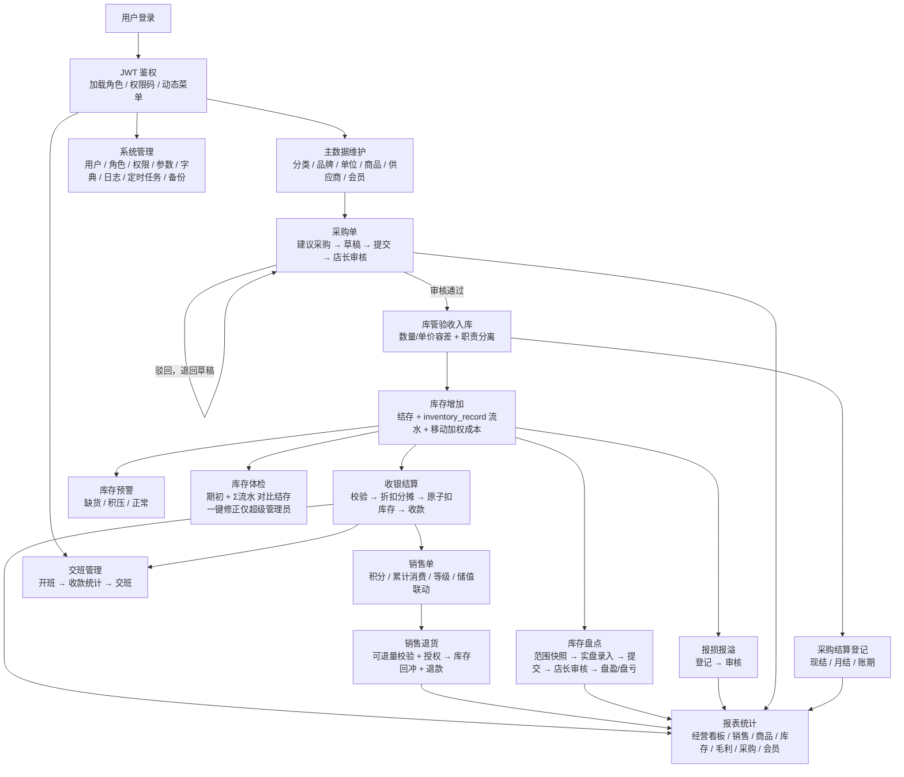
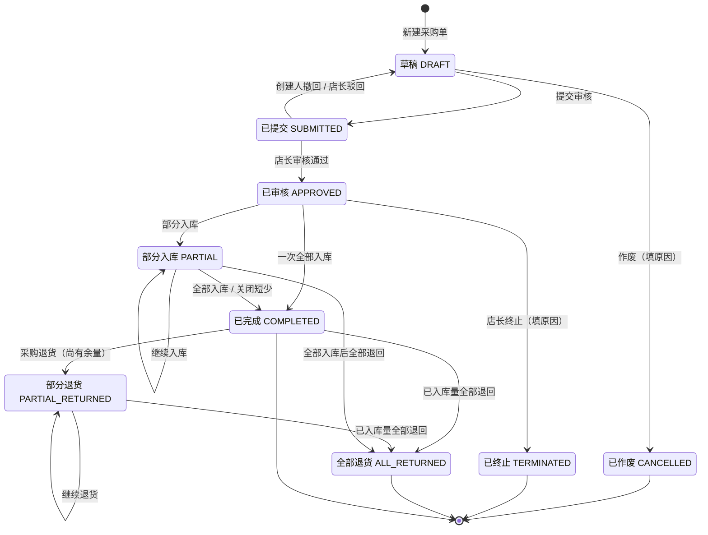
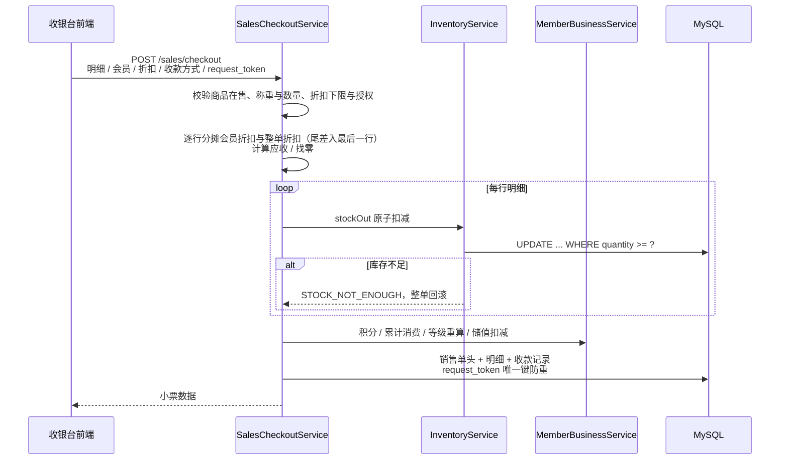
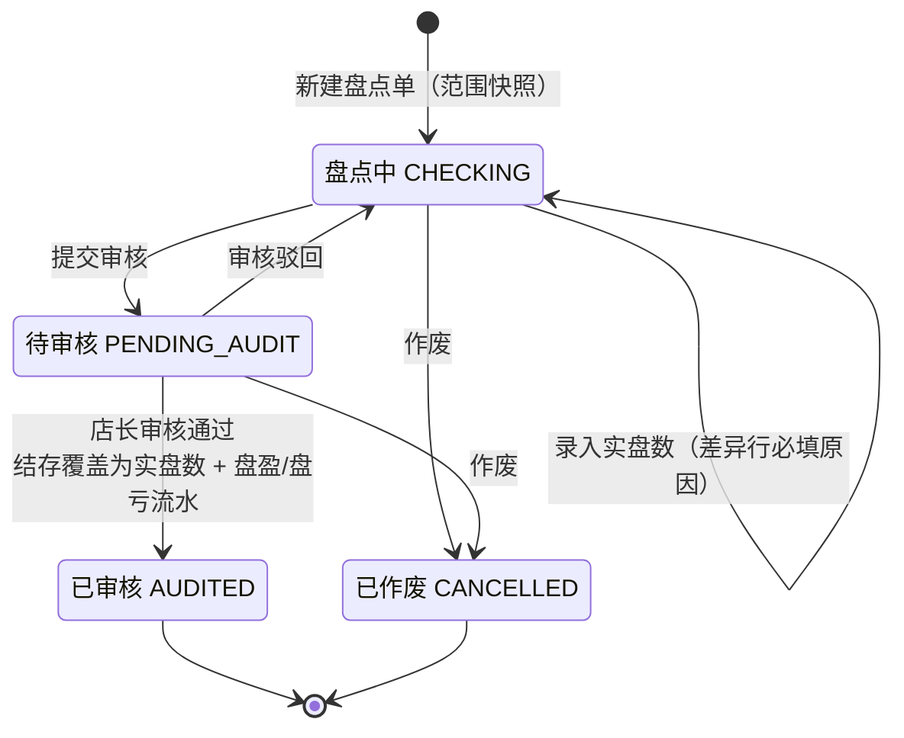
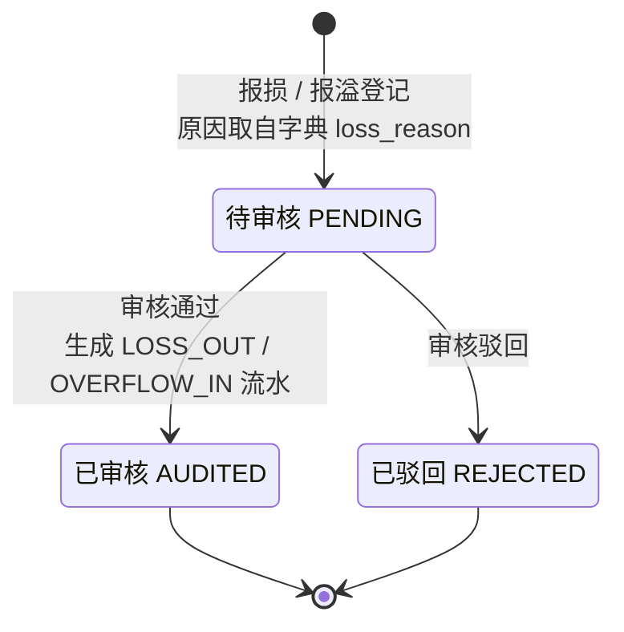

# 系统流程图

> 依据当前代码与 `docs/系统设计说明书.md` 整理，覆盖登录鉴权、主数据、采购入库、库存、销售退货、报表与系统管理。

## 1. 总体业务主流程

## 2. 采购单状态机

## 3. 收银结算时序（单事务）

## 4. 盘点与报损报溢状态机

## 5. 角色与模块对应关系

| 角色 | 主要入口 | 关键动作 |
|---|---|---|
| 超级管理员 | 全部菜单 + 系统管理 | 用户/角色/权限、参数、字典、日志、备份、库存体检一键修正 |
| 店长 | 业务全模块（除系统管理） | 采购审核、盘点审核、报损报溢审核、退货/超收/价差授权、报表与毛利 |
| 采购员 | 商品查看、库存查看、采购管理 | 供应商维护、采购单编制/提交/撤回、采购退货、建议采购 |
| 库管员 | 商品查看、库存、入库单 | 验收入库、盘点执行、报损报溢登记、库存预警处理 |
| 收银员 | 销售、会员 | 收银结算、退货办理、交班、会员查询/注册/储值充值 |
