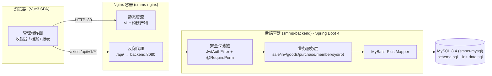
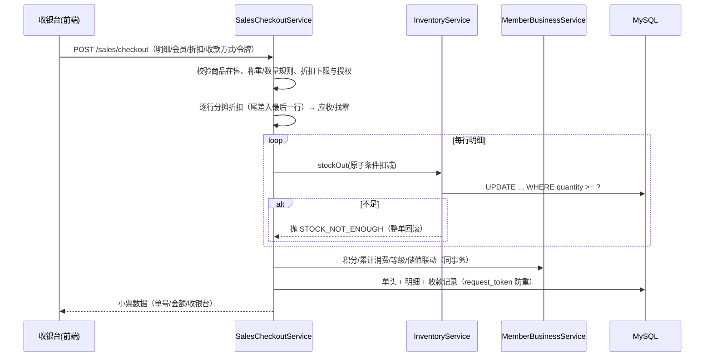
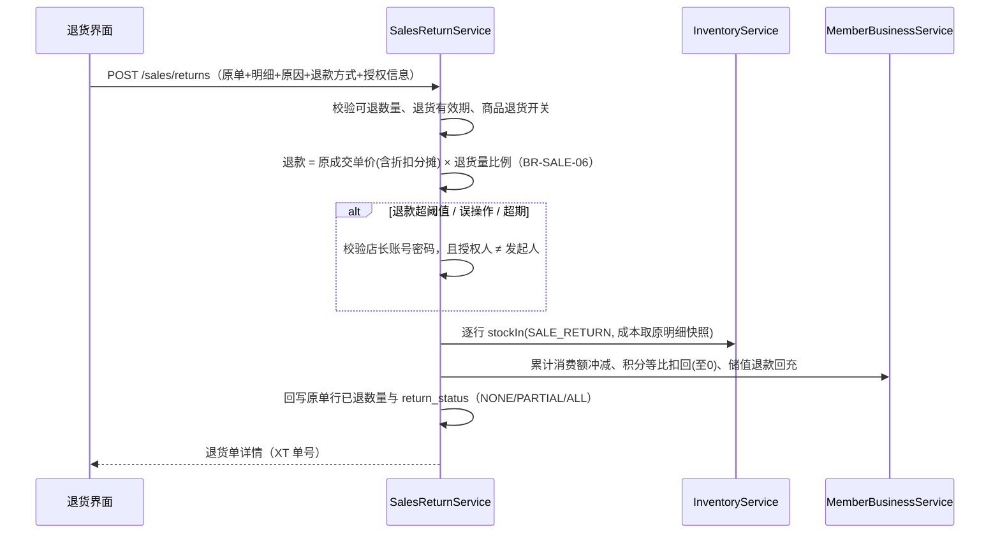
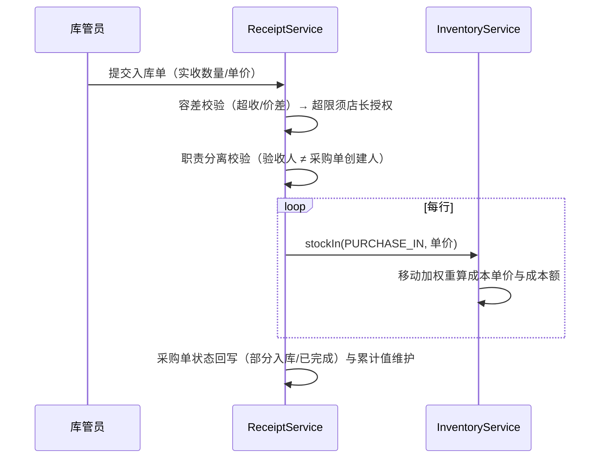

# 超市商品管理系统 系统设计说明书

| 项目 | 说明 |
| --- | --- |
| 文档编号 | SMMS-DD-01 |
| 版本 | V1.0 |
| 状态 | 定稿（对应交付验收 AC-D02） |
| 上游依据 | 《需求规格说明书-精简版》（下称 SRS）、《需求实现差距分析报告》 |
| 代码基线 | `main` 分支（P3 交付物补全后） |

---

## 1 引言

### 1.1 编写目的

本文档描述超市商品管理系统的总体架构与详细设计，作为系统实现、测试与维护的依据（AC-D02：概要设计、数据库设计、接口文档齐备且与代码一致）。读者对象为指导教师、评审人员与后续维护开发者。

### 1.2 参考资料

1. 《需求规格说明书-精简版》——功能需求（FR-*）、业务规则（BR-*）、数据需求（DR-*）、非功能需求（NFR-*）与验收标准（AC-01~AC-20、AC-D01~AC-D07）；
2. 《数据库设计说明书》——表结构与 DDL 细则；
3. 《接口设计说明书》——REST 接口清单与约定；
4. 《部署与运维手册》——运行环境与部署步骤；
5. 《测试报告》——测试结果与性能基线。

### 1.3 术语与缩略语

| 术语 | 说明 |
| --- | --- |
| SMMS | Supermarket Management System（本系统） |
| SKU | 最小库存单位，一行商品档案 |
| PLU | 称重商品收银码（Price Look-Up Code） |
| RBAC | 基于角色的访问控制 |
| 移动加权平均 | 入库按 `(原结存×原成本 + 入库量×入库价) ÷ 新结存` 重算成本单价（BR-INV-06） |
| 结存 | 当前库存数量（`inventory.quantity`） |
| 流水 | 库存变动记录（`inventory_record`，只增不改不删） |
| JWT | JSON Web Token，无状态登录凭证（HS256） |

---

## 2 总体设计

### 2.1 设计目标与约束

| 来源 | 目标/约束 | 设计落点 |
| --- | --- | --- |
| NFR-CMP-05 / AC-D04 | 一条命令容器化部署 | Dockerfile ×2 + docker-compose（MySQL 8.4 + 后端 + Nginx） |
| AC-08 / BR-INV-03 | 并发不超卖 | 单语句原子条件扣减 + READ COMMITTED |
| AC-04 / BR-INV-08 | 结存与流水强一致 | 库存唯一入口 `stockIn/stockOut` + 同事务流水链 |
| AC-06 / BR-SALE-03 | 金额分毫不差 | 整单折扣尾差入最后一行；行实付快照 |
| NFR-SEC-* | 安全基线 | BCrypt、JWT 黑名单、二次校验、脱敏、SQL 参数绑定 |
| DR-C-06 | 只增表不可改删 | 流水/日志类表无 UPDATE/DELETE 代码路径 |

### 2.2 系统架构

前后端分离的 B/S 架构，生产环境由 Docker Compose 编排三个容器：MySQL → 后端 → Nginx（托管前端静态资源并反向代理 `/api/`）。



### 2.3 技术栈与版本

| 层次 | 技术 | 版本 | 选型要点（详见 §8） |
| --- | --- | --- | --- |
| 后端语言 | Java | 25（LTS） | 虚拟线程、模式匹配，长期支持 |
| 后端框架 | Spring Boot | 4.1.1 | 生态成熟、安全与事务一等公民 |
| ORM | MyBatis-Plus | 3.5.17 | SQL 可控（原子扣减、报表聚合） |
| 数据库 | MySQL | 8.4 | 窗口函数、CTE；容器镜像统一 |
| 认证 | jjwt | 0.12.6 | HMAC-SHA 无状态令牌（算法随密钥长度自动选择）+ 黑名单 |
| Excel | Apache POI | 5.4.1 | xlsx 导入导出 |
| 前端 | Vue | 3.5 + Vite 8（Vite+） | 组合式 API；工具链统一由 `vp` 提供（build/test/lint/format） |
| UI 组件 | Element Plus | 2.14 | 表格/表单/弹窗组件齐全 |
| 图表 | ECharts | 6.1 | 看板可视化 |
| 状态与路由 | Pinia 4 / vue-router 5 | — | 动态菜单 + 路由守卫 |
| 构建/部署 | Gradle 9.7 / Docker / Docker Compose / Nginx | — | 一键部署（AC-D04） |
| 包管理 | pnpm 11（前端） | — | 锁文件 + 依赖层缓存 |

### 2.4 后端分层与包结构

```
backend/src/main/java/com/smms/
├── SmmsApplication.java            # 启动类
├── common/                         # 横切公共层
│   ├── annotation/  @RequirePerm @OpLog
│   ├── api/         ApiResponse ErrorCode PageVO（统一响应/错误码/分页）
│   ├── aspect/      PermissionAspect OperationLogAspect（AOP 鉴权与留痕）
│   ├── exception/   BusinessException GlobalExceptionHandler
│   ├── task/        异步任务框架（AsyncTask AsyncTaskService AsyncTaskController
│   │                TaskContext TaskProducer TaskFileStore TaskParams TaskDownload）
│   └── util/        Ean13Util PinyinUtils MaskUtils PasswordPolicy RequestUtils UserAgentUtils
├── config/          SecurityConfig MybatisPlusConfig JacksonConfig AsyncConfig
├── security/        JwtTokenService JwtAuthFilter LoginUser SecurityUtils
│                    LoginRateLimiter GlobalPermVersion IssuedTokenHolder UserContextService
├── controller/      PingController（健康探测）
├── sys/             # 系统与权限：用户/角色/权限/参数/字典/日志（FR-SYS）
├── goods/           # 主数据：分类/品牌/单位/商品/调价/促销（FR-CAT、FR-GOODS）
├── inv/             # 库存：结存/流水/预警/盘点/报损/体检/安全库存（FR-INV）
├── sale/            # 收银销售：结算/销售单/退货/挂单/交班（FR-SALE）
├── member/          # 会员：档案/等级/积分/储值（FR-MEM）
├── supplier/        # 供应商档案与供货清单（FR-SUP）
├── purchase/        # 采购：采购单/入库验收/采购退货/建议采购（FR-PUR）
└── rpt/             # 报表：看板/销售/商品/库存/毛利/采购/会员（FR-RPT）
```

每个业务域内部统一采用四层结构：`controller`（HTTP 边界）/ `dto`（出入参）/ `service`（业务规则与事务）/ `mapper`（SQL）+ `entity`（表映射）。

| 层 | 职责 | 约束 |
| --- | --- | --- |
| Controller | 参数绑定、`@RequirePerm` 声明权限、组装 `ApiResponse` | 不写业务分支 |
| Service | 业务规则、跨表事务、并发控制 | 事务边界所在层 |
| Mapper | CRUD 与报表聚合 SQL | 复杂 SQL 放 XML（`resources/mapper/**`） |
| Entity/DTO | 表映射 / 接口出入参 | DTO 不直接暴露 Entity |

### 2.5 模块划分

| 模块 | 子域 | 覆盖需求 | 关键类 |
| --- | --- | --- | --- |
| 系统与权限 | sys | FR-SYS-01~09 | `AuthController` `SysUserService` `SensitiveAuthService` `GlobalPermVersion` |
| 商品主数据 | goods | FR-CAT-01~07、FR-GOODS-01~13 | `GoodsService` `GoodsExcelService` `CategoryService` `PromotionService` |
| 库存 | inv | FR-INV-01~12 | `InventoryService` `StockCheckService` `LossOrderService` `InventoryHealthService` |
| 收银销售 | sale | FR-SALE-01~13 | `SalesCheckoutService` `SalesReturnService` `HoldOrderService` `CashierShiftService` |
| 会员 | member | FR-MEM-01~09 | `MemberService` `MemberBusinessService` `MemberLevelService` |
| 供应商/采购 | supplier/purchase | FR-SUP-01~05、FR-PUR-01~09 | `SupplierService` `PurchaseOrderService` `ReceiptService` `PurchaseReturnService` `SuggestPurchaseService` |
| 报表 | rpt | FR-RPT-01~09 | `ReportMapper`（聚合 SQL）+ 7 个报表 Controller |

### 2.6 前端工程结构

```
frontend/src/
├── main.ts                 # 应用入口（Element Plus + Pinia + Router）
├── router/index.ts         # 静态路由表 + 全局守卫（登录态/强制改密/菜单权限）
├── layouts/MainLayout.vue  # 侧边菜单 + 顶栏（用户菜单/改密/登出）
├── stores/auth.ts          # 登录态、用户信息、权限码集合、hasPerm()
├── api/                    # 按模块封装的请求函数（axios 实例统一拦截错误）
│   ├── request.ts          # baseURL=/api/v1、Token 注入、401/403 统一处理
│   └── auth|goods|inventory|sale|member|memberLevel|purchase|supplier|report|system.ts
└── views/                  # 41 个页面（登录、首页、7 大业务域、2 个错误页）
    ├── sale/               # cashier 收银台 / order 销售单 / return 退货 / shift 交班
    ├── inventory/          # list / record / warning / check / loss / health
    ├── goods/              # list / category / unit / brand
    ├── purchase/           # order / receipt / suggest / supplier
    ├── member/             # list / level
    ├── report/             # dashboard / sales / goods / inventory / profit / purchase / member
    │   └── components/     # DrillOrderDrawer 下钻抽屉等
    ├── system/             # user / role / config / dict / oplog / loginlog
    └── error/              # 403 / 404
```

---

## 3 横切设计

### 3.1 统一响应与分页

- 成功：`{"code":0,"message":"成功","data":...,"timestamp":"yyyy-MM-dd HH:mm:ss"}`（`ApiResponse`，null 字段不序列化）；
- 失败：同构返回 `code` 为业务错误码、`message` 为中文提示；
- 分页：`PageVO{list:[], total:0}`（IR-COM-04），查询参数统一 `page/size`（默认 20，上限 100）；
- 时间统一 `Asia/Shanghai`，Jackson 全局 `yyyy-MM-dd HH:mm:ss`。

### 3.2 异常与错误码体系

| 异常来源 | 处理 | HTTP 状态 |
| --- | --- | --- |
| `BusinessException`（携带 ErrorCode） | `GlobalExceptionHandler` 转为 `ApiResponse.fail` | 200（业务失败语义在 code） |
| 401/403 鉴权失败 | 由安全过滤链直接写出统一结构 | 401 / 403 |
| 参数校验（jakarta validation） | 汇总首条错误信息 `PARAM_INVALID` | 200 |
| 未知异常 | 兜底 `SYSTEM_ERROR`，服务端记日志不泄露堆栈 | 200 |

错误码按模块分段扩展（详见《接口设计说明书》附录）：`1100+` 系统、`1200+` 分类、`1300+` 商品、`1400+` 库存、`1500+` 销售、`1600+` 会员、`1700+` 供应商、`1800+` 采购。共 120 个错误码。

### 3.3 认证与鉴权（双重校验，BR-SYS-05）

1. **认证**：登录成功后签发 JWT（HMAC-SHA，算法随密钥长度自动选择 HS256/384/512；载荷含 `uid/roles/pwdFp/ver/jti`），前端经 `Authorization: Bearer` 携带；`JwtAuthFilter` 验签、校验黑名单与权限版本后注入 `LoginUser`。
2. **失效控制（IR-SW-03）**：登出/停用/权限变更将 `jti` 写入黑名单（`sys_token_blacklist`）；权限或密码变更会使 `ver`/`pwdFp` 失配，旧令牌即时失效。
3. **接口鉴权**：Controller 方法标注 `@RequirePerm("sys:xxx:yyy")`，`PermissionAspect` 比对当前用户权限码（超级管理员默认全通），不满足抛 `FORBIDDEN`。
4. **菜单鉴权**：前端路由 `meta.perm` + 守卫拦截；菜单树按用户权限动态渲染。前后端各自独立校验，前端仅作体验拦截。

### 3.4 操作留痕

- 标注 `@OpLog(module, action)` 的方法经 `OperationLogAspect` 记录：操作人、角色、模块、动作、目标单据号、请求方法/URL、参数摘要（不含密码等敏感字段）、IP、UA、结果与耗时、错误信息；
- 写库经 `@Async` 线程池（`logExecutor`，拒绝策略 CallerRuns）异步执行，不阻塞业务事务；
- `operation_log`/`login_log` 只增不改不删（DR-C-06），支持按时间/用户/模块索引查询（FR-SYS-08）。

### 3.5 校验与脱敏

- 出入参使用 jakarta validation 注解 + 服务内业务校验（如称重商品必须 PLU、分类必须叶子）；
- `MaskUtils` 对银行账号等敏感字段脱敏展示（FR-SYS-09）；成本/毛利按角色屏蔽（BR-SYS-08，报表层 `RptRoles.canViewProfit`）；
- 所有 SQL 经 MyBatis `#{}` 预编译参数绑定，杜绝拼接注入（NFR-SEC-03/04）。

### 3.6 异步任务（V1.1）

| 方面 | 设计 |
| --- | --- |
| 触发场景 | 重导出/导入提交（报表 6 类导出、商品/操作日志/预警导出、商品/会员导入提交） |
| 交互契约 | 提交 `POST/GET` 返回 `{taskNo,status,progress,...}`；轮询 `GET /api/v1/tasks/{taskNo}`；下载 `GET /api/v1/tasks/{taskNo}/download` |
| 执行模型 | `ThreadPoolTaskExecutor`（默认 2~4 线程 / 队列 50），队列满返回 1904 不留脏记录 |
| 状态机 | `QUEUED → RUNNING → SUCCESS/FAILED`；启动时将残留 `QUEUED/RUNNING` 置为 FAILED（避免永久挂起） |
| 鉴权上下文 | 提交时快照 `LoginUser` + authorities 随任务传递，在后台线程重建 `SecurityContext`，`finally` 清理 ThreadLocal（保证脱敏/超管分支行为一致） |
| 结果存储 | xlsx 落盘 `smms.task.file-dir`（容器内 `/app/task-files`），库中只存路径与元数据；保留期 `retain-hours`（默认 24h），定时任务清理 |
| 权限 | 仅提交人可查询/下载（1902）；过期/被清理报 1905 |
| 导入安全 | 上传文件先落盘再异步处理（不依赖请求生命周期）；仍为**单事务**提交，校验阶段保持同步 |

---

## 4 模块详细设计

### 4.1 系统与权限（sys）

- **登录**：失败计数 + 锁定（参数 `login_fail_limit`/`lock_minutes`）、`LoginRateLimiter` 限流、登录日志全量记录（FR-SYS-01）；初始账号首登强制改密。
- **用户/角色**：用户不可删除只可停用；内置角色不可删；超管角色仅可授予初始账号（BR-SYS-03）。
- **参数与字典**：`sys_config` 键值参数（改名即生效，`instant_effect` 标识）；`sys_dict`/`sys_dict_item` 支撑收款方式、退货原因等业务枚举，停用项不可被新单据选择（FR-SYS-07）。
- **敏感操作二次确认**：`SensitiveAuthService` 校验当前账号密码（BR-SYS-06），授权类操作校验店长账号密码且授权人 ≠ 发起人。

### 4.2 商品主数据（goods）

- **分类树**：`parent_id + level + path` 物化路径，限 3 级；同级重名、父级停用连锁校验；删除前校验子分类与商品引用。
- **商品档案**：编码 `分类码+流水`（创建后不可改）、条码全局唯一（EAN-13 校验位，`Ean13Util` 生成店内码）、`pinyin_initial` 支撑收银拼音检索（FR-SALE-02）；称重商品必填 PLU 且单位须为重量单位（BR-GOODS-05）；已发生业务的商品禁止删除只可停用（BR-GOODS-06）。
- **调价**：零售/会员/进货三类价格变更均写 `price_history`（前值、后值、原因、操作人），供追溯（FR-GOODS-10）。
- **促销**：单品限时促销，同商品同时间段仅一条生效（应用层互斥校验，BR-GOODS-04）；促销价必须低于零售价。
- **Excel 导入**：模板下载 → 校验（不落库，返回逐行校验报告）→ 确认导入（事务批量落库）两阶段（FR-GOODS-11）。

### 4.3 库存（inv）

- **统一入口**：所有库存增减必须经 `InventoryService.stockIn/stockOut`（BR-INV-11 禁止直改结存），变动类型枚举：`INIT/PURCHASE_IN/OVERFLOW_IN/SALE_RETURN/CHECK_SURPLUS`（入）与 `SALE_OUT/LOSS_OUT/CHECK_SHORTAGE/PURCHASE_RETURN`（出）。
- **出库原子扣减**：`UPDATE inventory SET quantity=quantity-? WHERE goods_id=? AND quantity >= ?` 单语句完成"余量判定+扣减"（BR-INV-03），受影响行数为 0 即库存不足；是否允许负库存由参数 `allow_negative_stock` 决定（BR-INV-02）。
- **入价成本规则（BR-INV-06，§8.2）**：`PURCHASE_IN` 按移动加权平均重算；报溢按当前成本平价入账；销售退货按原销售明细成本快照回冲，均不污染当前均价。
- **流水链**：每条 `inventory_record` 记录 `before/after` 结存，同事务内读回扣减后结存写入（行锁保持至提交），保证 `after = before + change` 且与结存强一致（BR-INV-08）。
- **盘点**：范围快照 → 实盘录入 → 提交 → 审核覆盖式生成 `CHECK_SURPLUS/CHECK_SHORTAGE` 流水；差异行必填原因；盘点人/审核人职责分离（BR-SYS-01）。
- **报损报溢**：登记 → 审核状态机；原因取自字典 `loss_reason`（FR-INV-10）。
- **库存体检**：重算"期初+Σ流水"与结存的差异清单，一键修正仅超管（FR-INV-11）。
- **预警**：缺货（≤下限）/积压（≥上限）/正常三类清单，按缺口量排序（FR-INV-05）。

### 4.4 收银销售（sale）

- **结算主流程（单事务）**：校验商品（在售/称重/数量）→ 会员识别与等级折扣 → 整单折扣（低于下限 `min_discount_rate` 须店长授权，BR-SALE-05/10）→ 金额分摊（会员折扣与整单折扣逐行核算，**尾差入最后一行**，BR-SALE-03）→ 库存逐行原子扣减（不足即中止回滚）→ 单头+明细+收款记录落库 → 会员联动（积分=基数×每元积分数×等级倍率取整、累计消费额与等级重算 BR-MEM-05/06、储值扣减及流水）→ 返回小票数据。
- **单号规则**：`XS + yyyyMMdd + 收银台2位 + 4位流水`（BR-SALE-02），唯一键冲突捕获后重试生成；请求令牌 `request_token` 唯一键兜底并发同单重放（NFR-REL-02）。
- **挂单**：明细快照落库（`hold_order`），取单/删除/24 小时过期清理，上限 50 张（FR-SALE-08）。
- **交班**：开班后按班次维度统计收款合计、退款、支付方式分布；未交班不允许重复开班（FR-SALE-09）。
- **退货**：见 §5.2；退款按原成交单价比例分摊（BR-SALE-06），超阈值/误操作/超期须店长授权且授权人 ≠ 发起人（FR-SALE-11）；已交班班次的单据退货限店长处理（BR-SALE-09）。

### 4.5 会员（member）

- 手机号全局唯一（BR-MEM-01）；编号流水生成；
- 等级：门槛+折扣率+积分倍率三要素，`ONLY_UP` 只升不降（BR-MEM-06）；
- 积分：`floor(基数 × 倍率)`，储值消费是否计积分由参数决定（BR-MEM-05/07）；`point_record` 只增流水；
- 储值：充值须授权（授权人 ≠ 本人）、消费扣减、退款回储值，余额不允许为负（BR-MEM-07）；
- 会员 Excel 导入与导出（FR-MEM-09）。

### 4.6 供应商与采购（supplier/purchase）

- **采购单状态机**：草稿→已提交→已审核（可驳回）→部分入库→已完成；撤回/作废/终止/关闭带原因（BR-PUR-02/04，FR-PUR-05）；
- **建议采购**：`建议量 = ceil(安全库存×K + 日均销量×提前期 − 结存 − 在途)`（BR-INV-07），一键转草稿采购单（需默认供应商）；
- **入库验收**：实收数量/单价录入；超收容差（`receiving_tolerance_rate`）与单价偏离容差超限须店长授权（BR-PUR-04/05）；验收人与采购单创建人须不同用户（BR-SYS-01 职责分离）；入库按移动加权重算成本（§4.3）；
- **采购退货**：从已完成/部分入库的采购单发起，退回数量校验、库存扣减与状态回写（FR-PUR-08）；
- **结算登记**：现结/月结/账期（字典 `settle_type`），累计采购额派生维护。

### 4.7 报表（rpt）

- 口径（BR-RPT-01）：`净销售 = 销售额 − 优惠额 − 退货额`；营业日/时段/收银台/支付方式维度可组合筛选；
- 七类报表：经营看板（`DashboardController`）、销售、商品（排行/滞销）、库存（周转/预警）、毛利（负毛利清单）、采购、会员；毛利按明细成本快照核算，历史单据不受后续调价影响（BR-SALE-04）；
- **下钻**（BR-RPT-06）：汇总数字 → 构成单据列表抽屉（`DrillOrderDrawer`）→ 单据详情；
- **导出**：xlsx 导出受参数 `export_max_rows` 限制（默认 5 万行），超限提示（FR-RPT-08）；
- **异步导出**（V1.1）：导出提交后立即返回 `taskNo`，由后台线程池生成 xlsx 并落盘，前端轮询进度并自动下载；用于规避反向代理（Cloudflare 约 100s）源站超时（见《部署与运维手册》§5.6）；
- 成本与毛利字段按角色屏蔽（店长可见，收银/采购等不可见，BR-SYS-08）。

---

## 5 关键流程设计

### 5.1 收银结算（FR-SALE-01~07、AC-05/06/07/09）



### 5.2 销售退货（FR-SALE-10/11、AC-10/11）



### 5.3 采购入库验收（FR-PUR-06/07、AC-02/03）



### 5.4 库存盘点（FR-INV-06~08、AC-12）

范围取范围树 → 生成盘点单（快照范围内商品及账面数）→ 实盘录入（差异行必填原因）→ 提交 → 店长审核通过 → 结存覆盖为实盘数并生成盘盈/盘亏流水 → 库存体检仍一致；盘点人与审核人必须不同用户。

### 5.5 库存体检（FR-INV-11、AC-04）

对全量商品重算 `期初 + Σ流水`，与结存比对输出差异清单；一键修正仅超级管理员可用（白盒校验能力）；体检算法只读+受控修正，是 AC-04 一致性的验收入口。

---

## 6 事务边界与并发控制

### 6.1 事务策略

- 以 Service 方法为事务边界（`@Transactional`），跨表写操作聚合在同一事务：结算（单头+明细+收款+库存+会员）、退货、入库、盘点审核、报损审核；
- 流水/日志类表（`inventory_record`、`point_record`、`balance_record`、`operation_log`、`login_log`）在代码层不提供 UPDATE/DELETE 路径（DR-C-06）；
- 日志写库使用 `@Async` 独立线程池，与业务事务解耦；参数修改等即时生效配置通过内存缓存/每次读取保证一致性。

### 6.2 库存并发控制（AC-08 / NFR-PERF-04）

- **原子条件扣减**：`UPDATE inventory SET quantity = quantity - ?, version = version + 1 WHERE goods_id = ? AND store_id = 1 AND quantity - ? >= 0`（单语句完成判定与扣减，行锁串行化，无"先查后改"竞态）；
- **隔离级别**：READ COMMITTED（`application.yaml`），跨 MySQL/MariaDB 兼容；扣减语句单条原子，语义不依赖可重复读；
- **前后结存一致性**：同事务内读回扣减后结存写入流水，行锁保持至提交，保证流水链与结存严格一致（BR-INV-08）；
- **实测**：`InventoryConcurrencyIntegrationTest`（Testcontainers 真库）100 线程争抢 10 件，恰好 10 单成功、90 单库存不足、结存为 0、流水恰好 10 条 —— 通过（详见《测试报告》）。

### 6.3 防重与幂等

| 场景 | 机制 |
| --- | --- |
| 结算/退货重复提交 | 客户端 `request_token` + 表唯一键；冲突捕获后回查已落库单据按重放返回（NFR-REL-02） |
| 单号并发生成 | 唯一键冲突 → 捕获 `DuplicateKeyException` → 重新取号重试，仍冲突则明确报错 |
| 盘点重复创建 | 应用层校验"范围内已有未审核盘点单"（BR-INV-09） |
| 商品/会员 Excel 批量导入 | 校验阶段查重 + 落库事务回滚 |

### 6.4 分布式/多门店扩展预留

全部业务表含 `store_id` 字段（本期恒为 1），为多门店扩展预留（NFR-EXT-02）；接口层无单店假设，扩展时按 `store_id` 增加租户过滤即可。

---

## 7 安全设计

| 安全项 | 实现 |
| --- | --- |
| 口令存储 | BCrypt 强度 10（`PasswordPolicy` 校验强度：长度/复杂度） |
| 登录防爆破 | 连续失败 N 次锁定 M 分钟（参数化）+ 限流器 |
| 会话安全 | JWT 无状态 + 黑名单（登出/停用/权限变更即时失效）+ 权限版本号 |
| 越权防护 | `@RequirePerm` 注解 + AOP 校验；报表成本/毛利按角色屏蔽 |
| 职责分离 | 盘点审核、采购验收、退货授权、储值充值等场景校验操作人/授权人 ≠ 发起人（BR-SYS-01） |
| 敏感操作 | 二次密码确认（BR-SYS-06） |
| 注入防护 | MyBatis `#{}` 参数绑定；Excel 上传类型/大小白名单（≤10MB，拒绝危险后缀） |
| 数据脱敏 | 银行账号等字段展示脱敏（FR-SYS-09） |
| 审计留痕 | 操作/登录日志只增不删，保留期 ≥ 1 年（FR-SYS-08/DR-C-06） |
| 传输安全 | 生产环境建议由前置网关启用 HTTPS；JWT 密钥经环境变量注入（≥32 字节） |

---

## 8 技术选型论证

| 选型项 | 候选方案 | 选定 | 论证要点 |
| --- | --- | --- | --- |
| 后端框架 | Spring Boot / Django / Express | **Spring Boot 4** | 事务与并发控制成熟（声明式事务、行锁语义直通 JDBC）；强类型 + 编译期检查；与 MyBatis 生态契合教学场景的 SQL 可控性 |
| 持久层 | MyBatis-Plus / JPA(Hibernate) | **MyBatis-Plus** | 本项目核心难点是"原子条件扣减、移动加权、报表聚合"等 SQL 敏感场景，需精确控制语句；MP 提供 CRUD 样板与分页插件但不隐藏 SQL |
| 数据库 | MySQL 8.4 / PostgreSQL | **MySQL 8.4** | 零售业务事实标准、窗口函数/CTE 满足报表需求；与课程环境一致，容器镜像成熟 |
| 认证方案 | Session / JWT 无状态 | **JWT + 黑名单** | 前后端分离与多实例部署友好；以 jti 黑名单与权限版本补足"无状态不可撤销"短板（IR-SW-03） |
| 前端框架 | Vue 3 / React | **Vue 3 + Element Plus** | 组合式 API 开发效率高；Element Plus 提供收银/报表所需的成熟表格、表单、弹窗组件；学习曲线平缓 |
| 状态管理 | Pinia / Vuex | **Pinia** | Vue 3 官方推荐，TS 类型友好，逻辑内聚于 store |
| 图表 | ECharts / Chart.js | **ECharts** | 中文文档完善，看板所需折线/柱状/饼图与大数据量渲染性能好 |
| 部署 | 裸机脚本 / Docker Compose / K8s | **Docker Compose** | 单机一键编排满足交付要求（AC-D04）；K8s 对单店场景过重 |

---

## 9 性能与容量设计

| 关注点 | 设计 |
| --- | --- |
| 列表查询（NFR-PERF-01） | 分页强制 + 覆盖索引（商品名称/条码/状态、单号时间等）；分类由 `path` 前缀匹配避免递归 |
| 收银结算（NFR-PERF-02） | 明细行数小（一单多行），逐行原子扣减 + 单事务；实测 P95 见《测试报告》 |
| 报表（NFR-PERF-03/05） | 聚合 SQL 走时间/维度索引；下钻分页；导出限制 5 万行；2M 单量级数据由仿真脚本生成验证（AC-D07/AC-20） |
| 连接池 | HikariCP 最大 20（`maximum-pool-size`），连接超时 5s |
| 前端资源（NFR-PERF-08） | Nginx gzip（文本类资源）+ 指纹资源长缓存 + index.html 不缓存 |
| 批量作业 | Excel 导入分批校验/落库；仿真数据生成脚本按批 INSERT（800 行/批）、定批提交 |
| 容量参考 | 单机 MySQL 8.4 + 20 连接可支撑 200 万销售单量级的数据查询与报表；数据生成/导入耗时见《测试报告》 |

---

## 10 需求覆盖对照（模块级）

| SRS 章节 | 需求范围 | 设计章节 |
| --- | --- | --- |
| G-01 系统与权限 | FR-SYS-01~09 | §3、§4.1、§7 |
| G-02 商品主数据 | FR-CAT、FR-GOODS | §4.2 |
| G-03 库存管理 | FR-INV-01~12 | §4.3、§5.4/5.5、§6.2 |
| G-04 收银销售 | FR-SALE-01~13 | §4.4、§5.1/5.2、§6.2/6.3 |
| G-05 会员营销 | FR-MEM-01~09 | §4.5 |
| G-06 供应商与采购 | FR-SUP、FR-PUR | §4.6、§5.3 |
| G-07 报表统计 | FR-RPT-01~09 | §4.7 |
| 非功能需求 | NFR-* | §6/§7/§8/§9 |

---

## 修订记录

| 版本 | 日期 | 修订说明 |
| --- | --- | --- |
| V1.0 | 2026-10-06 | 首次发布：总体架构、模块详细设计、关键流程时序、事务与并发方案、安全设计、选型论证；与代码基线一致 |
| V1.1 | 2026-10-07 | 新增 §3.6 异步任务设计（触发场景、交互契约、执行模型、状态机、鉴权上下文传递、结果存储）；§2.4 包结构补 `common/task`；§4.7 报表补充异步导出说明 |
| V1.2 | 2026-10-11 | 前端工具链迁移至 **Vite+**（`vite-plus` 1.1）：`vp dev/build/test/lint/fmt` 统一入口，构建切换到 Rolldown（Vite 8 核心）；ESLint + Prettier 替换为 oxlint（type-aware 类型检查）+ oxfmt，`.eslintrc-auto-import.json` 随之移除 |
