# 超市商品管理系统 需求规格说明书

**Software Requirements Specification (SRS)**

| 项目 | 内容 |
| --- | --- |
| 项目名称 | 超市商品管理系统（Supermarket Merchandise Management System，SMMS） |
| 文档版本 | V1.0（初稿） |
| 编写日期 | 2026-09-07 |
| 文档状态 | 待评审 |
| 适用阶段 | 本科毕业设计 —— 需求分析阶段 |
| 技术形态 | Spring Boot 3 + MyBatis-Plus + MySQL 8 + Vue 3，前后端分离，单门店 |

> **文档说明**：本稿按国内本科毕业设计通用结构编写，章节编号自成体系。待学校下发的正式模板确定后，可按第 10 章《附录》中的章节映射建议直接重排；需求条目编号（FR/NFR/UC/BR）独立于章节结构，重排后仍可稳定引用。

---

## 目录

1. [引言](#1-引言)
2. [项目概述](#2-项目概述)
3. [需求建模](#3-需求建模)
4. [功能需求](#4-功能需求)
5. [外部接口需求](#5-外部接口需求)
6. [非功能需求](#6-非功能需求)
7. [数据需求概述](#7-数据需求概述)
8. [需求验收标准](#8-需求验收标准)
9. [待确认问题清单](#9-待确认问题清单)
10. [附录](#10-附录)

---

## 1. 引言

### 1.1 编写目的

本文档旨在明确"超市商品管理系统"的完整需求，包括系统目标、业务边界、用户角色、功能需求、外部接口需求、非功能需求与数据需求，作为后续概要设计、数据库设计、接口设计、编码实现与测试验收的唯一依据。

预期读者：

| 读者 | 关注重点 |
| --- | --- |
| 指导教师 | 选题合理性、需求完整性、工作量饱满度、业务规则严谨性 |
| 开发者（本人） | 功能条目、业务规则、数据实体、验收标准 |
| 评审/答辩委员 | 系统边界、关键技术难点、需求可测试性 |

### 1.2 项目背景

中小型单体超市在日常经营中普遍存在以下问题：

1. **商品档案分散**：商品信息记录在纸质台账或独立 Excel 中，同一商品在不同表格中名称、单位、价格不一致，查询与统计依赖人工。
2. **库存不透明**：入库、销售、损耗各自记账，缺乏统一的库存流水，实际库存与账面库存长期偏离，只能依靠周期性人工盘点纠正；缺货与积压同时存在。
3. **采购决策凭经验**：无法快速得到"哪些商品低于安全库存""哪些商品滞销"，补货依赖店主记忆，造成资金占用与断货损失。
4. **销售与会员割裂**：会员消费记录不完整，等级与折扣靠人工判断，无法进行消费行为分析。
5. **经营分析缺失**：日营业额、毛利率、品类贡献等关键指标需要人工汇总，滞后且易错。

市面上的商业 POS/ERP 系统（如思迅、科脉、海鼎）功能完整但价格高、部署重、定制难，对单门店小型超市存在明显功能冗余。本课题面向**单门店中小型超市**，设计并实现一套轻量、可自主部署、覆盖"商品—库存—采购—销售—会员—报表"全链路的商品管理系统，具有实际应用价值；同时涵盖 Web 工程中的典型技术问题（事务一致性、库存并发扣减、复杂统计查询、权限控制），适合作为毕业设计课题。

### 1.3 术语与缩略语

| 术语/缩写 | 全称 | 说明 |
| --- | --- | --- |
| SKU | Stock Keeping Unit | 库存量单位，本系统中一条商品档案即一个 SKU |
| SPU | Standard Product Unit | 标准化产品单元，本系统不设 SPU 层，简化为单级商品档案 |
| EAN-13 | European Article Number | 国际通用 13 位商品条码标准 |
| 店内码 | In-store Code | 超市自编条码，以 `20`~`29` 开头，用于散装称重、生鲜等无国标条码商品 |
| PLU | Price Look Up code | 生鲜果蔬的 4~5 位售价查询码 |
| 移动加权平均 | Moving Weighted Average | 存货成本计价方法，每次入库后重算单位成本 |
| 安全库存 | Safety Stock | 触发补货预警的库存下限阈值 |
| 建议采购量 | Suggested Order Qty | 系统按阈值与日均销量计算的推荐补货数量 |
| RBAC | Role-Based Access Control | 基于角色的访问控制模型 |
| 盘盈/盘亏 | Inventory Surplus / Shortage | 实盘数大于/小于账面数的差额 |
| 收银台 | POS Terminal | 前端销售收银页面所在的客户端，非硬件设备 |
| MoSCoW | Must/Should/Could/Won't | 需求优先级划分方法 |
| SRS | Software Requirements Specification | 软件需求规格说明书 |

### 1.4 参考资料

1. GB/T 8567—2006《计算机软件文档编制规范》
2. GB/T 9385—2008《计算机软件需求规格说明规范》
3. IEEE Std 830-1998《Recommended Practice for Software Requirements Specifications》
4. GB 12904-2008《商品条码 零售商品编码与条码表示》
5. Spring Boot 3.x、MyBatis-Plus、Vue 3 官方文档
6. 《数据库系统概论》（第 5 版）—— 关系模型与范式理论
7. 《软件工程》（第 3 版）—— 需求获取与 UML 建模方法
8. 《阿里巴巴 Java 开发手册》

### 1.5 文档约定

**需求编号规则**：`<类型>-<模块>-<三位序号>`，全文唯一且不复用，条目删除后编号保留并标注"已废弃"。

| 类型前缀 | 含义 | 示例 |
| --- | --- | --- |
| UC | 用例（Use Case） | UC-SALE-001 |
| FR | 功能需求（Functional Requirement） | FR-INV-05 |
| BR | 业务规则（Business Rule） | BR-INV-03 |
| NFR | 非功能需求（Non-Functional Requirement） | NFR-PERF-02 |
| DR | 数据需求（Data Requirement） | DR-12 |
| IR | 接口需求（Interface Requirement） | IR-HW-01 |
| G | 系统目标（Goal） | G-02 |
| C | 约束（Constraint） | C-04 |
| A | 假设（Assumption） | A-02 |
| X | 范围外项（Out of Scope） | X-01 |

**模块代码**：CAT 分类 / GOODS 商品 / INV 库存 / SUP 供应商 / PUR 采购 / SALE 销售 / MEM 会员 / RPT 报表 / SYS 系统与权限。

**优先级定义（MoSCoW）**：

| 优先级 | 含义 | 判定标准 |
| --- | --- | --- |
| Must（高） | 必须实现 | 缺失则系统无法完成核心业务闭环，或答辩无法演示 |
| Should（中） | 应当实现 | 显著提升系统实用性与完整度，工作量可控 |
| Could（低） | 可以实现 | 加分项/亮点，时间富余时实现，论文中可作为"可扩展性"论述 |
| Won't（本期不做） | 明确排除 | 写入 2.2.2 范围外清单，避免需求蔓延 |

**需求描述模板**：核心用例采用"前置条件 / 基本事件流 / 分支事件流 / 异常事件流 / 后置条件 / 业务规则引用"的完整结构；一般功能需求采用表格条目形式，包含需求描述、优先级、处理逻辑与约束。

---

## 2. 项目概述

### 2.1 系统目标

| 编号 | 目标 | 可度量指标 |
| --- | --- | --- |
| G-01 | 建立统一、准确、可追溯的商品档案 | 商品信息单一数据源；重复档案率为 0；支持按名称/编码/条码/分类/品牌/状态多维检索 |
| G-02 | 实现库存的实时、准确、可追溯管理 | 任一时点满足"账面库存 = 期初 + Σ入库 − Σ出库 ± Σ调整"；所有变动均有流水记录 |
| G-03 | 支撑采购补货决策 | 缺货预警覆盖率 100%；提供可解释的建议采购量；滞销商品可识别 |
| G-04 | 支撑门店日常收银销售 | 单笔收银结算 ≤ 5 次交互完成；支持扫码录入与会员识别；并发下不超卖 |
| G-05 | 沉淀会员数据并支撑差异化营销 | 会员等级自动升降；折扣自动计算；消费历史可查 |
| G-06 | 提供经营分析能力 | 日/月销售、品类结构、商品排行、毛利、库存分布等报表自动生成并可下钻到单据 |
| G-07 | 保障系统安全与操作可审计 | RBAC 权限控制到按钮级；关键操作 100% 留痕；登录鉴权与越权拦截 |

### 2.2 系统范围与边界

#### 2.2.1 范围内（In Scope）

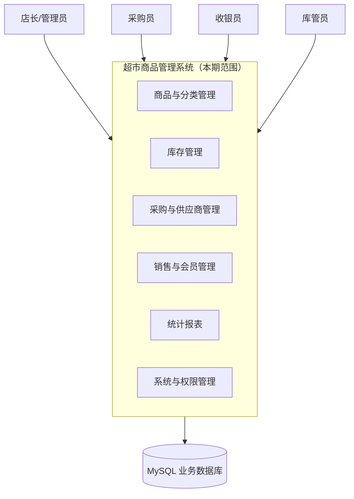

六大子系统构成完整业务闭环：**商品档案**是主数据基础 → **采购**驱动入库 → **库存**记录实时结存 → **销售**驱动出库并关联**会员** → 全流程数据汇入**报表** → **系统与权限**为所有模块提供支撑。

#### 2.2.2 范围外（Out of Scope，本期明确不做）

| 编号 | 排除项 | 排除理由 | 替代/降级方案 |
| --- | --- | --- | --- |
| X-01 | 真实第三方支付对接（微信/支付宝支付网关） | 需企业商户资质与签约，毕业设计不具备条件 | 结算时**登记收款方式**（现金/银行卡/移动支付/会员储值），金额由收银员录入，系统只做记录与对账统计 |
| X-02 | 连锁多门店与总部数据下发 | 单门店场景，多门店会显著放大数据模型与权限复杂度 | 数据模型预留门店维度（NFR-EXT-02），本期恒为默认值 |
| X-03 | 电子秤硬件对接（读数自动采集） | 需串口/网口协议与实体硬件 | 称重商品在收银页**手工录入净重**，系统按"单价 × 净重"计算金额（IR-HW-03） |
| X-04 | 小票打印机 ESC/POS 指令驱动 | 硬件依赖强，跨型号适配成本高 | 提供浏览器打印样式的**小票预览页**（IR-HW-02）；预留打印服务扩展接口 |
| X-05 | 财务总账、应收应付核销、税务申报 | 属独立财务系统职责，超出商品管理范畴 | 采购单/销售单记录**结算状态与金额**，可导出流水供财务离线处理 |
| X-06 | 优惠券、满减、秒杀、拼团等复杂促销 | 促销引擎规则复杂，与核心业务闭环无关 | 仅支持**会员等级折扣**、**单品限时促销价**与**店长整单折扣**三类简单优惠 |
| X-07 | 商品批次/有效期/先进先出成本核算 | 批次管理需增加批次维度库存表与出入库批次绑定 | 采用**移动加权平均成本**（BR-INV-06）；批次管理列为扩展项（见 Q-05） |
| X-08 | 移动端 App / 小程序 | 前端工作量翻倍 | 响应式 Web 页面，平板浏览器可直接使用收银界面 |
| X-09 | 供应商门户（供应商自助下单/对账） | 需外网暴露与多方账号体系 | 采购单可导出/打印，线下发送给供应商 |
| X-10 | 与既有商业 POS/ERP 的数据迁移工具 | 无既有系统可对接 | 提供 Excel 模板批量导入（FR-GOODS-11、FR-MEM-03） |
| X-11 | 离线收银与断网续传 | 需本地数据库、冲突合并等复杂机制 | 断网时禁用结算并保留已录入明细（UC-SALE-001 E9）；假设内网稳定（A-03） |

#### 2.2.3 系统上下文

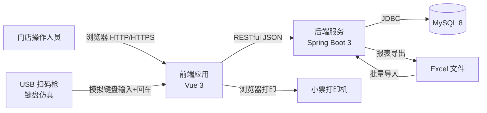

**说明**：本系统**不与任何外部业务系统实时集成**，无消息队列、无第三方 API 调用。扫码枪采用键盘仿真模式，对系统而言等价于"快速输入条码字符串后回车"，无需硬件 SDK（详见 IR-HW-01）。这一边界设定显著降低了实现风险，也使系统可完全在内网自足运行。

### 2.3 用户角色与职责

系统采用 RBAC 模型，预设 5 个角色。角色可由超级管理员增删改，权限可重新分配（FR-SYS-04、FR-SYS-05）。

| 角色代码 | 角色名称 | 典型岗位 | 核心职责 | 主要访问模块 |
| --- | --- | --- | --- | --- |
| SUPER_ADMIN | 超级管理员 | 系统运维/店主 | 系统初始化、用户与角色管理、权限分配、数据字典与参数维护、日志审计 | 全部（含系统管理） |
| MANAGER | 店长 | 门店负责人 | 经营全局查看、报表分析、价格与促销管理、采购与盘点审核、退货授权、供应商准入 | 报表、商品、库存、采购、销售、会员 |
| PURCHASER | 采购员 | 采购岗位 | 供应商维护、编制与提交采购单、跟踪到货、处理采购退货、处理缺货预警 | 采购、供应商、商品（查看）、库存（查看） |
| KEEPER | 库管员 | 仓储岗位 | 采购入库验收、报损报溢登记、库存盘点执行、预警处理 | 库存、采购入库、商品（查看） |
| CASHIER | 收银员 | 收银岗位 | 收银结算、退换货办理、会员查询与注册、交班对账 | 销售收银、会员（查询/注册） |

**角色互斥与职责分离原则（BR-SYS-01）**：

1. 采购单的**创建人**与**入库验收人**应为不同用户，避免"自采自验"造成账实不符与舞弊风险。系统在入库确认时校验操作人 ≠ 采购单创建人；若为同一人，按系统参数决定拒绝或放行并记录异常日志。
2. 盘点单的**盘点人**与**审核人**必须为不同用户；审核通过后才生成库存调整流水。
3. 销售退货金额超过阈值时须**店长授权**，授权人不得为退货发起人。
4. 超级管理员默认不参与日常业务操作；其对业务数据的任何修改必须留操作日志。

### 2.4 运行环境

#### 2.4.1 服务端环境

| 项目 | 要求 | 说明 |
| --- | --- | --- |
| 操作系统 | Windows 10/11、Windows Server 2016+、CentOS 7+ 或 Ubuntu 20.04+ | 单门店多为 Windows；开发阶段使用 Windows |
| JDK | OpenJDK 17（LTS） | Spring Boot 3.x 最低要求 Java 17 |
| 应用框架 | Spring Boot 3.2.x | Web、Validation、Security、AOP、Scheduling |
| 持久层 | MyBatis-Plus 3.5.x | 单表 CRUD 由框架生成，复杂统计用自定义 XML |
| 数据库 | MySQL 8.0.x | InnoDB 引擎，utf8mb4 字符集 |
| 连接池 | HikariCP | Spring Boot 默认 |
| 缓存 | Caffeine 本地缓存 | 数据字典、分类树、系统参数等低频变更数据；Redis 列为扩展（NFR-EXT-03） |
| 构建工具 | Maven 3.8+ | 依赖管理与打包 |
| 部署形态 | 可执行 JAR 单机部署，或 Docker Compose | 内存 ≥ 2 GB，磁盘 ≥ 20 GB |

#### 2.4.2 客户端环境

| 项目 | 要求 |
| --- | --- |
| 浏览器 | Chrome 100+ / Edge 100+ / Firefox 100+，最低分辨率 1366×768 |
| 收银端 | 建议 1920×1080 及以上，支持触屏操作（按钮尺寸 ≥ 44×44 px） |
| 前端技术 | Vue 3 + Vite + TypeScript + Element Plus + Pinia + Vue Router + Axios + ECharts |
| 网络 | 门店局域网，客户端至服务器带宽 ≥ 10 Mbps，RTT ≤ 10 ms |

### 2.5 设计与实现约束

| 编号 | 约束类型 | 约束内容 |
| --- | --- | --- |
| C-01 | 技术栈 | 后端采用 Spring Boot 3.x + MyBatis-Plus + MySQL 8；前端采用 Vue 3 生态；不得引入需商业授权的产品 |
| C-02 | 架构风格 | 前后端分离；后端提供 RESTful JSON API，不渲染页面；前端为独立构建产物，由 Nginx 或后端静态资源目录托管 |
| C-03 | 分层结构 | 后端严格分层 Controller → Service → Mapper，禁止 Controller 直接访问 Mapper；跨模块调用必须通过 Service 接口 |
| C-04 | 数据一致性 | 涉及多表写入的业务（结算、入库、盘点审核、退货）必须在单个数据库事务内完成，遵循 ACID |
| C-05 | 开源许可 | 第三方组件许可证须为 Apache-2.0 / MIT / BSD 等宽松许可，禁止 GPL 传染性许可组件进入发布包 |
| C-06 | 编码规范 | 遵循《阿里巴巴 Java 开发手册》；前端遵循 ESLint + Prettier 规则 |
| C-07 | 数据合规 | 会员手机号、姓名属个人信息，按角色脱敏展示（BR-SYS-08）；本期不采集身份证号等敏感证件信息 |
| C-08 | 时间与金额 | 全系统统一时区 Asia/Shanghai；时间精度到秒；金额精度到分，使用定点数（decimal）而非浮点数 |
| C-09 | 工作量约束 | 单人开发，总工期约 16 周，其中编码与联调 8 周；Must 级需求须在第 12 周前完成并可演示 |
| C-10 | 交付物 | 源代码、可执行部署包、数据库脚本、需求/设计/测试文档、毕业论文、答辩演示环境 |

### 2.6 假设与依赖

| 编号 | 假设/依赖 | 若不成立的影响 |
| --- | --- | --- |
| A-01 | 超市为单门店、单库房，不存在跨仓调拨 | 需增加仓库/门店维度，库存模型重构 |
| A-02 | 商品量级 5,000~20,000 SKU；日销售单 500~2,000 笔；年库存流水 50 万~200 万条 | 超出该量级需引入分库分表/OLAP，非本期设计目标 |
| A-03 | 营业期间网络与电力稳定，服务器为门店内单机部署 | 需设计离线收银与数据同步（见 X-11） |
| A-04 | 商品条码遵循 EAN-13 或店内码规则，扫码枪为 USB 键盘仿真模式 | 需硬件协议对接，超出本期能力 |
| A-05 | 操作人员在营业前完成商品档案初始化，可接受首次批量导入的人工校对成本 | 上线周期延长 |
| A-06 | 存货成本采用移动加权平均法，符合小微企业会计处理的简化要求 | 若要求批次实际成本法，需引入批次库存表（见 X-07） |
| A-07 | 系统不面向互联网公开，仅门店内网访问 | 需强化安全设计（WAF、限流、验证码升级） |

---

## 3. 需求建模

### 3.1 系统总体用例图

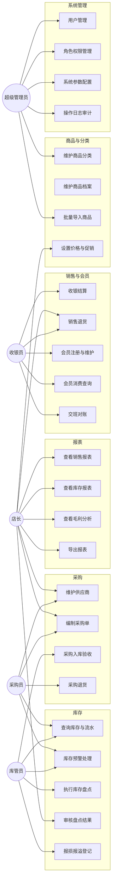

### 3.2 子系统用例图

#### 3.2.1 商品与分类管理

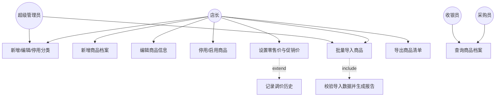

#### 3.2.2 库存管理

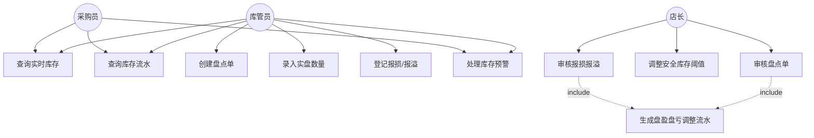

#### 3.2.3 采购与供应商管理

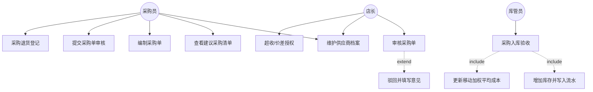

#### 3.2.4 销售与会员管理

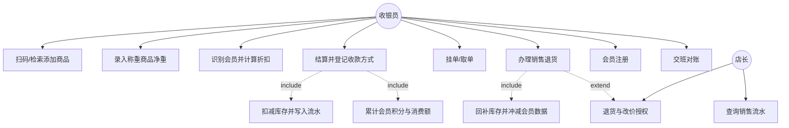

#### 3.2.5 报表与系统管理

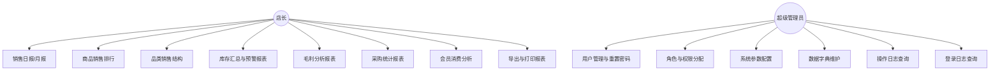

### 3.3 核心用例描述

以下对 7 个核心用例给出规范化描述。查询类、导出类等简单用例直接在第 4 章以功能需求条目形式说明，避免文档冗余。

---

#### UC-GOODS-001 新增商品档案

| 项目 | 内容 |
| --- | --- |
| 用例编号 | UC-GOODS-001 |
| 用例名称 | 新增商品档案 |
| 参与角色 | 超级管理员、店长 |
| 优先级 | Must |
| 关联需求 | FR-GOODS-01 ~ FR-GOODS-08 |
| 简要说明 | 录入一条新商品的完整档案信息，使其可被采购、销售与库存模块引用 |

**前置条件**

1. 操作人已登录且拥有"商品管理—新增"权限。
2. 目标商品所属分类已存在且状态为启用；若不存在须先维护分类。
3. 计量单位、品牌等基础字典数据已配置。

**基本事件流**

1. 操作人进入"商品管理 → 商品列表"，点击【新增】。
2. 系统打开商品录入表单，自动生成待用商品编码（允许手工覆盖）。
3. 操作人填写基本信息：商品名称、所属分类、品牌、计量单位、商品条码、规格、产地。
4. 操作人填写价格信息：进货参考价、零售单价、会员价（可选）、促销价与生效区间（可选）。
5. 操作人填写库存控制信息：初始库存数量、安全库存下限、库存上限（可选）。
6. 操作人选择商品属性：是否称重商品、是否允许退货、PLU 码、是否启用、备注，并可上传商品图片。
7. 操作人点击【保存】。
8. 系统按 BR-GOODS-01 ~ BR-GOODS-05 校验数据合法性与唯一性。
9. 校验通过后，系统在单事务内写入商品档案与库存结存记录；若初始库存 > 0，同时写入一条类型为"期初建账"的库存流水。
10. 系统提示"保存成功"，返回商品列表并定位到新记录。

**分支事件流**

- **3a. 勾选"称重商品"**：系统限定计价单位必须为重量单位（kg/g），并强制要求录入 PLU 码；收银时该商品必须录入净重（见 UC-SALE-001 异常流 E3）。
- **4a. 录入促销价**：系统校验促销价 < 零售单价且开始时间 < 结束时间；保存后该商品在促销期内收银自动取促销价（BR-GOODS-04）。
- **5a. 初始库存为 0**：系统仅创建档案，不生成库存流水；库存状态标记为"缺货"，立即进入预警列表。
- **6a. 上传商品图片**：限制 jpg/png、单张 ≤ 2 MB；上传失败不阻断档案保存，仅提示图片未保存（IR-SW-05）。

**异常事件流**

| 异常 | 系统响应 |
| --- | --- |
| E1 商品条码已被占用 | 拒绝保存，高亮条码字段，提示"条码 6901234567892 已被商品【XX 牛奶 250ml】占用" |
| E2 商品编码重复 | 拒绝保存，提供【重新生成编码】按钮 |
| E3 必填项为空或格式非法 | 前端即时校验 + 后端二次校验，逐项标红并给出具体错误文案 |
| E4 零售单价 ≤ 0 或进货参考价 < 0 | 拒绝保存，提示合法取值范围 |
| E5 所属分类已停用或非叶子分类 | 拒绝保存，提示"请选择启用状态的末级分类" |
| E6 称重商品未选重量单位或未填 PLU | 拒绝保存，定位到对应字段 |
| E7 保存过程中数据库异常 | 事务回滚，档案与库存均不落库，提示"保存失败，请重试"并记录错误日志 |
| E8 无操作权限 | 前端隐藏入口；若直接调用接口返回 403 并记录越权访问日志（BR-SYS-05） |

**后置条件**

1. 商品档案持久化，状态为"启用"。
2. 若初始库存 > 0，库存结存数量等于初始库存，且存在对应"期初建账"流水（满足 BR-INV-01、BR-INV-08）。
3. 生成一条操作日志（操作人、时间、IP、动作"新增商品"、目标商品编码）。

**业务规则引用**：BR-GOODS-01 ~ BR-GOODS-07、BR-INV-01、BR-SYS-05

---

#### UC-PUR-001 采购入库验收

| 项目 | 内容 |
| --- | --- |
| 用例编号 | UC-PUR-001 |
| 用例名称 | 采购入库验收 |
| 参与角色 | 库管员（主）、店长（异常授权） |
| 优先级 | Must |
| 关联需求 | FR-PUR-06 ~ FR-PUR-09、FR-INV-02、FR-INV-04 |
| 简要说明 | 供应商送货到店后，库管员依据已审核采购单核对实物，确认实收数量并入库；系统自动增加库存、更新成本单价与采购单状态 |

**前置条件**

1. 存在状态为"已审核待入库"或"部分入库"的采购单。
2. 采购单内商品档案存在（停用商品允许入库以闭环历史单据，但需提示）。
3. 操作人拥有"采购入库"权限。

**基本事件流**

1. 库管员进入"采购管理 → 待入库单"，按单号/供应商/日期检索并打开目标采购单。
2. 系统展示采购明细：商品、订购数量、已入库数量、待入库数量、采购单价、本次可收上限。
3. 库管员逐项录入本次**实收数量**与**实收单价**（默认取采购单价），可录入验收备注（如"外包装破损 2 件"）。
4. 库管员录入供应商送货单号（可选）与实际到货日期。
5. 库管员点击【确认入库】。
6. 系统校验：实收数量 ≥ 0；实收数量 ≤ 待入库数量 × (1 + 超收容差)（BR-PUR-04）；操作人 ≠ 采购单创建人（BR-SYS-01）；单据状态合法。
7. 系统在**单个事务**内依次执行：
   - 7.1 生成入库单，状态"已完成"，记录操作人与时间；
   - 7.2 为每个实收数量 > 0 的明细写入一条类型为"采购入库"的库存流水（数量为 +实收数量）；
   - 7.3 更新商品库存结存数量；
   - 7.4 按移动加权平均法重算并更新商品成本单价（BR-INV-06）；
   - 7.5 累加采购单已入库数量，更新采购单状态（全部入库 → "已完成"，部分 → "部分入库"）与实收金额；
   - 7.6 更新供应商累计采购额与最近合作时间；
   - 7.7 递增采购单版本号（乐观锁）。
8. 系统提示"入库成功"，展示入库单号，并提供【打印入库单】入口。

**分支事件流**

- **3a. 实收数量 < 待入库数量（短少）**：采购单状态置为"部分入库"，剩余数量保留可继续入库；库管员填写短少原因。
- **3b. 实收数量为 0**：该明细不产生库存流水，采购单状态不变。
- **3c. 实收单价与采购单价不一致**：容差内（默认 ±5%）直接允许；超出容差需店长授权（BR-PUR-05），实际入库成本按实收单价计算（BR-PUR-07）。
- **3d. 部分明细暂不验收**：库管员可只填写部分行，未填写行视为本次未收货。

**异常事件流**

| 异常 | 系统响应 |
| --- | --- |
| E1 采购单状态非"已审核待入库/部分入库" | 拒绝操作，提示当前状态与该状态下允许的操作 |
| E2 实收数量超过容差上限 | 拒绝保存，提示允许的最大实收数量，引导联系采购员修改采购单或走店长授权 |
| E3 商品档案已停用 | 该行标黄警告，允许入库以闭环单据，但提示"该商品已停用，入库后不可销售" |
| E4 并发操作同一采购单 | 版本号乐观锁冲突，后提交者收到"单据已被他人处理，请刷新后重试"（BR-PUR-06） |
| E5 事务执行中任一步失败 | 全部回滚，库存、成本、单据状态均不变，提示失败原因并记录错误日志（NFR-REL-01） |
| E6 操作人 = 采购单创建人 | 记录"职责未分离"异常日志；若系统参数开启强校验则拒绝，需店长账号授权后继续 |

**后置条件**

1. 库存结存数量增加，且存在与之匹配的库存流水（数量、时间、单据号、操作人可追溯）。
2. 商品移动加权平均成本单价被更新。
3. 采购单已入库数量、实收金额、状态、版本号被更新。
4. 供应商累计采购额被更新。
5. 生成入库单记录与操作日志；BR-INV-08 一致性不变式仍成立。

**业务规则引用**：BR-PUR-01 ~ BR-PUR-07、BR-INV-06、BR-INV-08、BR-SYS-01

---

#### UC-SALE-001 收银结算

| 项目 | 内容 |
| --- | --- |
| 用例编号 | UC-SALE-001 |
| 用例名称 | 收银结算 |
| 参与角色 | 收银员（主）、顾客（外部参与者）、店长（异常授权） |
| 优先级 | Must |
| 关联需求 | FR-SALE-01 ~ FR-SALE-07、FR-MEM-05、FR-MEM-07、FR-INV-04 |
| 简要说明 | 收银员将顾客选购的商品逐条录入销售单，识别会员并计算优惠，确认金额后登记收款完成结算；系统扣减库存、写入流水并更新会员数据 |

**前置条件**

1. 收银员已登录并进入收银台界面，已选择/绑定当前收银台编号。
2. 存在状态为"启用"且有可销库存的商品档案。
3. 若启用班次管理，当前营业日已开班（FR-SALE-12）。

**基本事件流**

1. 收银员在收银台商品录入框（自动聚焦）使用扫码枪扫描商品条码。
2. 系统按条码精确匹配商品，追加到销售明细：数量默认 1，单价按 BR-GOODS-04 取当前生效售价（促销价 > 会员价 > 零售价）。
3. 系统实时刷新明细行小计与订单汇总（件数、商品总额、优惠金额、应收金额）。
4. 重复步骤 1~3 录入其余商品；收银员可修改数量、删除明细行、整单清空。
5. 收银员点击【会员】，通过手机号/会员编号检索会员，选中后系统显示会员姓名、等级、当前积分与折扣率。
6. 系统按 BR-MEM-04 重算全单优惠金额与应收金额。
7. 收银员核对金额后点击【结算】。
8. 系统弹出结算面板显示应收金额；收银员选择收款方式（现金/银行卡/移动支付/会员储值，可组合）并录入实收金额。
9. 系统校验库存充足性（BR-INV-02）与"实收金额 ≥ 应收金额"，计算找零。
10. 收银员确认，系统在**单个事务**内执行：
    - 10.1 生成销售单（状态"已完成"）与销售明细，快照成交单价、折扣率、成本单价与毛利额（BR-SALE-04）；
    - 10.2 逐行执行条件更新扣减库存（BR-INV-03），并为每行写入类型为"销售出库"的库存流水（数量为 −销售数量）；
    - 10.3 写入收款记录（一单可多条）；
    - 10.4 若关联会员：累加累计消费额与消费次数，按 BR-MEM-05 计算并累加积分，写入积分流水，触发等级重算（FR-MEM-06）；
    - 10.5 记录收银员、收银台、班次、结算时间、营业日归属（BR-RPT-02）。
11. 系统提示"结算成功"，显示销售单号与找零金额，跳转小票预览页供打印。
12. 收银台自动重置为空白单，录入框重新聚焦，准备下一位顾客。

**分支事件流**

- **1a. 无扫码枪或条码破损**：收银员通过名称模糊/拼音首字母/编码/PLU 码检索，或浏览分类树点选商品（FR-SALE-02）。
- **2a. 同一商品重复扫码**：系统累加该行数量而非新增行，并给出高亮反馈（BR-SALE-01）。
- **5a. 散客（非会员）**：跳过会员识别，按零售价/促销价计算，销售单会员字段为空。
- **5b. 顾客现场注册会员**：在结算面板内跳转 UC-MEM-001 完成注册后返回，会员信息自动带入当前单。
- **7a. 挂单**：顾客临时离开时点击【挂单】，系统将当前明细暂存并清空收银台；后续通过【取单】恢复（FR-SALE-08）。挂单不扣减库存、不计入报表（BR-RPT-03）。
- **8a. 组合收款**：支持一单多种收款方式，系统分别记录并校验各方式金额之和 ≥ 应收金额；储值方式金额上限为当前余额。
- **6a. 店长整单折扣**：店长账号可施加整单折扣率或单品改价并填写原因，系统记录授权人与折前折后金额（FR-SALE-07、BR-SALE-05）。

**异常事件流**

| 异常 | 系统响应 |
| --- | --- |
| E1 条码无法匹配任何商品 | 提示"未找到条码 XXX 对应的商品"，允许手工检索；或按【无码商品】临时登记金额（不关联 SKU、不扣库存，单据标记"非档案商品"，FR-SALE-13，Could 级） |
| E2 商品状态为停用 | 拒绝加入销售单，提示"该商品已停售" |
| E3 称重商品 | 弹出净重输入框，收银员录入净重（kg，3 位小数），金额 = 单价 × 净重，四舍五入到分（BR-GOODS-05） |
| E4 库存不足 | 结算被拒绝，明细行标红并提示当前可售数量；收银员可减少数量或移除该行；是否允许负库存由系统参数控制（默认禁止，BR-INV-02） |
| E5 实收金额 < 应收金额 | 拒绝提交结算，提示差额数值 |
| E6 并发扣减同一商品库存 | 条件更新受影响行数为 0 时判定库存不足，回滚整单并提示收银员重新确认数量（BR-INV-03、NFR-PERF-04） |
| E7 会员储值余额不足 | 该收款方式可录入金额上限为余额，提示改用其他方式补足 |
| E8 结算事务中途失败 | 全部回滚，销售单与库存均不落库；收银台**保留已录入明细**，避免收银员重复扫码（NFR-REL-01） |
| E9 网络中断 | 前端提示离线并禁用结算按钮，已录入明细保存在浏览器会话中，恢复后可继续；本期不支持离线收银（X-11） |
| E10 重复提交（用户连点或网络重发） | 前端按钮提交后立即禁用；后端按请求令牌/唯一约束拦截重复单据（NFR-REL-02） |

**后置条件**

1. 生成状态为"已完成"的销售单及明细，单号唯一、时间精确到秒。
2. 相关商品库存结存减少，并生成对应"销售出库"流水；BR-INV-08 成立。
3. 若关联会员，其累计消费额、消费次数、积分、等级被更新，并生成积分流水。
4. 收款记录落库，各方式金额之和等于实收金额。
5. 生成操作日志（收银员、收银台、单号、金额）；该单据计入当日销售报表。

**业务规则引用**：BR-GOODS-04、BR-GOODS-05、BR-INV-02、BR-INV-03、BR-MEM-04、BR-MEM-05、BR-SALE-01 ~ BR-SALE-04、BR-RPT-02

---

#### UC-SALE-002 销售退货

| 项目 | 内容 |
| --- | --- |
| 用例编号 | UC-SALE-002 |
| 用例名称 | 销售退货 |
| 参与角色 | 收银员（发起）、店长（授权） |
| 优先级 | Must |
| 关联需求 | FR-SALE-10、FR-SALE-11、FR-INV-02、FR-MEM-02 |

**前置条件**

1. 存在状态为"已完成"且未全额退货的原销售单。
2. 退货发生在原单结算后 N 天内（系统参数，默认 7 天，BR-SALE-05）。
3. 操作人拥有退货权限；仅可操作本人经手的单据（BR-SALE-09），跨人/跨班次需店长权限。

**基本事件流**

1. 收银员按小票单号 / 会员手机号 / 时间范围检索原销售单并打开。
2. 系统展示原单明细及每行"可退数量"（= 销售数量 − 已退数量）。
3. 收银员勾选退货商品并录入退货数量（≤ 可退数量）。
4. 收银员选择退货原因（质量问题/顾客不满意/误操作/商品过期/其他）并填写说明。
5. 系统计算退款金额：按原单**实际成交单价**（含折扣后）计算，不按当前售价（BR-SALE-06）；同时按原明细成本快照计算回冲成本。
6. 若退款金额 > 授权阈值（默认 200 元）或原因为"误操作"，系统要求店长账号授权（输入账号密码或扫码确认），并校验授权人 ≠ 发起人（BR-SYS-01）。
7. 收银员选择退款方式（原路退回/现金退款/退至会员储值）。
8. 系统在**单个事务**内执行：生成退货单（关联原销售单）→ 写入"退货入库"库存流水（+数量）→ 增加库存结存 → 按成本快照回冲库存成本 → 若原单关联会员则扣减累计消费额与积分（BR-MEM-08）并写入积分流水 → 更新原销售单已退数量与退货状态 → 记录操作人与授权人。
9. 系统提示退货成功，生成退货单号并可打印退货凭证。

**分支事件流**

- **3a. 整单退货**：勾选全部明细行，退货完成后原单状态置为"全部退货"。
- **7a. 退至会员储值**：生成储值流水，余额增加；散客单不可选此项。
- **5a. 部分行退货 + 部分行不退**：原单状态置为"部分退货"，剩余可退数量保留。

**异常事件流**

| 异常 | 系统响应 |
| --- | --- |
| E1 退货数量超过可退数量 | 拒绝，提示该行已退数量与剩余可退数量 |
| E2 原单超过退货有效期 | 拒绝并提示截止日期；店长可越权处理，越权行为留痕（BR-SALE-05） |
| E3 授权失败或授权被取消 | 退货单不生成，已录入明细保留可继续处理 |
| E4 商品"不允许退货"（生鲜/散装等） | 该行不可勾选，提示原因（BR-SALE-07） |
| E5 会员积分已被使用导致扣减后为负 | 积分扣至 0，差额记入会员异常记录，不阻断退货（BR-MEM-05） |
| E6 事务失败 | 全部回滚，退货单与库存均不变，提示重试 |

**后置条件**

1. 退货单落库并关联原销售单；原单已退数量与退货状态被更新。
2. 库存结存增加，存在"退货入库"流水；BR-INV-08 成立。
3. 会员累计消费额与积分被冲减（若为会员单）。
4. 生成操作日志（含发起人与授权人）；退货额计入当日报表冲减项（BR-RPT-01）。

**业务规则引用**：BR-SALE-05 ~ BR-SALE-09、BR-MEM-08、BR-INV-04、BR-INV-08、BR-SYS-01

---

#### UC-INV-001 库存盘点与审核

| 项目 | 内容 |
| --- | --- |
| 用例编号 | UC-INV-001 |
| 用例名称 | 库存盘点与审核 |
| 参与角色 | 库管员（盘点执行）、店长（审核） |
| 优先级 | Must |
| 关联需求 | FR-INV-07 ~ FR-INV-10 |
| 简要说明 | 库管员按范围创建盘点单并录入实物数量，系统计算盈亏差异；店长审核后生成库存调整流水，使账面库存与实物一致 |

**前置条件**

1. 库管员拥有"盘点管理—新增/录入"权限，店长拥有"盘点管理—审核"权限。
2. 待盘点商品档案存在。
3. 该盘点范围内不存在其他未审核完成的盘点单（BR-INV-09）。

**基本事件流（阶段一：创建与录入）**

1. 库管员进入"库存管理 → 盘点单"，点击【新建盘点】。
2. 选择盘点范围：全店 / 指定分类（含子分类）/ 指定商品 / 库存预警商品；系统按范围**快照账面数量**并记录盘点基准时间。
3. 库管员保存盘点单，状态置为"盘点中"。
4. 库管员逐项录入实盘数量，支持扫码定位商品行与 Excel 批量导入实盘数。
5. 系统实时计算每行差异：`差异数量 = 实盘数量 − 账面数量`，`差异金额 = 差异数量 × 当前成本单价`；汇总盘盈总额与盘亏总额。
6. 库管员对差异 ≠ 0 的行填写差异原因（自然损耗/破损/过期/录单错误/失窃/其他）。
7. 库管员点击【提交审核】，状态置为"待审核"。

**基本事件流（阶段二：审核与调整）**

8. 店长进入"待审核盘点单"，查看盘点范围、差异汇总、逐行差异与原因，以及"盘点期间发生 N 笔出入库"提示（BR-INV-10）。
9. 店长选择【审核通过】或【驳回】；驳回须填写意见，单据退回"盘点中"，可修改后重新提交。
10. 审核通过后，系统在**单个事务**内执行：
    - 10.1 盘点单状态置为"已审核"，记录审核人、审核时间、审核意见；
    - 10.2 对每个差异 ≠ 0 的明细写入库存流水，类型为"盘盈调整"（正）或"盘亏调整"（负）；
    - 10.3 将商品库存结存覆盖为实盘数量；
    - 10.4 盘亏按当前成本单价结转损耗成本，盘盈按当前成本单价入账；
    - 10.5 生成盘点差异汇总记录，供损耗率报表统计。
11. 系统提示审核完成，展示调整后的库存变化摘要，并提供打印盘点差异表。

**分支事件流**

- **2a. 范围内商品数量庞大**：系统分批生成明细并显示进度；盘点单可分多次录入、分次保存。
- **4a. 部分商品未录入实盘数**：提交审核时系统提示未盘行数，允许"按账面数确认"（视为无差异）或返回继续录入。
- **4b. 盘点中发现档案外实物**：本期不处理（须先建档），在盘点单备注中说明。

**异常事件流**

| 异常 | 系统响应 |
| --- | --- |
| E1 盘点期间库存发生变动（销售/入库） | 系统保留账面快照，审核时以**实盘数量**覆盖结存，并在盘点单标注"盘点期间发生 N 笔出入库"，提示审核人复核差异原因合理性（BR-INV-10）。本期不做盘点锁库（营业中盘点为常态） |
| E2 审核人 = 盘点人 | 拒绝审核，提示职责分离要求（BR-SYS-01）；超级管理员可代为审核并留痕 |
| E3 实盘数量为负数或非数字 | 前后端双重校验，拒绝提交并定位错误行 |
| E4 已审核盘点单再次修改 | 拒绝，已审核单据只读；如需修正须新建盘点单（BR-INV-04 同源原则） |
| E5 审核事务失败 | 全部回滚，盘点单保持"待审核"，库存不变，提示重试 |
| E6 重复创建同范围盘点单 | 拒绝并提示已存在的盘点单号（BR-INV-09） |

**后置条件**

1. 盘点单状态为"已审核"，完整记录盘点人、审核人、时间与差异明细。
2. 相关商品库存结存等于实盘数量，并存在对应盘盈/盘亏流水。
3. BR-INV-08 一致性不变式仍成立。
4. 生成操作日志与盘点差异统计数据，可供损耗率报表使用。

**业务规则引用**：BR-INV-04、BR-INV-08 ~ BR-INV-12、BR-SYS-01

---

#### UC-INV-002 库存预警处理与建议采购

| 项目 | 内容 |
| --- | --- |
| 用例编号 | UC-INV-002 |
| 用例名称 | 库存预警处理与建议采购 |
| 参与角色 | 采购员、库管员、店长 |
| 优先级 | Should |
| 关联需求 | FR-INV-05、FR-INV-06、FR-PUR-02、FR-RPT-04 |

**前置条件**：商品档案已配置安全库存下限；系统参数（K 倍数、统计天数 N、默认提前期）已配置。

**基本事件流**

1. 系统在每次库存变动后（或定时任务，间隔 ≤ 5 分钟）比对商品结存与其安全库存下限、上限。
2. 判定库存状态：结存 = 0 → "缺货"；0 < 结存 ≤ 下限 → "预警"；结存 ≥ 上限 → "积压"；其余 → "正常"。
3. 预警商品进入"库存预警"列表，并在首页看板以待办角标提示相关角色（FR-RPT-01）。
4. 系统按 BR-INV-07 计算建议采购量：`建议采购量 = ceil(安全库存 × K + 近 N 日日均销量 × 采购提前期 − 当前结存 − 在途采购量)`。
5. 采购员打开建议采购清单，可查看每个商品的计算依据（当前库存、日均销量、在途量、提前期），保证结果**可解释**。
6. 采购员勾选需补货的商品行，可修改数量与供应商。
7. 点击【生成采购单】，系统按供应商分组，为每个供应商生成一张草稿采购单（明细含商品、建议数量、最近采购单价）。
8. 采购员补充预计到货日期等信息后提交审核，进入采购审核与入库流程。

**分支事件流**

- **4a. 积压预警**：系统给出"暂停采购"提示并纳入滞销分析（FR-RPT-03），不生成建议采购量。
- **6a. 修改建议数量**：系统保留原建议值与修改值，便于事后评估建议准确性。

**异常事件流**

| 异常 | 系统响应 |
| --- | --- |
| E1 商品无关联供应商 | 该行标记"待指定供应商"，不可直接生成采购单，引导先维护供应商商品关联（FR-SUP-04） |
| E2 商品已停用 | 不出现在预警列表 |
| E3 建议采购量计算结果 ≤ 0 | 不列入清单 |
| E4 在途采购量统计异常 | 以"已审核未入库"采购单的待入库数量为准；若为 0 需在界面明示，避免采购员误判 |

**后置条件**：预警状态可查、建议采购量及其计算依据可解释、草稿采购单已生成并可继续流转。

**业务规则引用**：BR-INV-07、BR-INV-12、BR-PUR-01

---

#### UC-MEM-001 会员注册

| 项目 | 内容 |
| --- | --- |
| 用例编号 | UC-MEM-001 |
| 用例名称 | 会员注册 |
| 参与角色 | 收银员、店长 |
| 优先级 | Must |
| 关联需求 | FR-MEM-01 ~ FR-MEM-05 |

**前置条件**：操作人拥有会员新增权限；会员等级规则与折扣率已在系统中配置。

**基本事件流**

1. 收银员进入会员模块点击【新增会员】，或在收银台结算流程中点击【注册会员】。
2. 录入手机号（必填）、姓名（必填）、性别、生日、地址、备注。
3. 系统校验手机号格式（BR-MEM-01）与唯一性。
4. 系统自动生成会员编号（BR-MEM-02），初始等级为"普通会员"，初始积分 0、储值余额 0、累计消费额 0。
5. 操作人确认保存，系统展示会员信息卡；若从收银台进入，自动回填会员信息到当前销售单并重新计算折扣。

**分支事件流**

- **3a. 手机号已存在**：系统直接展示既有会员信息，询问是否为同一人；若是则取消注册并选用既有会员，若为家人共用可继续（提示共用风险）。
- **2a. 顾客不愿提供手机号**：本期不支持无手机号会员（手机号为主要识别键），引导使用散客结算。

**异常事件流**

| 异常 | 系统响应 |
| --- | --- |
| E1 手机号格式非法 | 拒绝保存，提示"请输入 11 位有效手机号" |
| E2 姓名为空或超长 | 拒绝保存并定位字段 |
| E3 无权限 | 前端隐藏入口，接口返回 403 并记录日志 |
| E4 保存失败 | 事务回滚，提示重试；收银台当前单明细不受影响 |

**后置条件**：会员档案建立，可在收银结算中被检索与识别；生成操作日志。

**业务规则引用**：BR-MEM-01 ~ BR-MEM-04、BR-MEM-08、BR-SYS-05

### 3.4 关键业务流程图

#### 3.4.1 采购入库全流程

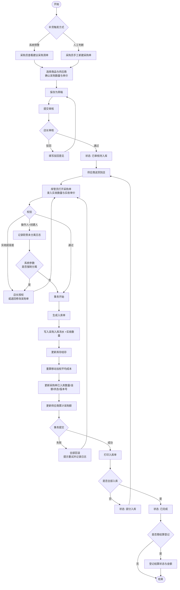

#### 3.4.2 销售收银全流程

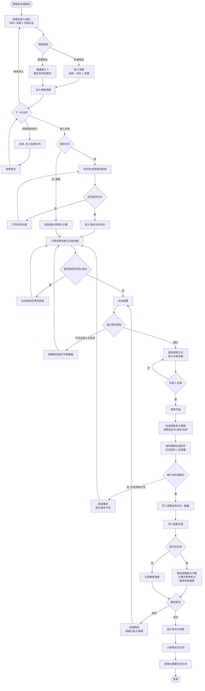

#### 3.4.3 库存盘点流程

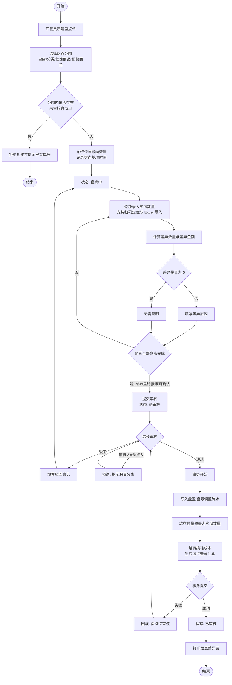

### 3.5 核心业务对象状态图

#### 3.5.1 采购单状态机

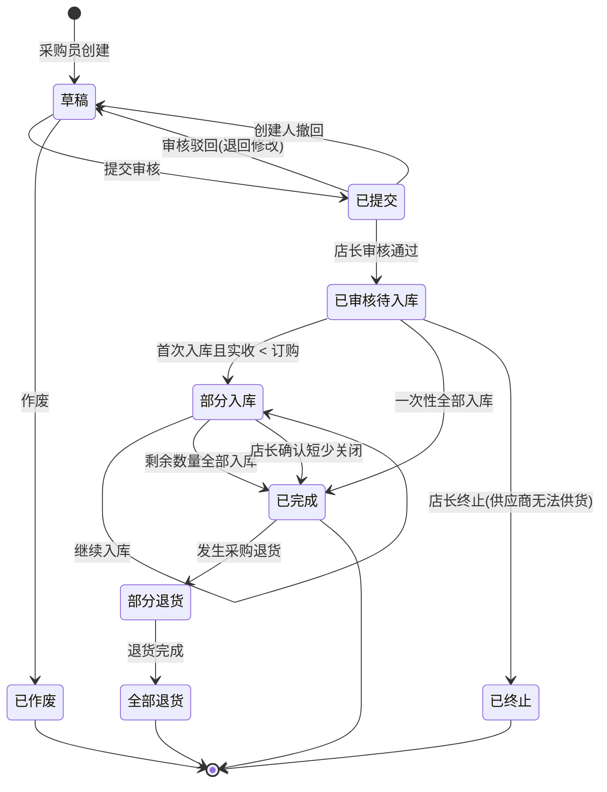

**状态—操作约束矩阵**

| 当前状态 | 允许操作 | 禁止操作 |
| --- | --- | --- |
| 草稿 | 编辑明细、删除、提交审核、作废 | 入库、退货 |
| 已提交 | 审核通过、审核驳回、创建人撤回 | 编辑明细、入库 |
| 已审核待入库 | 入库验收、终止 | 编辑数量与单价、删除 |
| 部分入库 | 继续入库、关闭短少、采购退货 | 删除、修改已入库行 |
| 已完成 | 采购退货、查看、打印、结算登记 | 任何数量与单价修改 |
| 部分退货 / 全部退货 | 继续退货（未退完时）、查看、打印 | 入库 |
| 已终止 / 已作废 | 仅查看 | 全部业务操作 |

#### 3.5.2 销售单状态机

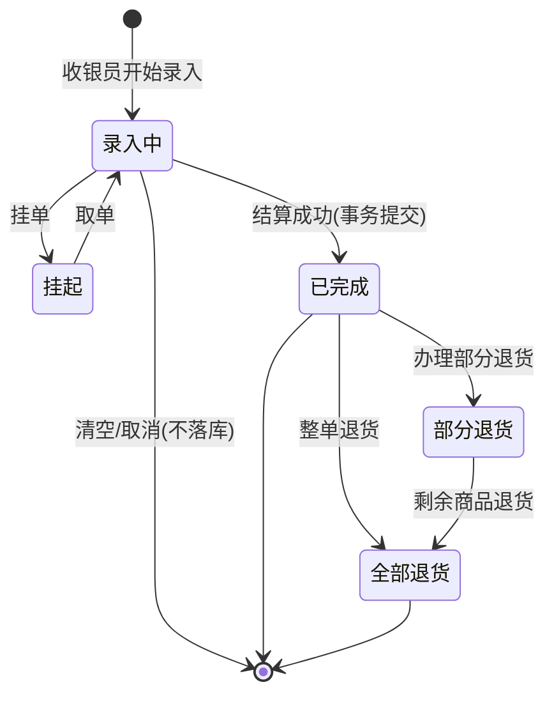

> **说明**：录入中与挂起状态的单据仅存在于会话或临时表中，不参与库存与报表统计；只有"已完成"及之后的状态才是持久化的正式销售单（BR-RPT-03）。销售单一经结算不可修改、不可删除，错误只能通过退货冲正（BR-SALE-08）。

#### 3.5.3 商品档案状态机

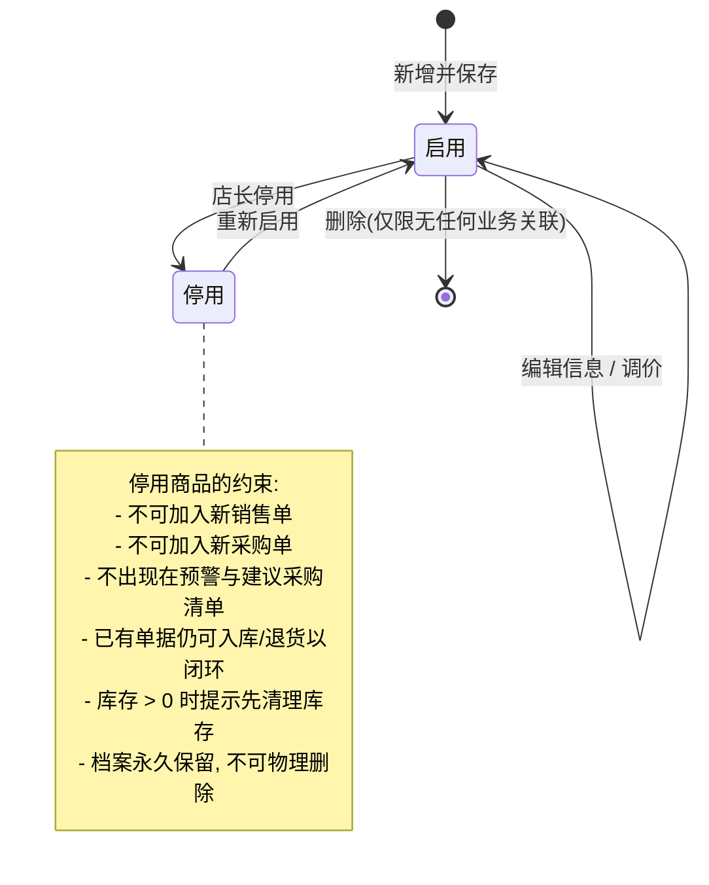

#### 3.5.4 盘点单状态机

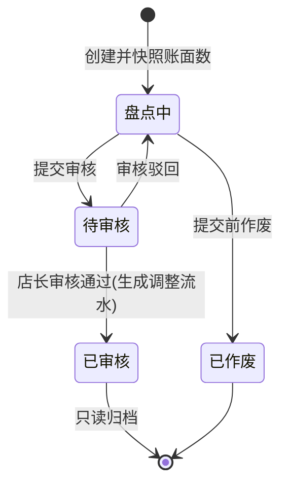

#### 3.5.5 库存流水与单据的不可变原则

库存流水、销售单、已审核盘点单、操作日志均遵循**只增不改不删**原则（BR-INV-04、BR-SALE-08、FR-SYS-08）。任何纠错都通过**新增反向记录**实现，而非修改历史记录。这一原则是系统可审计、报表可复核、数据可恢复的基础，也是本设计相较"直接改库存数字"的简易系统的关键差异。

---

## 4. 功能需求

### 4.0 功能需求总览

| 模块 | Must | Should | Could | 合计 |
| --- | --- | --- | --- | --- |
| 分类管理（CAT） | 4 | 2 | 1 | 7 |
| 商品管理（GOODS） | 9 | 3 | 1 | 13 |
| 库存管理（INV） | 8 | 2 | 2 | 12 |
| 供应商管理（SUP） | 3 | 1 | 1 | 5 |
| 采购管理（PUR） | 5 | 4 | 0 | 9 |
| 销售管理（SALE） | 9 | 3 | 1 | 13 |
| 会员管理（MEM） | 6 | 2 | 1 | 9 |
| 报表统计（RPT） | 6 | 3 | 1 | 10 |
| 系统与权限（SYS） | 9 | 1 | 1 | 11 |
| **合计** | **59** | **21** | **9** | **89** |

> **实现顺序建议**：SYS（登录鉴权与权限骨架）→ CAT + GOODS（主数据）→ INV（库存与流水）→ SUP + PUR（采购入库）→ SALE + MEM（收银销售）→ RPT（报表）。该顺序保证每一步都能形成可演示的闭环，符合 C-09 的进度约束。

### 4.1 分类管理（CAT）

商品分类采用**树形结构**，最多 3 级（一级大类 / 二级中类 / 三级小类），商品必须挂在叶子分类上（BR-CAT-04）。

| 编号 | 需求名称 | 优先级 | 需求描述 |
| --- | --- | --- | --- |
| FR-CAT-01 | 分类树查询 | Must | 以树形结构展示全部分类，支持展开/折叠、按名称关键字过滤并自动定位到命中节点；每个节点显示其下商品数量 |
| FR-CAT-02 | 新增分类 | Must | 录入分类名称、上级分类、排序号、状态；同级下名称不可重复（BR-CAT-01）；层级不超过 3 级 |
| FR-CAT-03 | 编辑分类 | Must | 修改名称、排序号、状态；修改上级分类时须校验不产生环（BR-CAT-02）、不超层级、目标父节点下无重名 |
| FR-CAT-04 | 停用/启用分类 | Must | 停用后该分类及其子分类不可被新商品选择；已有商品档案保留但在列表中提示"分类已停用" |
| FR-CAT-05 | 删除分类 | Should | 仅允许删除无子分类且无商品关联的分类；否则拒绝并提示占用情况（BR-CAT-03） |
| FR-CAT-06 | 分类排序调整 | Should | 支持拖拽或输入排序号调整同级顺序；跨级移动需二次确认并提示受影响的商品数量 |
| FR-CAT-07 | 分类经营概览 | Could | 在分类节点上直接查看该分类（含子分类汇总）的销售额、销量、库存数量与库存成本 |

**业务规则**

| 编号 | 规则内容 |
| --- | --- |
| BR-CAT-01 | 同一父分类下的子分类名称唯一；分类名称长度 1~30 字符，不含前后空格 |
| BR-CAT-02 | 分类树不允许出现环，即某分类的上级不能是它自身或它的后代节点 |
| BR-CAT-03 | 分类下存在商品（无论启用或停用）时禁止删除，只允许停用 |
| BR-CAT-04 | 分类层级上限 3 级；商品只能挂在叶子分类（无子分类的节点）上，保证品类统计口径唯一 |

### 4.2 商品管理（GOODS）

| 编号 | 需求名称 | 优先级 | 需求描述与处理逻辑 |
| --- | --- | --- | --- |
| FR-GOODS-01 | 商品档案新增 | Must | 见 UC-GOODS-001。必填：商品名称、所属分类、计量单位、零售单价、商品条码（无国标条码时可生成店内码）。选填：品牌、规格、产地、进货参考价、会员价、促销价与生效区间、图片、初始库存、安全库存下限、库存上限、是否称重、PLU 码、是否允许退货、备注 |
| FR-GOODS-02 | 商品档案编辑 | Must | 除商品编码与创建信息外均可修改；**条码修改需二次确认**并记录变更历史；**库存结存数量不可在此修改**，必须通过出入库单据（BR-INV-11）；零售价/会员价/进货价变更记录调价历史（FR-GOODS-10） |
| FR-GOODS-03 | 商品列表查询 | Must | 分页展示；支持按名称（模糊）、商品编码、条码、分类（含子分类）、品牌、状态、库存状态（正常/预警/缺货/积压）、是否称重、是否允许退货组合筛选；支持按编码/名称/库存/售价/创建时间排序；默认每页 20 条，可选 20/50/100 |
| FR-GOODS-04 | 商品详情查看 | Must | 展示完整档案 + 当前库存与成本 + 最近 10 条库存流水 + 最近 5 次采购价 + 近 30 天销量与销售额 + 关联供应商清单 |
| FR-GOODS-05 | 商品停用/启用 | Must | 停用后不可销售、不可加入新采购单、不进入预警清单；已有单据仍可闭环处理；档案永久保留，**不提供物理删除**（BR-GOODS-06） |
| FR-GOODS-06 | 商品删除 | Must | 仅允许删除"从未发生任何业务"的商品（无库存流水、无销售明细、无采购明细、结存为 0）；否则拒绝并提示改用停用（BR-GOODS-06） |
| FR-GOODS-07 | 编码与条码生成 | Must | 商品编码按 BR-GOODS-02 自动生成，可手工覆盖但须满足唯一性；无国标条码的商品可一键生成 EAN-13 格式店内码（前缀 20~29 可配置 + 商品序号 + 校验位），校验位按 EAN-13 标准算法计算 |
| FR-GOODS-08 | 计量单位管理 | Must | 维护单位字典（瓶/袋/盒/包/kg/g/个/箱/提/份…），标注是否为重量单位；称重商品只能选择重量单位（BR-GOODS-05） |
| FR-GOODS-09 | 促销价设置 | Should | 为单个或批量商品设置促销价与生效起止时间；同一商品同一时间段只允许一条生效促销（BR-GOODS-04）；到期自动失效，无需人工干预（IR-SW-06 定时任务） |
| FR-GOODS-10 | 调价历史 | Should | 记录每次零售价/会员价/进货参考价变更的前值、后值、操作人、时间、生效时间与调价原因；支持按商品查询完整价格轨迹，用于解释毛利波动 |
| FR-GOODS-11 | Excel 批量导入 | Must | 提供标准模板下载；上传后先**全量校验**（必填、格式、条码重复、分类/单位是否存在、价格合法性），生成校验报告（成功 N 条 / 失败 M 条 + 逐行失败原因）；用户确认后仅导入校验通过的行，失败行可导出修正后重传（BR-GOODS-07）；导入过程显示进度 |
| FR-GOODS-12 | 商品清单导出 | Should | 按当前筛选条件导出 Excel，导出字段可选；导出行为记录日志（FR-SYS-08） |
| FR-GOODS-13 | 品牌管理 | Could | 独立维护品牌字典（名称、首字母、Logo、状态），供商品档案下拉选择与报表按品牌统计 |

**业务规则**

| 编号 | 规则内容 |
| --- | --- |
| BR-GOODS-01 | 商品条码全局唯一（含停用商品）；同一实物的不同包装规格视为不同 SKU，各自独立条码与档案 |
| BR-GOODS-02 | 商品编码规则：`分类码(2~3位) + 流水号(5位)`，如 `0100123`；全系统唯一、创建后不可修改；亦支持自定义编码，须满足唯一性且长度 ≤ 20 |
| BR-GOODS-03 | 价格与数量约束：进货参考价 ≥ 0；零售单价 > 0；会员价 ≤ 零售单价；促销价 < 零售单价；金额精度到分 `decimal(12,2)`；重量精度到克 `decimal(10,3)`；数量精度：普通商品 `int`，称重商品 `decimal(10,3)` |
| BR-GOODS-04 | **售价优先级**：生效中的促销价 > 会员价（仅会员单）> 零售单价；散客不享受会员价；结算时以"取价时刻"的生效价为准并**快照**到销售明细，后续调价不影响已完成单据（与 BR-SALE-04 一致） |
| BR-GOODS-05 | **称重商品约束**：计价单位必须为重量单位；必须录入 PLU 码；销售时必须录入净重；金额 = 单价 × 净重，四舍五入到分；库存以重量为单位管理与预警（BR-INV-12） |
| BR-GOODS-06 | 商品档案不可物理删除；一旦产生业务关联只能停用。这是保证历史单据、库存流水与报表可追溯的前提 |
| BR-GOODS-07 | 批量导入采用"**全量校验、部分提交**"策略：校验阶段不写库；提交阶段仅写入通过校验的行，且整个提交过程在单事务内完成，避免半成功状态 |

### 4.3 库存管理（INV）

库存模块是本系统的核心与技术难点，采用**"结存字段 + 不可变流水"双记录**设计：结存字段用于快速查询与并发扣减，流水表用于追溯、成本核算与一致性校验。

| 编号 | 需求名称 | 优先级 | 需求描述与处理逻辑 |
| --- | --- | --- | --- |
| FR-INV-01 | 实时库存查询 | Must | 分页展示商品编码、名称、分类、单位、结存数量、成本单价、库存成本金额、零售价、库存状态、最近变动时间；支持按分类/名称/编码/库存状态筛选；合计行显示总 SKU 数与库存总成本金额 |
| FR-INV-02 | 库存变动统一入口 | Must | 所有库存增减必须通过库存流水实现，来源仅限 9 类：采购入库、采购退货、销售出库、销售退货、盘盈调整、盘亏调整、报损出库、报溢入库、期初建账。**禁止任何界面直接修改结存数量**（BR-INV-11） |
| FR-INV-03 | 库存流水记录与查询 | Must | 每次变动写入一条**不可修改、不可删除**的流水，含：流水号、商品、变动类型、变动数量（带正负）、变动前结存、变动后结存、单位成本、关联单据类型与单号、操作人、操作时间、备注；支持按商品/类型/时间区间/单据号/操作人查询，按时间倒序分页 |
| FR-INV-04 | 库存结存更新 | Must | 变动后同步更新结存字段；并发场景采用条件更新或乐观锁，保证不超卖、不出现非法负库存（BR-INV-02、BR-INV-03） |
| FR-INV-05 | 库存预警 | Must | 按安全库存下限与上限判定状态：缺货（结存 = 0）、预警（0 < 结存 ≤ 下限）、积压（结存 ≥ 上限）、正常；预警列表支持按缺口量排序与导出；首页看板展示预警数量角标（FR-RPT-01） |
| FR-INV-06 | 安全库存阈值维护 | Should | 单个或批量设置商品的安全库存下限与上限；支持按分类批量设置默认阈值；修改留痕（操作人、前值、后值、时间） |
| FR-INV-07 | 盘点单创建 | Must | 见 UC-INV-001。选择盘点范围，系统快照账面数量并记录盘点基准时间；同范围不可重复创建未审核盘点单（BR-INV-09） |
| FR-INV-08 | 盘点数量录入 | Must | 支持逐行手工录入、扫码定位行、Excel 批量导入实盘数；实时计算差异数量与差异金额并汇总盘盈/盘亏总额；差异行必须填写原因 |
| FR-INV-09 | 盘点审核与调整 | Must | 店长审核通过后在单事务内生成盘盈/盘亏流水并将结存覆盖为实盘数；审核人与盘点人必须不同（BR-SYS-01）；驳回须填意见并退回"盘点中" |
| FR-INV-10 | 报损/报溢登记 | Should | 针对过期、破损、失窃、赠品、样品等场景单独登记，须填写原因、数量与（报溢时的）成本单价；店长审核后生成对应流水；与销售退货分开统计，便于计算损耗率（FR-RPT-04） |
| FR-INV-11 | 库存重算与体检 | Could | 提供"库存体检"功能：按流水重算每个商品的理论结存并与结存字段比对，输出差异清单；支持一键按流水修正结存（仅超级管理员，操作留痕）——用于验证 BR-INV-08 与故障恢复 |
| FR-INV-12 | 库存日快照 | Could | 每日营业结束后定时记录全店库存快照（日期、商品、结存、成本单价、成本金额），支撑"库存变动趋势""日均库存""周转率"类报表，避免报表实时聚合大表（NFR-PERF-05） |

**业务规则**

| 编号 | 规则内容 |
| --- | --- |
| BR-INV-01 | 商品档案创建时若初始库存 > 0，须生成一条类型为"期初建账"的流水，作为该商品库存演算的起点 |
| BR-INV-02 | **负库存策略**：系统参数 `allow_negative_stock` 默认 `false`。为 false 时，销售出库与报损出库在库存不足时必须被拒绝；为 true 时允许出库并使结存为负（用于"先卖后补录"场景），负库存商品在列表中高亮标记并纳入预警 |
| BR-INV-03 | **并发扣减规则**：库存扣减必须由数据库原子操作完成，判定条件与扣减动作在同一条语句内（形如"仅当结存 ≥ 扣减量时才执行扣减"），通过受影响行数判断成败，为 0 即判定库存不足并回滚整个业务事务。**严禁"先 SELECT 查询再 UPDATE 赋值"的两步操作**——这是本系统最关键的技术难点，也是 NFR-PERF-04 的验收对象 |
| BR-INV-04 | 库存流水一旦生成不可修改、不可删除；纠错只能通过**反向流水**冲正（如误入库须登记等量报损或盘亏），保证审计链完整 |
| BR-INV-05 | 数量符号约定：入库为正、出库为负；`结存 = 期初 + Σ流水数量` |
| BR-INV-06 | **存货成本采用移动加权平均法**：每次采购入库后重算 `新成本单价 = (原结存 × 原成本单价 + 本次入库数量 × 本次入库单价) / (原结存 + 本次入库数量)` 结果四舍五入保留 4 位小数；原结存为负或为 0 时直接取本次入库单价。销售出库、盘亏、报损按**当前成本单价**结转成本，并将该成本单价**快照**写入单据明细用于毛利计算；销售退货按原销售明细中快照的成本单价回冲，不改变当前移动平均成本 |
| BR-INV-07 | **建议采购量公式**： `建议采购量 = ceil( 安全库存 × K + 日均销量(N日) × 采购提前期 − 当前结存 − 在途采购量 )` 其中 K 默认 1.5，N 默认 28 天，提前期取供应商配置（默认 3 天）；在途采购量 = 状态为"已审核待入库/部分入库"的采购单待入库数量之和；日均销量 = 近 N 日销售出库数量合计 / N，无销售记录时按 0 计；计算结果 ≤ 0 时不建议采购；称重商品按重量单位计算并向上取整到 0.1 kg |
| BR-INV-08 | **一致性不变式**：任意时刻、任意商品，`库存结存数量 = 期初数量 + Σ(该商品全部库存流水数量)`。该不变式是库存正确性的核心验收标准，也是 FR-INV-11 库存体检的校验依据 |
| BR-INV-09 | 同一商品在同一时间只能存在一张未审核完成的盘点单，避免重复调整 |
| BR-INV-10 | 盘点期间发生的出入库不阻断盘点（营业中盘点为常态）；审核时以实盘数覆盖结存，但系统须在盘点单上标注"盘点期间发生 N 笔出入库"，提示审核人复核差异原因的合理性 |
| BR-INV-11 | 库存结存是**派生数据**，只能由库存流水驱动变更；任何模块（含商品编辑页）不得提供直接修改结存的入口 |
| BR-INV-12 | 称重商品库存以重量（kg）为单位管理与预警，销售按录入净重扣减，允许小数 |

### 4.4 供应商管理（SUP）

| 编号 | 需求名称 | 优先级 | 需求描述 |
| --- | --- | --- | --- |
| FR-SUP-01 | 供应商档案维护 | Must | 录入供应商名称、编码（自动生成）、联系人、联系电话、地址、邮箱、开户行与账号、纳税人识别号、供货品类、结算方式（现结/月结/账期 N 天）、采购提前期（天）、状态、备注；名称与编码唯一（BR-SUP-01、BR-SUP-03） |
| FR-SUP-02 | 供应商查询 | Must | 分页 + 按名称/编码/联系人/电话/状态/供货品类筛选；列表展示累计采购额、未结算金额、最近合作时间、在途采购单数 |
| FR-SUP-03 | 供应商停用/启用 | Must | 停用后不可被新采购单选择；历史单据与结算记录保留可查；存在未完成采购单或未结算金额时不可删除（BR-SUP-02） |
| FR-SUP-04 | 供应商—商品关联 | Should | 维护某供应商可供的商品清单及供货单价；一个商品可对应多个供应商并指定默认供应商；编制采购单与建议采购清单时按此自动带出供应商与最近供货价 |
| FR-SUP-05 | 供应商绩效统计 | Could | 按供应商统计采购总额、采购频次、到货及时率（实际到货日 vs 预计到货日）、退货率、平均单价波动幅度，用于供应商评估与淘汰决策 |

**业务规则**

| 编号 | 规则内容 |
| --- | --- |
| BR-SUP-01 | 供应商名称唯一；联系电话须符合手机号或固话格式；银行账号与纳税人识别号仅店长及以上角色可见（BR-SYS-08） |
| BR-SUP-02 | 存在未完成采购单或未结算金额的供应商不可删除，只能停用 |
| BR-SUP-03 | 供应商编码规则：`S` + 5 位流水号（如 `S00012`），系统生成，唯一且创建后不可修改 |

### 4.5 采购管理（PUR）

| 编号 | 需求名称 | 优先级 | 需求描述与处理逻辑 |
| --- | --- | --- | --- |
| FR-PUR-01 | 采购单创建 | Must | 选择供应商后录入明细：商品（从供应商关联商品或全量商品中选择）、采购数量、采购单价、预计到货日期、行备注；自动计算明细金额与单据总额；保存为草稿，可反复编辑与删除 |
| FR-PUR-02 | 建议采购清单 | Should | 见 UC-INV-002。展示所有触发缺货/预警的商品、当前结存、日均销量、在途量、建议采购量及其计算依据、默认供应商、最近采购价；支持勾选后按供应商分组一键生成草稿采购单 |
| FR-PUR-03 | 采购单查询 | Must | 分页 + 按单号/供应商/状态/创建人/创建日期区间/预计到货日期区间/商品筛选；列表展示总额、已入库数量、入库进度、结算状态 |
| FR-PUR-04 | 采购单提交与审核 | Must | 草稿 → 提交审核 → 店长审核通过/驳回；驳回须填意见并退回草稿态；创建人可在审核前撤回；已审核单据明细不可编辑（BR-PUR-02） |
| FR-PUR-05 | 采购单作废/终止 | Should | 草稿可作废（须填原因）；已审核未入库的可由店长终止（须填原因）；已部分入库的单据不可作废，只能"关闭剩余数量"使其转为已完成 |
| FR-PUR-06 | 采购入库验收 | Must | 见 UC-PUR-001。录入实收数量与实收单价，事务内完成入库单生成、库存流水写入、结存更新、移动加权平均成本重算、采购单状态与金额更新、供应商累计采购额更新 |
| FR-PUR-07 | 入库单查询与打印 | Must | 按入库单号/采购单号/供应商/日期区间/操作人查询入库记录；详情展示逐行实收数量、实收单价、金额、验收备注；提供 A4 打印视图（含供应商、明细、合计、验收人、时间） |
| FR-PUR-08 | 采购退货 | Should | 针对质量问题等将已入库商品退回供应商：选择入库单或采购单 → 勾选商品与退货数量（≤ 已入库数量 − 已退数量）→ 填写原因 → 店长审核 → 事务内生成"采购退货"流水（负数）、扣减结存、按入库时成本单价冲减库存成本、更新采购单退货数量与应付金额 |
| FR-PUR-09 | 采购结算状态登记 | Should | 采购单支持标记结算状态（未结算/部分结算/已结算）并登记结算日期、结算金额、结算方式、经办人；用于统计供应商未结算金额（不做财务核销，见 X-05） |

**业务规则**

| 编号 | 规则内容 |
| --- | --- |
| BR-PUR-01 | 单号规则：采购单 `PO` + `yyyyMMdd` + 4 位当日流水（如 `PO202610150001`）；入库单 `RK` + 同规则；采购退货单 `PT` + 同规则。单号由系统生成，全局唯一，不可手工指定 |
| BR-PUR-02 | 单据状态机严格遵循 3.5.1 定义；已审核后的采购数量与单价不可修改，如需变更须终止原单并新建，保证"审核过的承诺"不被事后篡改 |
| BR-PUR-03 | 采购数量必须 > 0；采购单价 ≥ 0；单张采购单明细行数上限 200 行；单据总额 = Σ(数量 × 单价)，保留 2 位小数 |
| BR-PUR-04 | **超收容差**：单次实收数量 ≤ 待入库数量 × (1 + 容差比例)，容差比例由系统参数配置，默认 5%；超出须店长授权，授权记录写入日志与单据 |
| BR-PUR-05 | **价差提示与授权**：实收单价与该商品最近 3 次平均采购价偏离超过 ±20% 时给出黄色提示（不阻断）；实收单价与本次采购单价偏离超过容差（默认 ±5%）时须店长授权。两者共同用于发现录单错误与价格异常 |
| BR-PUR-06 | **并发控制**：同一采购单不允许多人同时入库；采用版本号乐观锁，冲突时后提交者收到明确提示并需刷新后重试 |
| BR-PUR-07 | 采购入库的存货成本以**实收单价**为准（而非采购单价），确保成本反映实际支出 |
| BR-PUR-08 | 在途采购量 = 状态为"已审核待入库"或"部分入库"的采购单中，尚未入库的数量之和；该值参与建议采购量计算（BR-INV-07），采购单终止或关闭时须同步扣除 |

### 4.6 销售管理（SALE）

| 编号 | 需求名称 | 优先级 | 需求描述与处理逻辑 |
| --- | --- | --- | --- |
| FR-SALE-01 | 收银台界面 | Must | 独立全屏布局：左侧商品明细区（名称、单价、数量、小计、删除按钮），右侧金额汇总区（件数、商品总额、优惠、应收、实收、找零）与操作按钮（结算、挂单、清空、会员、退货）；顶部商品录入框自动聚焦；关键按钮尺寸适配触屏；支持全键盘操作（扫码回车录入、F2 结算、F4 挂单、Esc 取消） |
| FR-SALE-02 | 商品录入 | Must | 三种方式：① 条码精确匹配（扫码枪输入 + 回车）；② 关键字检索（名称模糊 / 拼音首字母 / 商品编码 / PLU 码）弹出候选列表选择；③ 分类树浏览点选。同一商品重复录入时累加数量而非新增行（BR-SALE-01） |
| FR-SALE-03 | 明细编辑 | Must | 修改数量（普通商品正整数、称重商品支持 3 位小数）、修改行备注、删除单行、整单清空（二次确认）；**收银员不可改价**，改价与整单折扣需店长授权（FR-SALE-07） |
| FR-SALE-04 | 称重商品处理 | Must | 录入称重商品时弹出净重输入框，支持 3 位小数；金额 = 单价 × 净重，四舍五入到分；支持录入皮重并自动扣除（Could）；净重为 0 或非法时拒绝加入明细 |
| FR-SALE-05 | 会员识别与折扣 | Must | 通过手机号/会员编号检索会员，选中后展示姓名、等级、当前积分、折扣率；按 BR-MEM-04 计算全单优惠；散客单会员字段为空；会员停用时提示且不给折扣（BR-MEM-03） |
| FR-SALE-06 | 结算与收款 | Must | 见 UC-SALE-001 步骤 8~12。支持多种收款方式组合登记；校验实收 ≥ 应收并计算找零；事务内完成销售单落库、库存条件扣减、流水写入、收款记录、会员数据更新 |
| FR-SALE-07 | 整单折扣与改价授权 | Should | 店长账号可对单笔订单施加整单折扣率（下限由系统参数控制，默认 70%）或对单品改价，须填写原因；系统记录授权人、折前金额、折后金额、原因；收银员发起、店长现场授权（输入账号密码） |
| FR-SALE-08 | 挂单与取单 | Should | 挂单将当前明细暂存（会话级或临时表），收银台清空；挂单列表展示挂单时间、件数、金额摘要与会员，支持取单恢复与删除；挂单不扣库存、不计入报表（BR-RPT-03）；交班时提示处理未取挂单 |
| FR-SALE-09 | 销售单查询 | Must | 分页 + 按单号/收银员/收银台/会员/收款方式/销售日期区间/金额区间/退货状态/是否会员单筛选；单据详情展示明细（成交单价、数量、折扣、优惠、成本快照、毛利额）、收款信息、关联退货记录、操作日志 |
| FR-SALE-10 | 销售退货 | Must | 见 UC-SALE-002。基于原销售单发起，按原成交单价退款，事务内回补库存、按成本快照回冲成本、冲减会员消费与积分、更新原单退货状态 |
| FR-SALE-11 | 退货授权 | Must | 退款金额超过阈值（系统参数，默认 200 元）或退货原因为"误操作"时须店长账号授权；授权人 ≠ 发起人；授权信息落库并写入操作日志 |
| FR-SALE-12 | 交班对账 | Should | 收银员开班/交班登记：交班时系统按收银员 + 班次统计销售单数、销售总额、各收款方式金额、退货额、应收现金，生成交班单供打印与核对；交班后该班次单据的退货须店长处理（BR-SALE-09） |
| FR-SALE-13 | 无码商品临时登记 | Could | 对条码缺失的临时商品，允许录入名称与金额直接计入本单（不关联 SKU、不扣库存），单据与明细标记"非档案商品"，便于日结对账且不污染商品销售统计 |

**业务规则**

| 编号 | 规则内容 |
| --- | --- |
| BR-SALE-01 | 同一销售单内同一商品只占一行，重复录入累加数量；数量精度：普通商品正整数，称重商品支持 3 位小数 |
| BR-SALE-02 | 销售单号规则：`XS` + `yyyyMMdd` + 收银台号(2位) + 4 位当日该收银台流水；退货单号 `XT` + 同规则；系统生成，全局唯一 |
| BR-SALE-03 | **金额计算顺序与分摊**：明细金额 = 取价（BR-GOODS-04）× 数量 → 整单优惠（会员折扣 × 店长折扣）按比例分摊到各行 → 行优惠额四舍五入到分 → **分摊尾差计入最后一行**，保证"Σ行金额 = 单据总额"，避免对账差 1 分钱；应收金额 = Σ行实付金额；找零 = 实收 − 应收 |
| BR-SALE-04 | 销售明细必须**快照**记录：成交单价、成本单价、折扣率、优惠金额、实付金额、毛利额（= 实付金额 − 成本单价 × 数量）；快照后即使商品调价或成本变动，历史单据的毛利与报表结果保持不变 |
| BR-SALE-05 | 退货授权阈值（默认 200 元）、退货有效期（默认 7 天）、最低整单折扣率（默认 70%）均为系统参数，由超级管理员配置，修改留痕 |
| BR-SALE-06 | 退货退款金额按**原单实际成交单价**（含折扣后）计算，不按退货时的当前售价，避免调价导致退款金额争议 |
| BR-SALE-07 | 商品档案带"是否允许退货"标志；生鲜、散装食品等默认不允许退货，退货界面禁止勾选并提示原因 |
| BR-SALE-08 | 销售单一旦结算成功即为"已完成"，不可修改、不可删除；错误只能通过退货单冲正（与 BR-INV-04 同源的审计原则） |
| BR-SALE-09 | 收银员只能查询与办理**本人本班次**经手的销售单退货；查询他人单据、跨班次退货需店长权限 |
| BR-SALE-10 | 会员折扣与店长整单折扣可叠加，最终折扣率 = 等级折扣率 × 整单折扣率，且不得低于系统参数规定的最低折扣率（BR-MEM-04） |

### 4.7 会员管理（MEM）

| 编号 | 需求名称 | 优先级 | 需求描述 |
| --- | --- | --- | --- |
| FR-MEM-01 | 会员注册 | Must | 见 UC-MEM-001。必填手机号、姓名；选填性别、生日、地址、备注；自动生成会员编号；初始等级"普通会员"，积分/储值余额/累计消费额均为 0 |
| FR-MEM-02 | 会员信息维护 | Must | 修改姓名、性别、生日、地址、备注、状态；手机号修改需校验唯一性；**积分、累计消费额、储值余额不可手工直接修改**，只能通过业务单据产生；确需人工调整走 FR-MEM-09 并留痕 |
| FR-MEM-03 | 会员查询与列表 | Must | 分页 + 按会员编号/姓名/手机号/等级/状态/注册日期区间筛选；列表展示累计消费额、消费次数、当前积分、储值余额、最近消费时间；支持 Excel 批量导入会员（复用 FR-GOODS-11 的校验—确认—部分提交机制） |
| FR-MEM-04 | 会员消费记录 | Must | 查看某会员全部销售单与退货单（时间倒序），展示单号、日期、金额、优惠、实付、积分变动、收银员；支持按时间区间统计消费总额、频次与客单价 |
| FR-MEM-05 | 会员等级规则维护 | Must | 维护等级：名称、升级门槛（累计消费额）、折扣率、积分倍率、排序、状态；预设普通会员（无门槛，无折扣，1.0 倍）、银卡（满 1,000 元，98 折，1.0 倍）、金卡（满 5,000 元，95 折，1.2 倍），门槛与折扣均可配置 |
| FR-MEM-06 | 等级自动升降 | Should | 每次消费/退货后按累计消费额重算等级；升级立即生效并在收银台提示；降级策略默认"只升不降"（BR-MEM-06） |
| FR-MEM-07 | 积分累计与查询 | Must | 按 BR-MEM-05 规则累计积分并写入积分流水；会员详情与收银台均可查看当前积分与近期积分变动明细（来源单据号、变动类型、变动值、变动后余额、时间） |
| FR-MEM-08 | 会员储值 | Should | 支持储值充值（登记金额与收款方式，需店长授权）与储值消费；余额变动全部写入不可删改的储值流水；销售退款可退回储值余额；余额不允许为负（BR-MEM-07） |
| FR-MEM-09 | 会员停用与人工调整 | Could | 停用会员（不可再被收银台识别，历史数据保留）；超级管理员可人工调整积分/储值并强制填写原因，生成调整流水与审计日志 |

**业务规则**

| 编号 | 规则内容 |
| --- | --- |
| BR-MEM-01 | 手机号全局唯一且为会员主要识别键；须符合中国大陆 11 位手机号规则；本期不采集身份证号 |
| BR-MEM-02 | 会员编号规则：`M` + 8 位流水号（如 `M00000123`），系统生成，唯一且不可修改 |
| BR-MEM-03 | 会员状态：正常 / 停用；停用会员在收银台检索时提示"该会员已停用"，不可享受折扣与积分累计 |
| BR-MEM-04 | **折扣计算规则**：会员折扣按等级折扣率作用于"促销价/零售价小计"，即 `会员优惠额 = 商品小计 × (1 − 等级折扣率)`；会员折扣与单品促销价**可叠加**（先取促销价，再乘等级折扣率）；与店长整单折扣叠加时 `最终折扣率 = 等级折扣率 × 整单折扣率`（BR-SALE-10）；优惠金额四舍五入到分，分摊规则见 BR-SALE-03 |
| BR-MEM-05 | **积分规则**：`本次积分 = floor(实付金额 × 每元积分数 × 等级积分倍率)`，每元积分数默认 1；积分基数为**实付金额**（扣除全部优惠后）；退货按原单所得积分等比例扣回，扣至 0 为止，差额记入会员异常记录（不阻断退货）；积分本期不设过期清零（列为扩展项） |
| BR-MEM-06 | 等级判定基于 `累计消费额 = Σ已完成销售单实付金额 − Σ退货单退款金额`；默认策略"只升不降"，避免顾客体验争议；策略可由系统参数切换为"按自然年重算" |
| BR-MEM-07 | 储值余额不允许为负；储值充值与消费均生成不可删改的余额流水；储值消费金额**不计入积分基数**（避免充值与消费二次积分），该行为可由系统参数调整 |
| BR-MEM-08 | 会员个人信息遵循最小必要原则：收银台仅显示姓名与手机号后 4 位；完整手机号仅店长及以上角色可见；导出文件中的手机号按角色权限决定是否脱敏（BR-SYS-08、FR-SYS-09） |

### 4.8 统计报表（RPT）

所有报表统一支持：时间区间选择（今日/昨日/本周/本月/上月/自定义）、条件筛选、表格与图表双视图、导出 Excel、打印视图、汇总数字下钻到明细单据（BR-RPT-06）。

| 编号 | 需求名称 | 优先级 | 内容说明 |
| --- | --- | --- | --- |
| FR-RPT-01 | 经营概览看板 | Must | 首页展示：今日销售额、今日订单数、今日毛利额与毛利率、今日新增会员数、库存预警数；待办事项（待审核采购单 N 张、待审核盘点单 N 张、缺货商品 N 个、超期未到货采购单 N 张）；近 7/30 日销售趋势折线图；TOP10 热销商品；各角色待办按其权限过滤 |
| FR-RPT-02 | 销售报表 | Must | ① 销售日报/月报：日期、单数、件数、销售额、优惠额、净销售额、退货额、净销售、销售成本、毛利额、毛利率、客单价；② 按收款方式汇总；③ 按时段（小时）分布，用于排班分析；④ 按收银员/收银台业绩汇总；⑤ 会员单与散客单占比 |
| FR-RPT-03 | 商品销售分析 | Must | ① 商品销售排行（按销量/销售额/毛利额，支持 TOP N 与全量）；② 品类销售结构（各分类销售额与占比，饼图/矩形树图）；③ 滞销商品清单（指定区间内销量为 0 或低于阈值，含当前库存量与占用资金）；④ 品牌销售分析 |
| FR-RPT-04 | 库存报表 | Must | ① 库存汇总表（分类/商品维度：结存数量、成本单价、库存成本金额、零售价值、库存状态）；② 库存预警报表（缺货/低库存/积压清单，含建议采购量）；③ 库存变动明细报表（按变动类型汇总数量与金额）；④ 库存周转率与周转天数（按分类/商品）；⑤ 损耗报表（报损 + 盘亏汇总，`损耗率 = 损耗金额 / 期初库存金额 × 100%`） |
| FR-RPT-05 | 毛利分析 | Must | 按商品/分类/时段分析毛利额与毛利率；`毛利率 = (净销售 − 销售成本) / 净销售 × 100%`；负毛利商品清单（成交价低于成本价，用于发现定价错误与异常改价） |
| FR-RPT-06 | 采购报表 | Should | ① 采购汇总表（供应商/商品维度：采购数量、采购金额、已入库、在途、退货、结算状态）；② 供应商采购排行与占比；③ 采购价格波动分析（同商品多次采购单价趋势）；④ 到货及时率统计 |
| FR-RPT-07 | 会员报表 | Should | ① 会员增长趋势（新增/累计）；② 会员消费排行 TOP N；③ 会员等级分布；④ 会员消费贡献占比（会员销售额 / 总销售额）；⑤ 沉睡会员清单（N 天未消费）；⑥ 会员生日提醒清单（当月/本周） |
| FR-RPT-08 | 报表导出 | Must | 所有报表可导出 `.xlsx`，内容遵循当前筛选条件；单次导出上限 5 万行，超限提示缩小范围；采用流式写出避免内存溢出（IR-SW-04）；导出操作记入日志 |
| FR-RPT-09 | 报表与单据打印 | Should | 提供打印友好视图（A4 纵向/横向、小票 58/80 mm），含标题、统计区间、生成时间、页眉页脚与分页；入库单、采购单、销售小票、退货凭证、交班单、盘点差异表均需可打印 |
| FR-RPT-10 | 自定义报表 | Could | 允许店长选择统计维度（时间/分类/商品/收银员）、指标（销售额/销量/毛利/成本）与图表类型，保存为个人常用报表 |

**业务规则**

| 编号 | 规则内容 |
| --- | --- |
| BR-RPT-01 | **统计口径统一**（全系统唯一定义，报表与看板必须一致）： 销售额 = Σ已完成销售单明细金额（折扣前） 优惠额 = Σ明细优惠金额 净销售额 = 销售额 − 优惠额 退货额 = Σ退货单退款金额 净销售 = 净销售额 − 退货额 销售成本 = Σ(明细成本单价 × 数量) − Σ(退货明细成本单价 × 退货数量) 毛利额 = 净销售 − 销售成本 毛利率 = 毛利额 / 净销售 × 100%（净销售为 0 时显示 "—"，不做除零） 客单价 = 净销售额 / 销售单数 |
| BR-RPT-02 | **营业日归属**：单据按"结算时间"归属营业日；系统参数可配置营业日起始时刻（默认 00:00，若营业至次日凌晨可设为 06:00），避免跨零点单据归属混乱。营业日在单据落库时即写入字段，报表按该字段聚合，不做运行时计算 |
| BR-RPT-03 | 报表数据来源仅为已完成的正式单据；挂单、草稿、已作废、已终止单据一律不计入统计 |
| BR-RPT-04 | 报表查询默认时间区间为"今日"；单次最大可查询区间 1 年；跨度过大时提示并建议缩小范围（性能保护，NFR-PERF-05） |
| BR-RPT-05 | 金额以"分"为最小单位存储与计算，展示时转换为"元"并保留 2 位小数；百分比保留 2 位小数；全程使用定点数，禁止浮点累加（避免报表合计对不上明细） |
| BR-RPT-06 | **可复核性**：任一汇总数字必须能下钻到构成它的明细单据（点击汇总行 → 查看单据列表 → 打开单据详情）。这是报表可信度的验收要点，也是答辩演示的有力证据 |
| BR-RPT-07 | 收银员不可见成本价与毛利类指标（BR-SYS-08）；报表菜单与字段按角色权限过滤，无权字段不返回而非前端隐藏 |

### 4.9 系统与权限管理（SYS）

| 编号 | 需求名称 | 优先级 | 需求描述 |
| --- | --- | --- | --- |
| FR-SYS-01 | 用户登录与登出 | Must | 用户名 + 密码登录；密码连续错误 5 次锁定账号 15 分钟（参数可配）；登录成功签发 JWT Token（有效期默认 8 小时）；支持"记住我"延长有效期；登出使 Token 失效；记录登录日志（成功/失败、IP、浏览器、操作系统、时间） |
| FR-SYS-02 | 用户管理 | Must | 用户的增、改、停用/启用、重置密码、分配角色；属性：用户名、真实姓名、手机号、所属角色（可多角色）、状态、备注；用户名唯一；停用用户 Token 立即失效；**用户不可物理删除**，只可停用，保证操作日志可追溯 |
| FR-SYS-03 | 修改自身密码 | Must | 校验原密码；新密码须满足强度要求（BR-SYS-04）；修改成功后强制其他端重新登录 |
| FR-SYS-04 | 角色管理 | Must | 角色的增、改、停用；预设 5 个内置角色（内置角色不可删除，权限可调整）；属性：角色名、角色代码、描述、是否内置、状态 |
| FR-SYS-05 | 权限管理 | Must | 权限以"目录 / 菜单 / 按钮（接口）"三级粒度定义并树形展示；为角色勾选权限；用户登录后前端按其角色权限动态渲染菜单与按钮，后端对每个接口独立校验（**前端隐藏不等于安全**，BR-SYS-05）；权限变更 ≤ 1 分钟内对已登录用户生效（NFR-SEC-02） |
| FR-SYS-06 | 系统参数配置 | Must | 以键值对维护业务参数：负库存开关、超收容差比例、价差授权阈值、退货授权阈值与有效期、最低整单折扣率、每元积分数、会员等级门槛与折扣、营业日起始时刻、建议采购量参数（K、N）、单据打印页眉、超市名称/地址/电话等；参数分组展示，修改需权限并留痕，标注是否立即生效 |
| FR-SYS-07 | 数据字典维护 | Must | 维护计量单位、收款方式、退货原因、报损原因、盘点差异原因、结算方式等枚举字典；字典项含代码、名称、排序、状态；停用项不可被新单据选择，但历史数据仍能正确显示名称（单据存代码，展示时关联字典） |
| FR-SYS-08 | 操作日志 | Must | 记录所有写操作（新增/修改/删除/审核/授权/导入/导出/登录/登出）：操作人、角色、操作时间、IP、模块、动作描述、目标对象标识、请求参数摘要、执行结果（成功/失败）、错误信息、耗时；支持按操作人/模块/时间/结果查询与导出；日志**只增不改不删**，保留期 ≥ 1 年 |
| FR-SYS-09 | 敏感信息脱敏 | Must | 非授权角色查看会员手机号时脱敏（`138****5678`）；供应商银行账号按角色控制可见性；日志中不记录明文密码与完整 Token；接口异常响应不暴露表名、SQL、堆栈（NFR-SEC-07） |
| FR-SYS-10 | 数据备份与恢复 | Should | 提供数据库定时备份脚本（每日营业结束后全量备份，保留最近 30 份）与恢复操作手册；系统内提供备份记录查看页面与"一键触发备份"入口（Could 级） |
| FR-SYS-11 | 系统运行监控 | Could | 展示当前在线用户数、系统运行时长、JVM 内存使用、数据库连接池状态、慢接口 TOP10，便于运维与答辩演示 |

**业务规则**

| 编号 | 规则内容 |
| --- | --- |
| BR-SYS-01 | **职责分离**：采购单创建人 ≠ 入库验收人；盘点人 ≠ 盘点审核人；退货/改价授权人 ≠ 发起人。违反时按系统参数决定"拒绝"或"放行但记录异常日志"；超级管理员可代为处理，但同样留痕 |
| BR-SYS-02 | 密码使用 BCrypt（强度 10）单向加盐哈希存储，**禁止明文或可逆加密**；重置密码生成随机初始密码并强制首次登录修改 |
| BR-SYS-03 | 超级管理员账号唯一且不可停用、不可删除，其权限不可被剥夺，避免系统失去可维护性 |
| BR-SYS-04 | 密码强度：长度 8~32 位，须同时包含字母与数字；不得与用户名相同；不得为常见弱口令（内置弱口令黑名单） |
| BR-SYS-05 | **双重校验原则**：前端按权限隐藏菜单与按钮仅为体验优化；后端每个接口必须独立校验登录态与权限；越权访问返回 403 并记录安全日志 |
| BR-SYS-06 | 会话安全：Token 过期或登出后失效；同一账号允许多端登录（收银台与管理端并存）；敏感操作（审核、授权、参数修改、重置密码）要求二次密码确认 |
| BR-SYS-07 | 关键业务动作（采购审核、盘点审核、退货授权、调价、参数修改、权限变更）必须同时记录账号与真实姓名，日志不可由业务角色删除 |
| BR-SYS-08 | **字段级数据可见性**：本期为单门店，所有角色可见全店业务数据；但敏感字段按角色控制——收银员不可见成本价与毛利指标，采购员不可见会员完整手机号，供应商银行账号仅店长及以上可见。无权字段由后端不返回，而非前端隐藏 |

---

## 5. 外部接口需求

### 5.1 用户界面需求（IR-UI）

| 编号 | 需求内容 |
| --- | --- |
| IR-UI-01 | **风格统一**：采用 Element Plus 组件库并定制主题色（建议蓝/绿系，体现零售业态）；列表页统一为"筛选区 + 表格区 + 分页区"三段式布局；表单页统一为"分组标题 + 字段 + 底部固定操作栏"结构；同类操作按钮位置与文案在全系统保持一致 |
| IR-UI-02 | **整体布局**：管理端为左侧可折叠菜单 + 顶部导航（面包屑、全屏切换、待办消息、用户下拉）+ 右侧内容区，支持多标签页（Could）；收银台为独立全屏布局，不含管理端菜单，避免误操作 |
| IR-UI-03 | **操作反馈**：耗时 > 300 ms 的操作显示加载状态并禁用重复点击；成功用绿色轻提示（2 s 自动消失）；失败用红色提示并说明具体原因；危险操作（删除、作废、清空、审核通过、覆盖结存）必须二次确认，弹窗文案明确说明后果（如"确认后该分类将被停用，其下 23 个商品无法在新单据中选择"） |
| IR-UI-04 | **表单校验**：必填项标红星；失焦即时校验并给出具体错误文案（禁止"输入有误"这类无信息提示）；提交时后端校验错误须映射回对应字段高亮定位；批量导入错误须给出行号与列名 |
| IR-UI-05 | **表格规范**：支持列排序、列宽调整、列显示配置（Could）；金额与数量右对齐、文本左对齐；时间统一 `YYYY-MM-DD HH:mm:ss`；金额统一千分位 + 2 位小数；空数据展示占位提示；长文本溢出省略并提供 tooltip |
| IR-UI-06 | **收银台专项**：字号显著大于管理端（明细行 ≥ 16 px，应收金额 ≥ 32 px 加粗，找零 ≥ 24 px）；关键按钮 ≥ 44×44 px 支持触屏；扫码后焦点自动回到录入框；结算成功有明确视觉反馈（可选声音）；库存不足等异常信息在显著位置展示且不自动消失，需收银员手动确认 |
| IR-UI-07 | **容错与无障碍**：浏览器前进/后退不产生重复提交；表单有未保存修改时离开页面给出提示；网络异常显示统一错误页并提供重试；页面在 1366×768 下不出现横向滚动（收银台按 1920 设计并自适应缩小）；色彩不作为唯一信息载体（状态同时用文字标签，兼顾色觉障碍用户） |
| IR-UI-08 | **打印视图**：小票宽度 58 mm / 80 mm 可选；单据类报表 A4 纵向；明细过宽报表 A4 横向；打印内容含超市名称、地址、电话（取自系统参数）、单号、时间、操作人；打印样式与屏幕样式隔离，不出现按钮与导航 |

### 5.2 硬件接口需求（IR-HW）

| 编号 | 设备 | 接口方式 | 需求内容 |
| --- | --- | --- | --- |
| IR-HW-01 | USB 条码扫码枪 | 键盘仿真（HID） | 扫码枪作为标准键盘设备输入条码字符串并以回车（`\n` 或 `\r`）结尾。前端收银台须满足：① 页面加载与每次录入完成后自动保持录入框焦点；② 监听回车事件触发商品查询；③ 兼容无结束符的扫码枪（提供"扫码后自动查询"参数，按输入间隔 ≤ 50 ms 判定为扫码结束）；④ 支持连续快速扫码，前一次查询未返回时不阻塞后续输入（请求队列或防抖），避免高峰期漏扫；⑤ 扫码输入不受输入法状态影响（录入框强制英文/数字模式） |
| IR-HW-02 | 小票打印机 | 操作系统打印通道 | 通过浏览器打印 API + 专用打印样式输出 58/80 mm 小票，不直接驱动打印机端口；预留打印服务抽象接口，后续可扩展为 ESC/POS 指令或本地 WebSocket 打印代理服务（本期不实现，见 X-04） |
| IR-HW-03 | 电子秤 | 无硬件对接 | 不对接串口/网口；称重商品由收银员手工录入净重（FR-SALE-04）。设计上将"重量来源"抽象为独立接口，预留后续接入串口读数的扩展点 |
| IR-HW-04 | 钱箱 | 无对接 | 本期不驱动钱箱弹开；若打印机自身支持钱箱联动，由打印机设置决定，系统不干预 |
| IR-HW-05 | 顾客显示屏 | 无对接 | 本期不实现双屏客显；收银台金额区可全屏放大供顾客查看（Could） |

### 5.3 软件接口需求（IR-SW）

| 编号 | 接口对象 | 需求内容 |
| --- | --- | --- |
| IR-SW-01 | 前端 ↔ 后端 | RESTful HTTP/JSON；统一响应结构（状态码、消息、数据、时间戳）与统一错误码规范（详见后续《接口设计说明书》）；接口版本以路径前缀 `/api/v1` 标识（NFR-EXT-05）；跨域通过后端 CORS 配置或 Nginx 反向代理解决；所有时间字段使用 `yyyy-MM-dd HH:mm:ss` 字符串或秒级时间戳，前后端约定一致 |
| IR-SW-02 | 后端 ↔ MySQL | JDBC（HikariCP 连接池）；连接地址、账号、密码通过外部化配置文件或环境变量注入，**禁止硬编码在源码中**，且不得提交到版本库；数据库账号按最小权限分配（应用账号不授予 DROP、GRANT 权限） |
| IR-SW-03 | 认证机制 | JWT（HS256），密钥通过配置注入且长度 ≥ 32 字节；Token 置于 HTTP `Authorization: Bearer <token>` 头；载荷含用户 ID、用户名、角色代码列表、权限版本号、过期时间；服务端维护 Token 黑名单（登出、停用、权限变更）以支持即时失效 |
| IR-SW-04 | Excel 导入导出 | 导入支持 `.xlsx`，单文件 ≤ 10 MB、行数 ≤ 5,000；导出采用流式写出（EasyExcel），避免大数据量内存溢出；导入模板字段与需求文档一致并提供下载入口；导出文件带 UTF-8 BOM 头保证中文不乱码（NFR-CMP-04） |
| IR-SW-05 | 文件上传（商品图片） | 支持 jpg/png，单文件 ≤ 2 MB；校验扩展名与 MIME 类型；存储于服务器本地可配置目录，数据库保存相对访问路径；文件名使用 UUID 重命名，**禁止将用户上传的原始文件名直接用作存储路径**（防目录穿越）；上传目录与 Web 根隔离，通过受控接口访问 |
| IR-SW-06 | 定时任务 | 使用 Spring 内置调度实现：促销价到期失效、库存日快照、会员生日提醒生成、挂单超时清理、日志归档；任务执行结果与耗时写入日志；失败可重试且**必须幂等**，重跑不产生重复数据；任务可手工触发补跑（NFR-REL-07） |
| IR-SW-07 | 日志框架 | SLF4J + Logback；分级输出（控制台 INFO、文件按天与按大小滚动、ERROR 独立文件）；日志中不得包含明文密码、完整 Token、完整银行账号（NFR-SEC-07）；关键业务日志须含单据号与操作人，便于按单据追溯 |
| IR-SW-08 | 部署接口 | 提供健康检查端点（存活探针与就绪探针），返回数据库连接状态与版本号，供容器编排或运维脚本使用；管理端点须鉴权，不得匿名暴露 |

### 5.4 通信接口需求（IR-COM）

| 编号 | 需求内容 |
| --- | --- |
| IR-COM-01 | 门店内网 HTTP 通信；默认端口后端 8080、前端开发 5173 / 生产 80；端口均可配置，避免与门店既有软件冲突 |
| IR-COM-02 | 若需外网访问（店长远程查看报表），建议通过 VPN 或 Nginx + HTTPS 反向代理实现，证书可使用 Let's Encrypt；系统本身不主动向外网发起任何请求，无外部依赖 |
| IR-COM-03 | 所有请求须设置超时（前端查询类 15 s、收银结算类 30 s）；**重试仅适用于幂等的查询接口**，结算、入库、退货等写操作一律不自动重试，避免重复扣库存与重复开单（NFR-REL-02） |
| IR-COM-04 | 请求/响应体大小限制 ≤ 10 MB；分页接口单页最大 500 条，防止超大分页拖垮数据库；列表接口须返回总条数以支持前端分页 |

---

## 6. 非功能需求

### 6.1 性能需求（NFR-PERF）

**容量假设**（以下指标成立的前提，源自 A-02）：商品 20,000 SKU；会员 20,000；供应商 200；销售单累计 200 万条（3 年）；销售明细累计 1,000 万条；库存流水累计 500 万条；同时在线收银台 10 个、管理端用户 10 个。

| 编号 | 指标项 | 要求 | 测量方法 |
| --- | --- | --- | --- |
| NFR-PERF-01 | 常规查询响应 | 列表查询（商品/库存/会员/单据，带筛选与分页）P95 ≤ 500 ms，P99 ≤ 1 s；详情页 P95 ≤ 300 ms | JMeter 50 并发压测，统计后端接口耗时（不含前端渲染） |
| NFR-PERF-02 | 收银结算响应 | 单笔结算（20 行明细，含库存扣减、流水写入、会员更新）P95 ≤ 800 ms，P99 ≤ 1.5 s | 模拟 10 收银台并发结算压测 |
| NFR-PERF-03 | 吞吐量 | 结算类 ≥ 20 TPS；查询类 ≥ 100 TPS；错误率 < 0.1% | JMeter 阶梯加压至目标 TPS 并稳定运行 10 分钟 |
| NFR-PERF-04 | **并发正确性** | 10 个收银台并发销售同一商品且库存仅剩 1 件时，**必须且只能有 1 笔成功**，其余返回库存不足；不得超卖，不得出现非法负库存 | 编写并发集成测试：100 线程争抢固定库存（如 10 件），断言成功笔数 = 初始库存且最终结存 = 0 |
| NFR-PERF-05 | 报表查询性能 | 单日报表 P95 ≤ 2 s；月度报表（30 天、约 6 万单）P95 ≤ 5 s；跨月复杂报表允许 ≤ 15 s 但须显示进度提示；超过 1 年的区间须提示缩小范围（BR-RPT-04） | 造 200 万销售单测试数据后实测 |
| NFR-PERF-06 | 批量导入性能 | 5,000 行商品 Excel 导入（含全量校验）≤ 60 s 并反馈进度；导入期间不阻塞其他用户的正常业务 | 实测 |
| NFR-PERF-07 | 资源占用与稳定性 | 单机 4 核 8 GB 环境、正常营业负载下 CPU 平均占用 ≤ 60%；连续运行 8 小时 JVM 堆内存稳定、无持续增长（无明显内存泄漏）；数据库连接池活跃连接 ≤ 最大连接的 70% | 8 小时稳定性运行 + JVisualVM/Prometheus 观测 |
| NFR-PERF-08 | 前端性能 | 生产构建后首屏可交互时间 ≤ 3 s（内网、有缓存时 ≤ 1 s）；静态资源启用 gzip/brotli 压缩、路由懒加载与按需引入；单个 JS 分包 ≤ 500 KB | Lighthouse 与浏览器 Network 面板实测 |
| NFR-PERF-09 | 数据库访问 | 高频查询（商品列表、库存列表、销售单查询）必须命中索引，禁止全表扫描；单条 SQL 执行时间 ≤ 200 ms（报表类聚合 SQL 除外）；开启慢查询日志（阈值 1 s）并定期复查 | `EXPLAIN` 逐条核对 + 慢查询日志分析 |

### 6.2 安全性需求（NFR-SEC）

| 编号 | 需求内容 |
| --- | --- |
| NFR-SEC-01 | **认证**：除登录、健康检查外的所有接口必须携带有效 Token；未认证返回 401；Token 过期返回 401 并由前端引导重新登录，不得静默失败 |
| NFR-SEC-02 | **授权**：接口级权限校验（BR-SYS-05），越权返回 403 并记录安全日志；权限变更（角色调整、用户停用）须在 ≤ 1 分钟内对已登录用户生效（Token 黑名单或权限版本号机制） |
| NFR-SEC-03 | **密码安全**：BCrypt 加盐哈希存储（BR-SYS-02）；连续 5 次失败锁定账号 15 分钟；登录接口做频率限制（同 IP 每分钟 ≤ 20 次），防止暴力破解 |
| NFR-SEC-04 | **SQL 注入防护**：所有数据库访问使用参数化查询/预编译（MyBatis 使用 `#{}` 而非 `${}`）；动态排序字段与动态表名采用**白名单映射**，禁止把前端传入的字符串直接拼接进 SQL。报表模块的动态筛选是本系统最主要的注入风险点，须在代码评审中重点检查 |
| NFR-SEC-05 | **XSS/CSRF 防护**：前端输出转义，不使用 `v-html` 渲染用户输入；后端对备注类长文本做标签白名单过滤；采用 Token 头认证而非 Cookie 会话，CSRF 风险较低，仍须禁止跨站携带凭证；若 Token 存于 localStorage 须在文档中说明 XSS 风险与取舍 |
| NFR-SEC-06 | **文件上传安全**：校验扩展名与 MIME 类型、限制大小、UUID 重命名、存储目录与 Web 根隔离、禁止可执行脚本类型（IR-SW-05） |
| NFR-SEC-07 | **敏感数据保护**：会员手机号按角色脱敏（FR-SYS-09）；供应商银行账号仅店长及以上可见；日志与异常堆栈不得输出密码、完整 Token、完整账号；生产环境接口错误响应不得暴露数据库表名、SQL 语句与堆栈，统一返回友好错误码 |
| NFR-SEC-08 | **审计**：所有写操作留痕（FR-SYS-08）；日志只增不改不删，保留 ≥ 1 年；提供越权访问、异常登录（非工作时间/新 IP）、大额退货授权、成本价查看等安全事件的查询视图 |
| NFR-SEC-09 | **传输安全**：内网部署可用 HTTP；对外提供服务须启用 HTTPS（TLS 1.2+），并配置安全响应头（HSTS、X-Content-Type-Options、X-Frame-Options） |
| NFR-SEC-10 | **依赖安全**：不使用存在已知高危漏洞的依赖版本；发布前执行依赖漏洞检查（OWASP Dependency-Check 或 Maven 版本检查）并在交付文档中记录结果 |
| NFR-SEC-11 | **配置安全**：数据库口令、JWT 密钥等敏感配置通过环境变量或外部配置文件注入，不进入版本库；仓库中提供的示例配置使用占位值 |

### 6.3 可靠性与可用性（NFR-REL）

| 编号 | 需求内容 |
| --- | --- |
| NFR-REL-01 | **事务完整性**：所有涉及多表写入的业务操作（结算、入库、退货、盘点审核、报损审核、参数变更）必须在单事务内完成，异常时全部回滚，不得出现"单据已生成但库存未变动"或"库存已扣但单据未落库"的中间态（对应 BR-INV-08） |
| NFR-REL-02 | **幂等与防重**：结算、入库、退货提交须防重复提交（前端按钮即时禁用 + 后端请求令牌或业务唯一约束）；网络重发不得产生重复单据与重复扣库存 |
| NFR-REL-03 | **故障恢复**：服务异常退出后重启，已提交事务的数据不丢失；重启至可服务时间 ≤ 60 s；启动时自动校验数据库连接与必要表结构，缺失时给出明确错误而非静默失败 |
| NFR-REL-04 | **可用性目标**：营业时段（07:00–22:00）可用率 ≥ 99%（月度累计不可用 ≤ 4.5 小时）；计划内维护安排在非营业时段并提前告知 |
| NFR-REL-05 | **数据备份**：每日营业结束后全量备份数据库，保留最近 30 份；备份文件须校验可恢复（每学期至少演练一次恢复并记录结果）；RPO ≤ 24 小时，RTO ≤ 2 小时 |
| NFR-REL-06 | **异常处理**：可预期异常（校验失败、库存不足、权限不足、单据状态非法、并发冲突）返回明确业务错误码与中文提示；不可预期异常统一兜底，完整堆栈记录到日志但不返回前端（NFR-SEC-07） |
| NFR-REL-07 | **降级策略**：报表统计、看板、定时任务等非核心功能异常时**不得影响收银主流程**；定时任务失败仅告警并可手工补跑（IR-SW-06） |
| NFR-REL-08 | **数据一致性自检**：提供库存体检（FR-INV-11）与单据—流水对账功能，可在任意时点验证 BR-INV-08 与 BR-RPT-01，出现不一致时输出差异清单并支持按流水修正 |

### 6.4 可维护性与可扩展性（NFR-MNT / NFR-EXT）

| 编号 | 需求内容 |
| --- | --- |
| NFR-MNT-01 | 代码分层清晰（C-03），模块间低耦合；单个方法不超过 80 行，单个类不超过 500 行；公共逻辑抽取为工具类或通用组件，避免复制粘贴 |
| NFR-MNT-02 | 配置外部化：数据库连接、端口、文件路径通过配置文件/环境变量管理，业务参数通过数据库参数表管理（FR-SYS-06），修改均无需重新编译 |
| NFR-MNT-03 | 日志规范：关键业务节点（结算、入库、审核、授权、成本重算）输出 INFO 日志并含单据号与操作人；异常输出 ERROR 日志含上下文；便于问题定位与答辩演示 |
| NFR-MNT-04 | 文档完备：交付需求文档、概要/详细设计、数据库设计、接口文档、部署手册、用户操作手册、测试报告，并与最终代码保持一致 |
| NFR-MNT-05 | 测试要求：核心业务逻辑（金额计算与优惠分摊、移动加权平均成本重算、建议采购量、积分计算、库存条件扣减）单元测试覆盖率 ≥ 70%；库存并发场景必须有集成测试（对应 NFR-PERF-04）；金额类计算的单元测试须覆盖尾差与边界值 |
| NFR-MNT-06 | 版本管理：使用 Git 管理源码，提交信息说明变更内容；阶段性成果打标签，便于回溯与论文截图取证 |
| NFR-EXT-01 | **枚举与字典可扩展**：收款方式、退货原因、报损原因、盘点差异原因、计量单位等通过数据字典表维护，新增取值无需改代码（FR-SYS-07） |
| NFR-EXT-02 | **多门店扩展预留**：库存、销售单、采购单、盘点单等核心表预留门店/仓库标识字段（本期恒为默认值且不参与业务逻辑），使未来扩展为连锁多门店时无需重构主表结构（对应 X-02） |
| NFR-EXT-03 | **缓存扩展预留**：数据字典、分类树、系统参数等读多写少数据的访问抽象为接口，本地缓存实现与 Redis 实现可替换 |
| NFR-EXT-04 | **打印与硬件扩展预留**：打印逻辑抽象为服务接口（当前浏览器打印实现，可扩展 ESC/POS 或本地打印代理）；称重商品重量来源抽象为接口（当前手工录入，可扩展串口电子秤） |
| NFR-EXT-05 | **接口版本化**：API 路径带 `/api/v1` 前缀，为未来不兼容升级保留 `/api/v2` 空间 |
| NFR-EXT-06 | **批次管理扩展预留**：库存流水表预留批次号字段（本期为空），未来引入批次/有效期管理时可在此基础上扩展，无需改动流水主结构（对应 X-07） |

### 6.5 兼容性与可移植性（NFR-CMP）

| 编号 | 需求内容 |
| --- | --- |
| NFR-CMP-01 | 兼容 Chrome 100+、Edge 100+、Firefox 100+；不要求兼容 IE |
| NFR-CMP-02 | 支持 1366×768 至 2560×1440 分辨率；管理端在 1366 宽度下正常显示不出现横向滚动；收银台针对 1920×1080 优化并可自适应缩放 |
| NFR-CMP-03 | 后端可在 Windows 与 Linux 上运行，不因路径分隔符、文件编码、时区差异产生缺陷（路径使用统一 API 拼接，文件统一 UTF-8，时区显式配置为 Asia/Shanghai） |
| NFR-CMP-04 | 中文显示无乱码：数据库 utf8mb4、连接串指定字符编码、HTTP 响应 UTF-8、Excel/CSV 导出带 BOM 头 |
| NFR-CMP-05 | 支持容器化部署：提供 Dockerfile 与 docker-compose（MySQL + 后端 + Nginx），一条命令启动完整环境（Could 级，建议实现——对运维方向的答辩与求职有直接价值） |

### 6.6 易用性（NFR-USE）

| 编号 | 需求内容 |
| --- | --- |
| NFR-USE-01 | 收银员经 ≤ 30 分钟培训可独立完成扫码、会员识别、结算、挂单、退货全流程；库管员经 ≤ 1 小时培训可完成入库验收与盘点 |
| NFR-USE-02 | 收银主流程可纯键盘完成，不强制鼠标：扫码回车录入、F2 结算、F4 挂单、Esc 取消 |
| NFR-USE-03 | 关键金额（应收、实收、找零）在收银台以大字号醒目展示，减少收错款与找错零 |
| NFR-USE-04 | 所有提示文案使用业务语言（"该商品库存不足，当前可售 3 件"）而非技术语言（"SQLException: constraint violation"） |
| NFR-USE-05 | 常用操作路径 ≤ 3 次点击可达；列表页保留上次筛选条件，避免反复设置 |
| NFR-USE-06 | 提供用户操作手册，含每个功能的操作步骤与界面截图、常见问题与处理办法 |

---

## 7. 数据需求概述

> 本章描述**需求层面**的数据实体、关键属性与关系约束，作为《数据库设计说明书》的输入。完整表结构、字段类型、索引设计与 DDL 脚本在数据库设计文档中给出。

### 7.1 实体清单

| 编号 | 实体 | 说明 | 关键属性 | 预估量（3 年） |
| --- | --- | --- | --- | --- |
| DR-01 | 商品分类 Category | 树形，最多 3 级 | 分类ID、父分类ID、名称、层级、路径、排序号、状态 | < 500 |
| DR-02 | 商品 Goods | 核心主数据，一 SKU 一条 | 商品ID、编码、条码、名称、分类ID、品牌ID、单位ID、规格、产地、进货参考价、零售价、会员价、PLU、是否称重、是否允许退货、安全库存下限、上限、图片、状态、备注 | 20,000 |
| DR-03 | 品牌 Brand | 字典性实体 | 品牌ID、名称、首字母、Logo、状态 | < 1,000 |
| DR-04 | 计量单位 Unit | 字典 | 单位ID、名称、符号、是否重量单位、状态 | < 50 |
| DR-05 | 供应商 Supplier | 供货方档案 | 供应商ID、编码、名称、联系人、电话、地址、邮箱、开户行、账号、纳税人识别号、结算方式、提前期、累计采购额、状态、备注 | 200 |
| DR-06 | 供应商商品 SupplierGoods | 供应商—商品多对多及供货价 | ID、供应商ID、商品ID、供货单价、是否默认、最近供货时间 | 50,000 |
| DR-07 | 采购单 PurchaseOrder | 单头 | 单号、供应商ID、状态、创建人、创建时间、审核人、审核时间、审核意见、预计到货日、订购总额、实收总额、结算状态、结算金额、版本号、终止原因、备注 | 30,000 |
| DR-08 | 采购单明细 PurchaseOrderItem | 单行 | ID、采购单ID、商品ID、订购数量、采购单价、金额、已入库数量、已退货数量、行备注 | 150,000 |
| DR-09 | 入库单 ReceiptOrder | 采购入库凭证 | 单号、采购单ID、供应商ID、入库时间、操作人、授权人、送货单号、总金额、备注 | 35,000 |
| DR-10 | 入库单明细 ReceiptOrderItem | | ID、入库单ID、采购明细ID、商品ID、实收数量、实收单价、金额、验收备注 | 170,000 |
| DR-11 | 库存 Inventory | 商品当前结存（派生数据，与商品 1:1） | 商品ID、结存数量、成本单价、库存成本金额、最近变动时间、版本号 | 20,000 |
| DR-12 | 库存流水 InventoryRecord | **不可变**，审计与成本核算核心 | 流水ID、商品ID、变动类型、变动数量（±）、变动前结存、变动后结存、单位成本、单据类型、单据号、批次号（预留）、操作人、操作时间、备注 | 5,000,000 |
| DR-13 | 盘点单 StockCheckOrder | | 单号、盘点范围类型、范围描述、状态、盘点人、开始时间、基准时间、审核人、审核时间、审核意见、盘盈金额、盘亏金额、期间出入库笔数、作废原因 | 1,000 |
| DR-14 | 盘点明细 StockCheckItem | | ID、盘点单ID、商品ID、账面数量、实盘数量、差异数量、成本单价、差异金额、差异原因、备注 | 2,000,000 |
| DR-15 | 报损报溢单 LossOrder | | 单号、类型（报损/报溢）、商品ID、数量、成本单价、金额、原因、申请人、审核人、状态、时间 | 20,000 |
| DR-16 | 销售单 SalesOrder | 单头 | 单号、收银台号、收银员ID、班次ID、会员ID、销售时间、营业日、件数、商品总额、优惠额、应收额、实收额、找零、整单折扣率、成本合计、毛利额、状态、退货状态、授权人、备注 | 2,000,000 |
| DR-17 | 销售明细 SalesOrderItem | 单行（含全部快照） | ID、销售单ID、商品ID、商品名称快照、条码快照、单价、数量、是否称重、净重、金额、折扣率、优惠额、实付额、成本单价快照、成本额、毛利额、已退数量、行类型（档案商品/无码商品） | 10,000,000 |
| DR-18 | 收款记录 PaymentRecord | 支持一单多方式 | ID、销售单ID、收款方式代码、金额、收款时间、操作人 | 2,200,000 |
| DR-19 | 退货单 ReturnOrder | 销售退货单头 | 单号、原销售单ID、会员ID、退货原因、原因说明、退款金额、退款方式、收银员、授权人、授权时间、退货时间、状态 | 60,000 |
| DR-20 | 退货明细 ReturnOrderItem | | ID、退货单ID、原销售明细ID、商品ID、退货数量、退款单价、退款金额、成本单价、成本额、备注 | 100,000 |
| DR-21 | 挂单 HoldOrder | 临时态，滚动清理 | ID、收银台号、收银员ID、会员ID、明细JSON、件数、金额、挂单时间 | < 1,000 |
| DR-22 | 会员 Member | | 会员ID、会员编号、姓名、手机号、性别、生日、地址、等级ID、积分、储值余额、累计消费额、消费次数、最近消费时间、注册人、注册时间、状态、备注 | 20,000 |
| DR-23 | 会员等级 MemberLevel | 规则配置 | 等级ID、名称、升级门槛、折扣率、积分倍率、排序、状态 | < 10 |
| DR-24 | 积分流水 PointRecord | 不可变 | ID、会员ID、变动类型（消费/退货/人工调整）、变动值、变动后余额、来源单据号、操作人、时间、备注 | 2,000,000 |
| DR-25 | 储值流水 BalanceRecord | 不可变 | ID、会员ID、变动类型（充值/消费/退款/人工调整）、变动金额、变动后余额、收款方式、来源单据号、授权人、时间、备注 | 200,000 |
| DR-26 | 调价历史 PriceHistory | | ID、商品ID、价格类型（零售/会员/进货）、前值、后值、生效时间、操作人、时间、调价原因 | 100,000 |
| DR-27 | 促销 Promotion | 单品限时促销 | ID、商品ID、促销价、开始时间、结束时间、状态、创建人、创建时间、备注 | 5,000 |
| DR-28 | 用户 SysUser | | 用户ID、用户名、密码哈希、真实姓名、手机号、状态、最后登录时间、登录失败次数、锁定到期时间、创建时间、备注 | < 100 |
| DR-29 | 角色 SysRole | | 角色ID、角色名、角色代码、描述、是否内置、状态、创建时间 | < 20 |
| DR-30 | 权限 SysPermission | 目录/菜单/按钮树 | 权限ID、父ID、名称、类型、权限标识、路由路径、前端组件、图标、排序、状态 | < 500 |
| DR-31 | 用户角色 SysUserRole | 关联表 | 用户ID、角色ID | < 200 |
| DR-32 | 角色权限 SysRolePermission | 关联表 | 角色ID、权限ID | < 5,000 |
| DR-33 | 操作日志 OperationLog | 只增不改不删 | 日志ID、用户ID、用户名、角色、模块、动作、目标标识、请求方法、请求URL、参数摘要、IP、User-Agent、结果、错误信息、耗时、操作时间 | 5,000,000 |
| DR-34 | 登录日志 LoginLog | | ID、用户名、用户ID、IP、浏览器、操作系统、状态、提示信息、登录时间 | 200,000 |
| DR-35 | 系统参数 SysConfig | 键值配置 | ID、参数名、参数键、参数值、值类型、分组、是否可修改、是否立即生效、备注 | < 200 |
| DR-36 | 数据字典 SysDict / SysDictItem | 枚举字典 | 字典ID、字典类型、名称；字典项ID、字典ID、标签、值、排序、状态、备注 | < 1,000 |
| DR-37 | 收银班次 CashierShift | | 班次ID、收银员ID、收银台号、开班时间、交班时间、销售单数、销售额、各收款方式金额、退货额、应收现金、状态 | 30,000 |
| DR-38 | 库存日快照 InventorySnapshot | Could，需按保留期清理 | ID、快照日期、商品ID、结存数量、成本单价、成本金额 | 每年约 700 万 |

### 7.2 实体关系（概念模型）

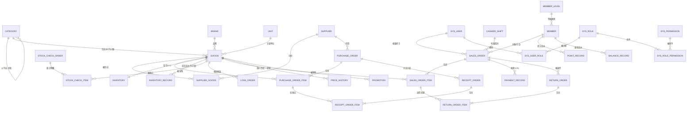

### 7.3 数据完整性与约束要求

| 编号 | 约束要求 |
| --- | --- |
| DR-C-01 | **唯一性约束**：商品编码、商品条码、供应商编码、供应商名称、会员编号、会员手机号、用户名、角色代码、各类单据号、分类（同父下名称）均须建立唯一约束，由数据库层兜底，不仅依赖应用层校验 |
| DR-C-02 | **引用完整性**：明细表对单头表、单据对商品/供应商/会员/用户的外键关系须保证有效；考虑到性能与历史数据保留，可采用"逻辑外键 + 应用层校验"，但**商品、用户、供应商、会员一律不做物理删除**（只停用），从根源避免悬挂引用（BR-GOODS-06、FR-SYS-02、BR-SUP-02） |
| DR-C-03 | **取值约束**：价格 ≥ 0（零售价 > 0）；数量按商品类型限定精度；状态字段使用有限枚举值；时间字段不得为未来时间（预计到货日期除外） |
| DR-C-04 | **派生数据一致性**：库存结存（DR-11）、会员累计消费额与积分（DR-22）、供应商累计采购额（DR-05）、采购单已入库数量（DR-07）均为派生数据，必须与其来源流水/明细保持一致，须在事务内同步更新，并可通过 FR-INV-11 类功能校验 |
| DR-C-05 | **快照不可变**：销售明细中的商品名称、成交单价、成本单价、毛利额（DR-17）为快照字段，落库后不得随主数据变更而改变（BR-SALE-04） |
| DR-C-06 | **只增表**：库存流水（DR-12）、积分流水（DR-24）、储值流水（DR-25）、操作日志（DR-33）、登录日志（DR-34）为只增表，应用层不提供 UPDATE/DELETE 路径，数据库账号可考虑收回对应权限 |
| DR-C-07 | **金额精度**：所有金额字段使用 `decimal(12,2)`；成本单价使用 `decimal(12,4)`；折扣率使用 `decimal(5,4)`；数量使用 `int` 或 `decimal(10,3)`（称重）；**禁止使用 float/double 存储金额**（C-08、BR-RPT-05） |
| DR-C-08 | **审计字段**：所有业务表统一包含创建人、创建时间、更新人、更新时间；关键单据额外包含审核人、审核时间、授权人、版本号 |

### 7.4 数据量、保留期与归档

| 数据类型 | 保留期 | 归档策略 |
| --- | --- | --- |
| 商品/供应商/会员/用户主数据 | 永久（只停用不删除） | 不归档 |
| 销售单与明细、收款记录 | 在线保留 3 年 | 3 年以上数据归档到历史库或导出压缩存储，主库删除前须校验归档成功 |
| 库存流水 | 在线保留 3 年 | 同上；归档前须确保 BR-INV-08 可校验（保留期初快照） |
| 采购单、入库单、盘点单、退货单 | 在线保留 3 年 | 同上 |
| 积分流水、储值流水 | 在线保留 3 年 | 同上 |
| 操作日志、登录日志 | ≥ 1 年（FR-SYS-08） | 按月分表或定期归档，超期数据压缩留存 |
| 库存日快照（DR-38） | 在线保留 1 年 | 超期按月汇总后删除明细快照 |
| 挂单（DR-21） | 24 小时 | 定时任务清理超期挂单（IR-SW-06） |

> **说明**：归档功能本期不实现自动执行（Could 级），但需求中明确保留期，是为了在数据库设计阶段就为流水表规划合适的索引与分区策略，避免 3 年后表膨胀导致报表不可用（NFR-PERF-05）。

---

## 8. 需求验收标准

本章给出可执行的验收标准，作为测试用例设计的输入与答辩演示脚本的依据。

### 8.1 业务闭环验收（Must 全部通过方可答辩演示）

| 编号 | 验收场景 | 通过标准 | 关联需求 |
| --- | --- | --- | --- |
| AC-01 | 主数据初始化 | 通过 Excel 导入 5,000 条商品，校验报告准确标出所有非法行，合法行全部导入成功且库存结存正确 | FR-GOODS-11、BR-GOODS-07 |
| AC-02 | 采购全流程 | 从建议采购清单生成草稿采购单 → 提交 → 店长审核通过 → 入库验收（含短少场景）→ 采购单状态正确流转至"部分入库"再到"已完成" | FR-PUR-01~07、UC-PUR-001 |
| AC-03 | 成本重算正确性 | 同一商品两次不同单价入库后，移动加权平均成本单价等于手工计算值（误差 ≤ 0.0001 元） | BR-INV-06 |
| AC-04 | 库存一致性 | 完成 AC-01~AC-03 及若干销售、退货、盘点后，执行库存体检，**所有商品结存 = 期初 + Σ流水**，差异清单为空 | BR-INV-08、FR-INV-11 |
| AC-05 | 收银全流程 | 扫码录入 10 件商品（含 1 件称重商品）→ 识别金卡会员 → 折扣正确 → 组合收款（储值 + 现金）→ 结算成功 → 库存减少 → 积分增加 → 小票可打印 | UC-SALE-001、BR-MEM-04、BR-SALE-03 |
| AC-06 | 金额分摊准确性 | 含会员折扣与整单折扣的订单，Σ行实付金额 = 单据应收金额，**分毫不差**；找零计算正确 | BR-SALE-03 |
| AC-07 | 库存不足拦截 | 商品库存 3 件时销售 5 件，结算被拒绝并提示可售数量；调整为 3 件后结算成功，结存为 0 | BR-INV-02、UC-SALE-001 E4 |
| AC-08 | **并发不超卖** | 库存 10 件，100 个并发请求各购买 1 件，最终成功恰好 10 笔、结存为 0、库存流水恰好 10 条，其余请求返回库存不足 | NFR-PERF-04、BR-INV-03 |
| AC-09 | 事务回滚 | 人为制造结算过程中途异常（如会员更新失败），销售单、库存流水、收款记录、会员数据**全部未落库**，收银台明细保留 | NFR-REL-01、UC-SALE-001 E8 |
| AC-10 | 销售退货 | 对 AC-05 的订单退其中 2 件，退款金额按原成交单价计算，库存回补 2 件，会员积分与累计消费额按原单等比冲减，原单状态变为"部分退货" | UC-SALE-002、BR-SALE-06、BR-MEM-05 |
| AC-11 | 退货授权 | 退款金额 > 200 元时未授权无法提交；店长授权后成功；授权人 = 发起人时被拒绝 | FR-SALE-11、BR-SYS-01 |
| AC-12 | 盘点全流程 | 创建范围盘点 → 录入实盘数（含盘盈与盘亏）→ 提交 → 店长审核通过 → 结存覆盖为实盘数 → 生成盘盈/盘亏流水 → AC-04 一致性仍成立；盘点人自审被拒绝 | UC-INV-001、BR-SYS-01 |
| AC-13 | 职责分离 | 采购员用自己的账号对自己创建的采购单执行入库验收，系统按参数拒绝或放行并记录"职责未分离"异常日志 | BR-SYS-01、UC-PUR-001 E6 |
| AC-14 | 会员等级自动升级 | 会员累计消费额跨过 1,000 元门槛后，等级自动变为银卡，下次收银折扣率自动按 98 折计算 | FR-MEM-06、BR-MEM-06 |
| AC-15 | 权限控制 | 收银员账号登录后看不到成本价与毛利字段、看不到报表菜单；直接调用报表接口返回 403 并记录安全日志 | FR-SYS-05、BR-SYS-05、BR-SYS-08 |
| AC-16 | 报表口径一致 | 同一天的销售日报中"净销售 = 销售额 − 优惠额 − 退货额"成立；点击汇总数字可下钻到构成它的销售单列表，逐单金额之和与汇总一致 | BR-RPT-01、BR-RPT-06 |
| AC-17 | 毛利计算 | 报表中某商品毛利额 = Σ(实付金额 − 成本快照 × 数量)，与手工按明细核算一致；调价后历史单据毛利不变 | BR-SALE-04、FR-RPT-05 |
| AC-18 | 操作留痕 | 对商品调价、参数修改、采购审核、退货授权各执行一次，操作日志中均可查到对应记录（操作人、时间、前值后值） | FR-SYS-08、FR-GOODS-10 |
| AC-19 | 安全基线 | 数据库中密码为 BCrypt 哈希；SQL 注入探测（在筛选框输入 `' OR 1=1 --`）返回正常空结果或校验错误，不泄露数据；上传 `.jsp` 文件被拒绝 | NFR-SEC-03、NFR-SEC-04、NFR-SEC-06 |
| AC-20 | 性能基线 | 在 2 万商品、200 万销售单数据量下，商品列表查询 P95 ≤ 500 ms，单笔结算 P95 ≤ 800 ms，销售日报 P95 ≤ 2 s | NFR-PERF-01、02、05 |

### 8.2 文档与交付验收

| 编号 | 验收项 | 通过标准 |
| --- | --- | --- |
| AC-D01 | 需求文档 | 本 SRS 经指导教师评审通过，Must 级需求全部可追溯到设计与测试用例 |
| AC-D02 | 设计文档 | 概要设计、数据库设计（含 ER 图与完整 DDL）、接口文档齐备且与代码一致 |
| AC-D03 | 测试文档 | 测试用例覆盖全部 Must 需求与 AC-01~AC-20；测试报告记录执行结果与缺陷修复情况 |
| AC-D04 | 部署交付 | 提供可执行部署包（或 docker-compose）、数据库初始化脚本、部署手册；在干净环境按手册可在 ≤ 1 小时内完成部署并跑通 AC-05 |
| AC-D05 | 用户手册 | 覆盖收银、入库、盘点、报表四大高频场景，含截图与常见问题 |
| AC-D06 | 论文与答辩 | 论文明确阐述系统边界、关键技术难点（库存并发扣减、移动加权平均成本、金额分摊、RBAC）及其解决方案；答辩现场可完成 AC-05、AC-08、AC-12、AC-16 演示 |

### 8.3 需求可测试性说明

本文档中每条 Must 级功能需求均满足：

1. **有明确的输入与输出**（字段、格式、取值范围）；
2. **有可判定的成功条件**（业务规则以公式或不等式表达，如 BR-INV-06、BR-INV-07、BR-MEM-04、BR-SALE-03、BR-RPT-01）；
3. **有明确的异常处理路径**（每个核心用例均列出异常事件流与系统响应）；
4. **有优先级标注**，便于测试排期与范围裁剪。

不存在"系统应该好用""性能要高"这类无法判定的表述——所有非功能需求均给出了数值指标与测量方法（第 6 章）。

---

## 9. 待确认问题清单

以下问题需要与指导教师确认后定稿。每项都给出了**推荐方案**，若无异议可直接采纳。

| 编号 | 待确认问题 | 影响范围 | 推荐方案 | 状态 |
| --- | --- | --- | --- | --- |
| Q-01 | 学校是否下发统一的需求文档模板与字数要求？ | 全文结构 | 已按通用毕设结构编写；拿到模板后按第 10.2 节映射表重排，需求编号保持不变 | 待确认 |
| Q-02 | 系统名称与副标题的正式表述（是否需要体现"基于 Spring Boot"）？ | 封面、论文标题 | 建议论文标题为《基于 Spring Boot 的超市商品管理系统的设计与实现》，系统名称保持"超市商品管理系统" | 待确认 |
| Q-03 | 是否要求包含可行性分析（技术/经济/操作/法律可行性）与开题报告内容？ | 需增章节 | 本 SRS 未含可行性分析（通常属开题报告）；若模板要求，可基于第 2 章扩写为独立章节 | 待确认 |
| Q-04 | 会员储值功能是否纳入必做范围？ | FR-MEM-08、DR-25、UC-SALE-001 收款方式 | 涉及"资金"语义，若导师认为超出商品管理范畴，可降级为 Could 或移除，收款方式保留现金/银行卡/移动支付三类 | 待确认 |
| Q-05 | 是否需要商品保质期/批次管理？ | X-07、BR-INV-06、DR-12 | 建议本期不做（移动加权平均已能算毛利），但在库存流水表预留批次号字段（NFR-EXT-06），论文中作为"可扩展性"论述 | 待确认 |
| Q-06 | 是否要求实现收银班次管理（开班/交班）？ | FR-SALE-12、DR-37、BR-SALE-09 | 建议实现（Should 级）——它是"收银员只能退本人本班次单据"权限规则的前提，也是演示权限控制的有力场景 | 待确认 |
| Q-07 | 报表是否需要与真实超市数据对接验证？ | 第 8 章验收 | 无真实数据源，建议编写数据生成脚本造 2 万商品 + 200 万销售单的仿真数据，用于性能测试与报表演示（同时满足 NFR-PERF-05 的测试前提） | 待确认 |
| Q-08 | 是否要求容器化部署（Docker）？ | NFR-CMP-05、AC-D04 | 强烈建议实现：工作量约 1~2 天，显著提升部署可复现性，且与运维/云原生方向的求职目标高度契合 | 待确认 |
| Q-09 | 前端是否需要适配移动端/平板？ | X-08、NFR-CMP-02 | 建议仅保证收银台在平板横屏可用，管理端不做移动端适配 | 待确认 |
| Q-10 | 论文中技术难点的呈现重点？ | 论文撰写 | 建议聚焦四点：① 库存并发扣减与不超卖（BR-INV-03、AC-08）；② 移动加权平均成本与毛利快照（BR-INV-06、BR-SALE-04）；③ 金额分摊尾差处理（BR-SALE-03）；④ 流水驱动的库存一致性与体检（BR-INV-08、FR-INV-11）。这四点都是"有正确性可证明"的硬问题，比罗列框架 API 更有说服力 | 待确认 |

---

## 10. 附录

### 10.1 需求跟踪矩阵（核心链路）

用于保证"业务目标 → 用例 → 功能需求 → 业务规则 → 数据实体 → 验收标准"的端到端可追溯性。完整的逐条矩阵建议在详细设计阶段补全。

| 系统目标 | 用例 | 功能需求 | 业务规则 | 数据实体 | 验收标准 |
| --- | --- | --- | --- | --- | --- |
| G-01 商品档案 | UC-GOODS-001 | FR-CAT-01~07、FR-GOODS-01~13 | BR-CAT-01~04、BR-GOODS-01~07 | DR-01~04、DR-26、DR-27 | AC-01 |
| G-02 库存管理 | UC-INV-001、UC-PUR-001、UC-SALE-001 | FR-INV-01~12 | BR-INV-01~12 | DR-11~15、DR-38 | AC-04、AC-07、AC-08、AC-09、AC-12 |
| G-03 采购决策 | UC-INV-002、UC-PUR-001 | FR-SUP-01~05、FR-PUR-01~09 | BR-SUP-01~03、BR-PUR-01~08、BR-INV-07 | DR-05~10 | AC-02、AC-03、AC-13 |
| G-04 收银销售 | UC-SALE-001、UC-SALE-002 | FR-SALE-01~13 | BR-SALE-01~10、BR-GOODS-04~05 | DR-16~21、DR-37 | AC-05、AC-06、AC-10、AC-11 |
| G-05 会员营销 | UC-MEM-001、UC-SALE-001 | FR-MEM-01~09 | BR-MEM-01~08 | DR-22~25 | AC-05、AC-10、AC-14 |
| G-06 经营分析 | 全部业务用例 | FR-RPT-01~10 | BR-RPT-01~07 | 全部业务实体 | AC-16、AC-17、AC-20 |
| G-07 安全审计 | 全部用例 | FR-SYS-01~11 | BR-SYS-01~08 | DR-28~36 | AC-11、AC-13、AC-15、AC-18、AC-19 |

### 10.2 学校模板章节映射建议

拿到学校正式模板后，按下表将本稿内容搬移即可，**需求编号无需改动**。

| 常见模板章节名 | 对应本稿章节 |
| --- | --- |
| 1 引言 / 编写目的 / 背景 / 术语 | 1.1、1.2、1.3 |
| 2 任务概述 / 项目概述 / 系统目标 | 2.1、2.2、2.3 |
| 3 运行环境 / 开发环境 | 2.4 |
| 4 需求规定 / 功能需求 | 第 4 章（4.1~4.9） |
| 5 用例分析 / 系统建模 | 第 3 章（3.1~3.5） |
| 6 数据描述 / 数据字典 / 数据流 | 第 7 章（7.1~7.4） |
| 7 外部接口需求 | 第 5 章（5.1~5.4） |
| 8 性能需求 / 非功能需求 | 第 6 章（6.1~6.6） |
| 9 设计约束 / 假设与依赖 | 2.5、2.6 |
| 10 验收标准 / 测试要求 | 第 8 章 |
| 11 其他 / 待解决问题 | 第 9 章 |
| 附录 | 第 10 章 |

> **搬移提示**：若模板要求"数据流图（DFD）"而非用例图，需另补顶层 DFD 与 0 层 DFD；本稿采用用例图 + 流程图 + 状态图的 UML 组合，覆盖同等的建模深度。若模板要求单独成章的"可行性分析"，可基于 1.2、2.1、2.5、2.6 扩写（见 Q-03）。

### 10.3 系统参数清单（FR-SYS-06 明细）

| 参数键 | 参数名 | 默认值 | 影响需求 |
| --- | --- | --- | --- |
| allow_negative_stock | 是否允许负库存 | false | BR-INV-02、AC-07 |
| receiving_tolerance_rate | 采购超收容差比例 | 5% | BR-PUR-04 |
| price_diff_tolerance_rate | 实收单价价差容差 | 5% | BR-PUR-05 |
| price_diff_warn_rate | 采购价异常提示阈值 | 20% | BR-PUR-05 |
| return_auth_amount | 退货授权金额阈值 | 200 元 | BR-SALE-05、AC-11 |
| return_valid_days | 退货有效期 | 7 天 | BR-SALE-05 |
| min_discount_rate | 最低整单折扣率 | 70% | BR-SALE-05、BR-SALE-10 |
| point_per_yuan | 每元积分数 | 1 | BR-MEM-05 |
| point_include_recharge | 储值消费是否计积分 | false | BR-MEM-07 |
| member_level_downgrade | 会员降级策略 | 只升不降 | BR-MEM-06 |
| suggest_order_k | 建议采购量安全倍数 K | 1.5 | BR-INV-07 |
| suggest_order_days | 日均销量统计天数 N | 28 | BR-INV-07 |
| default_lead_time_days | 默认采购提前期 | 3 天 | BR-INV-07 |
| business_day_start | 营业日起始时刻 | 00:00 | BR-RPT-02 |
| login_fail_limit / lock_minutes | 登录失败锁定阈值/时长 | 5 次 / 15 分钟 | FR-SYS-01、NFR-SEC-03 |
| token_expire_hours | Token 有效期 | 8 小时 | IR-SW-03 |
| duty_separation_strict | 职责分离是否强制拒绝 | false（放行但记日志） | BR-SYS-01、AC-13 |
| store_name / address / phone | 超市名称/地址/电话 | 空 | IR-UI-08 打印页眉 |
| receipt_paper_width | 小票纸宽 | 58 mm | IR-HW-02 |
| export_max_rows | 导出最大行数 | 50,000 | FR-RPT-08 |

### 10.4 库存变动类型枚举（FR-INV-02 明细）

| 类型代码 | 名称 | 数量符号 | 触发来源 | 影响成本 |
| --- | --- | --- | --- | --- |
| INIT | 期初建账 | + | 商品档案新增（初始库存 > 0） | 设定初始成本单价 |
| PURCHASE_IN | 采购入库 | + | UC-PUR-001 | **重算移动加权平均成本** |
| PURCHASE_RETURN | 采购退货 | − | FR-PUR-08 | 按当前成本单价结转 |
| SALE_OUT | 销售出库 | − | UC-SALE-001 | 按当前成本单价结转并快照 |
| SALE_RETURN | 销售退货 | + | UC-SALE-002 | 按原单成本快照回冲，不改变当前均价 |
| CHECK_SURPLUS | 盘盈调整 | + | UC-INV-001 | 按当前成本单价入账 |
| CHECK_SHORTAGE | 盘亏调整 | − | UC-INV-001 | 按当前成本单价结转损耗 |
| LOSS_OUT | 报损出库 | − | FR-INV-10 | 按当前成本单价结转损耗 |
| OVERFLOW_IN | 报溢入库 | + | FR-INV-10 | 按当前成本单价入账 |

### 10.5 文档修订记录

| 版本 | 日期 | 修订人 | 修订说明 |
| --- | --- | --- | --- |
| V1.0 | 2026-09-07 | —— | 初稿创建：完成引言、项目概述（含 11 项范围外裁剪）、需求建模（7 个核心用例、3 张流程图、4 个状态机）、89 条功能需求与 60 余条业务规则、外部接口需求、非功能需求、38 个数据实体、20 条业务闭环验收标准、10 项待确认问题 |
| V1.1 | 待定 | —— | 待第 9 章问题确认后修订；待学校模板下发后按 10.2 重排章节 |

### 10.6 后续文档规划

本 SRS 定稿后，建议按以下顺序产出配套文档（可按需委托编写）：

| 文档 | 主要内容 | 依赖 |
| --- | --- | --- |
| 《系统设计说明书》 | 总体架构图、后端分层与包结构、前端工程结构、模块交互、关键流程时序图、事务边界与并发控制方案、异常与错误码体系、技术选型对比论证 | 本 SRS |
| 《数据库设计说明书》 | ER 图细化、完整表结构与 DDL、字段类型与约束、索引设计（针对 NFR-PERF-09）、初始数据脚本、仿真数据生成方案 | 本 SRS 第 7 章 |
| 《接口设计说明书》 | REST 接口清单（路径/方法/入参/出参/错误码）、统一响应体、鉴权约定、分页与排序约定、前后端对接示例 | 本 SRS 第 5 章、系统设计 |
| 《测试方案与用例》 | 覆盖 AC-01~AC-20 的测试用例、并发测试脚本设计、性能压测方案、测试数据准备 | 本 SRS 第 8 章 |
| 《部署与运维手册》 | 环境准备、数据库初始化、JAR/Docker 部署步骤、备份恢复操作、常见问题排查 | 系统设计、数据库设计 |
| 《用户操作手册》 | 分角色的界面操作指引与截图（收银员/库管员/采购员/店长/管理员） | 系统实现完成 |

---

**文档结束**

